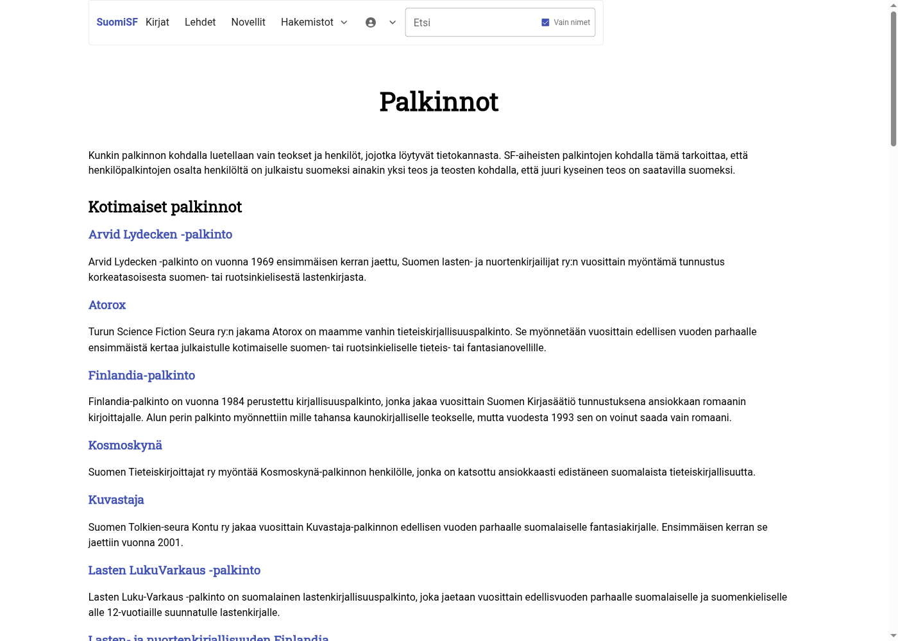
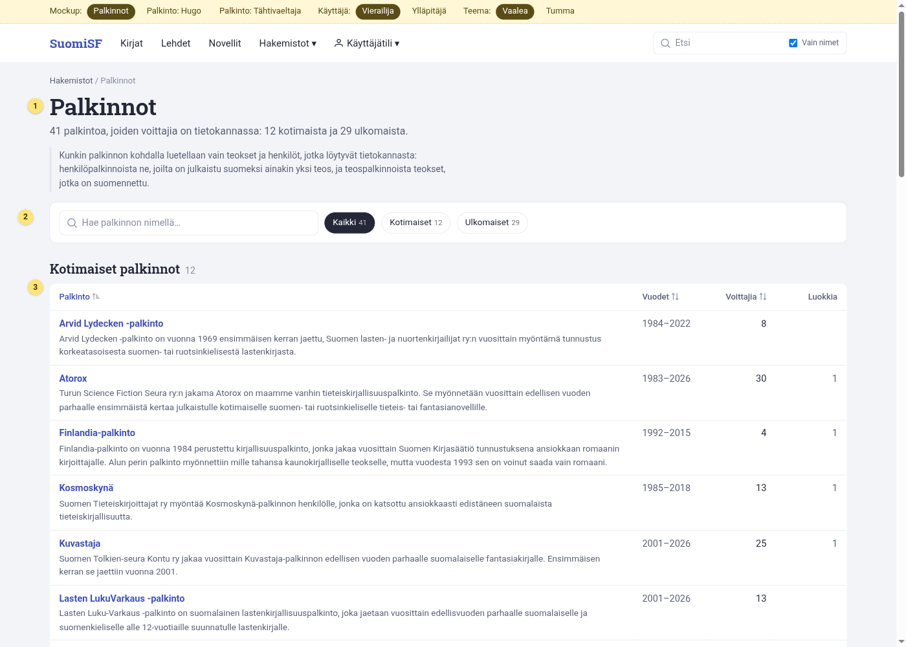
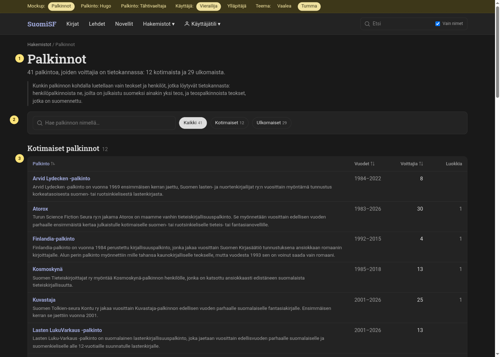
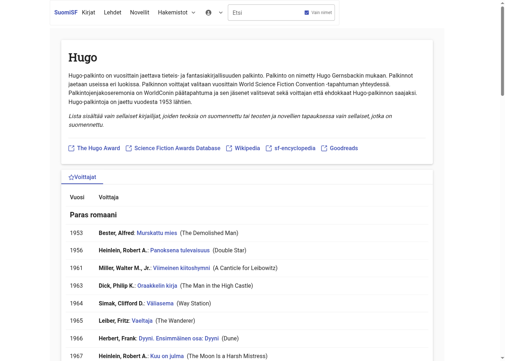
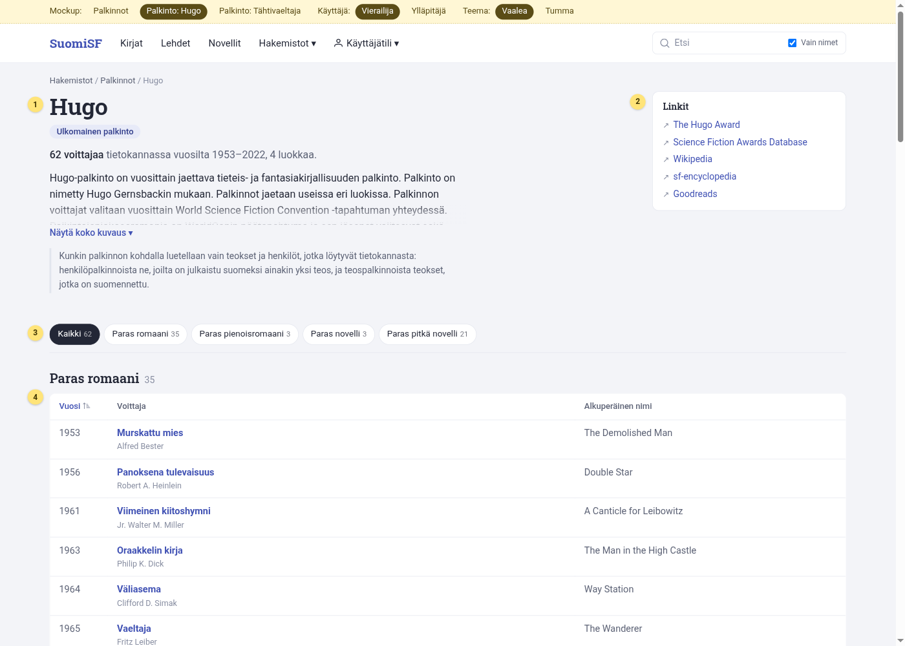
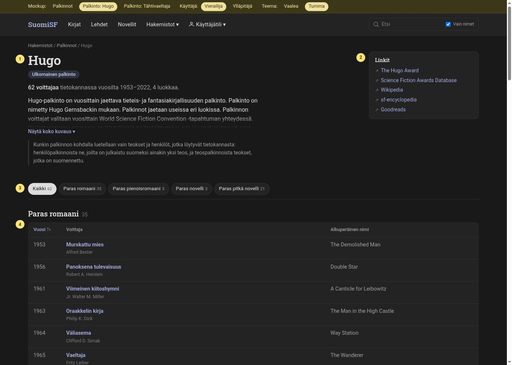
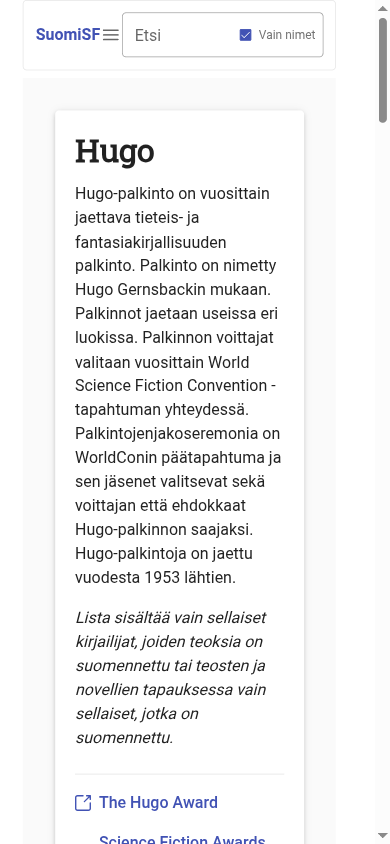
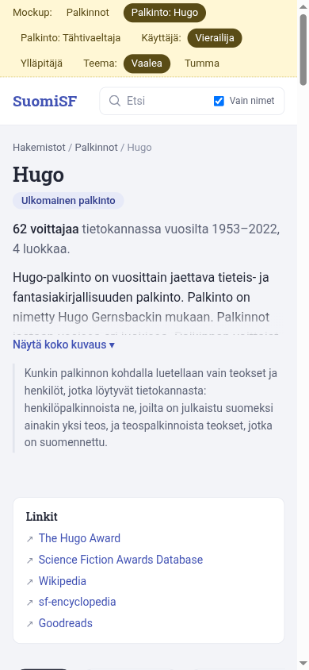
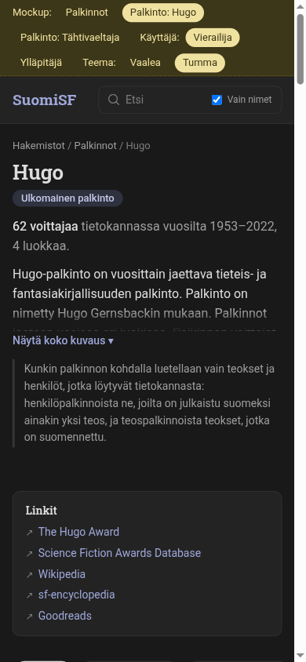

# Awards

**Routes:** `/awards`, `/awards/:id` · **Code:** `src/features/award/routes/awards-page.tsx`, `award-page.tsx`; backend `GET /api/awards`, `/api/awards/:id`
**Status:** Agreed · **Updated:** 2026-11-22
**Samples:** the list (41 awards), Hugo (62 winners in the database, https://www.sf-bibliografia.fi/awards/2) and Tähtivaeltaja-palkinto (https://www.sf-bibliografia.fi/awards/8).
**Mockup:** [`../mockups/awards.html`](../mockups/awards.html) with [`awards-data.js`](../mockups/awards-data.js) (real data): `?v=list`, `?v=hugo`, `?v=tv`.

| Before | After (mockup, light) | After (mockup, dark) |
|---|---|---|
|  |  |  |
|  |  |  |
|  |  |  |

More: [after, one category](../images/awards/after-hugo-category.png) · [after, Tähtivaeltaja](../images/awards/after-domestic.png) · [before, Tähtivaeltaja](../images/awards/before-domestic.png).

## What's wrong today

1. **The list is 41 full descriptions** (4,571 px, 8,083 px on a phone) with no winner counts or years.
2. **The award page's important caveat** (only works translated into Finnish are listed) is italic body text.
3. **Winners show surname first** ("Bester, Alfred"), no way to jump to a category, one lone "Voittajat" tab.

## Proposed layout

1. **List:** count sentence, the caveat as a note, filter bar (name, Kaikki / Kotimaiset / Ulkomaiset), two tables (domestic, foreign):
   name with the description clamped to two lines, years, number of winners, number of categories.
2. **Award page:** header with type chip and facts ("62 voittajaa tietokannassa vuosilta 1953–2022, 4 luokkaa"), description clamped with
   "Näytä koko kuvaus", the caveat as a note, links in the sidebar.
3. **Category bar** (sticky) with counts; choosing one shows only that category (in the URL, e.g. `?luokka=…`).
4. **Winners per category** as a table: year, winner (title, author in natural order, or person for personal awards), original title; oldest first.
   Admins keep the SpeedDial (edit, import winners).

## Implementation steps

1. **Backend:** the list returns winner count and year span per award.
2. **Pages:** list tables and filters; award header, category bar, winner tables. Name formatting must handle suffixes:
   the mockup's simple reversal turns "Miller, Walter M., Jr." into "Jr. Walter M. Miller", which the real code must not do.
3. **Tests and wiki.**

## Open questions

_None._

## Decisions

2026-11-23, project owner:
- The backend change (winner count and year span per award in the list) is fine.
- Winners only; no nominees section.
