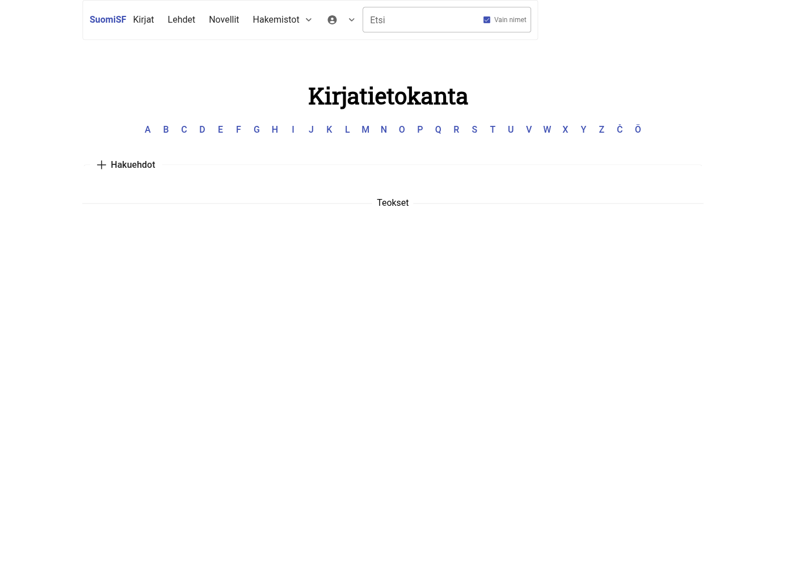
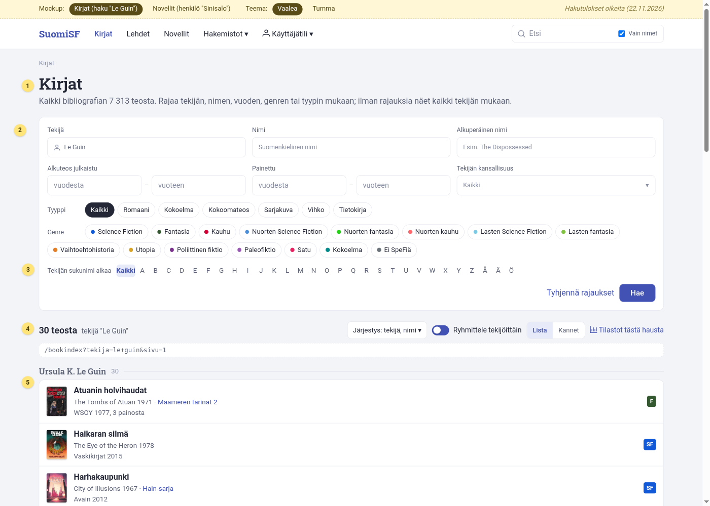
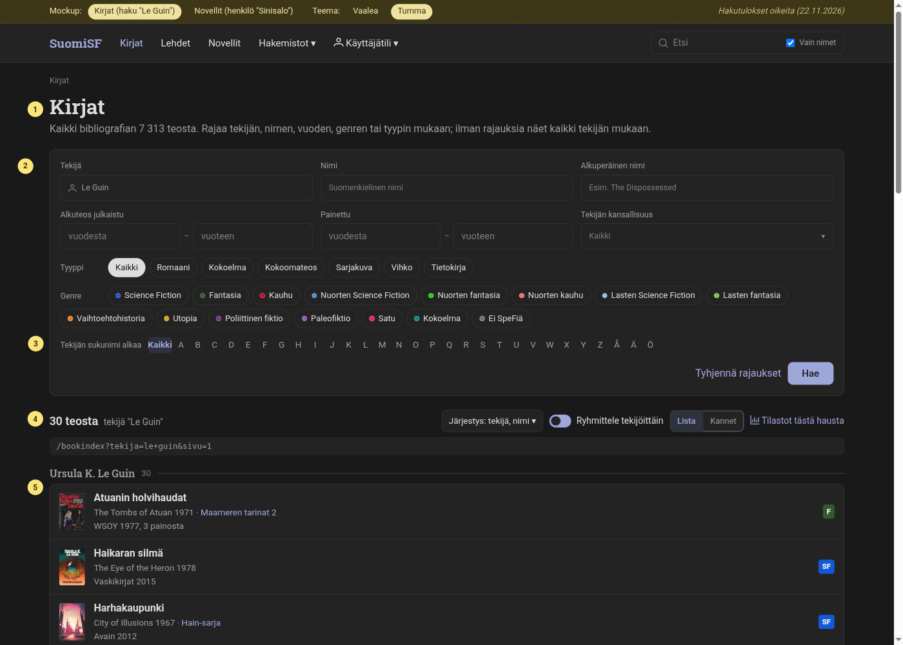
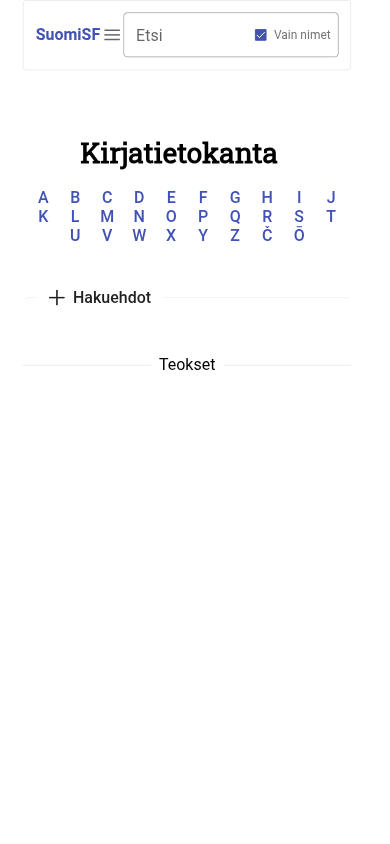
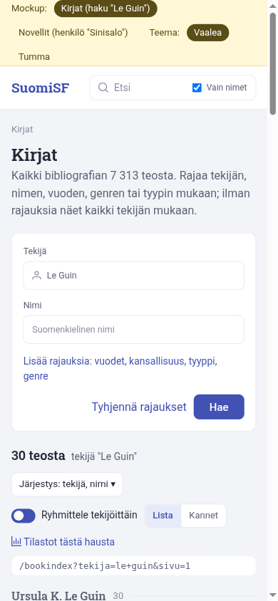
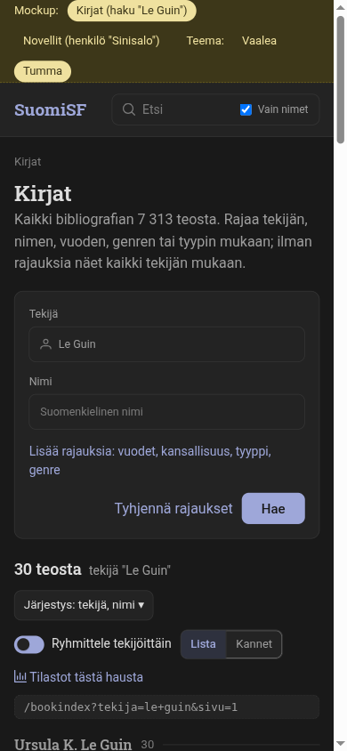

# Book index (and non-fiction)

**Routes:** `/bookindex` ("Kirjat" in the menu) and `/nonfiction` · **Code:** `src/features/work/routes/work-search.tsx`, `works-by-type.tsx`,
`src/features/work/components/work-list.tsx`; backend `POST /api/searchworks`, `GET /api/worksbyinitial/<letter>`, `GET /api/firstlettervector/works`
**Status:** Agreed · **Updated:** 2026-11-22
**Sample:** https://www.sf-bibliografia.fi/bookindex, searched for author "Le Guin" (30 works).
**Mockup:** [`../mockups/index.html?k=books`](../mockups/index.html) with [`index-data.js`](../mockups/index-data.js) (real results).
The same mockup shows the [short story index](short-index.md) (`?k=shorts`): both indexes share one pattern.

| Before | After (mockup, light) | After (mockup, dark) |
|---|---|---|
|  |  |  |
|  |  |  |

More: [before, form opened](../images/book-index/before-books-form-open.png) · [before, results for "Le Guin"](../images/book-index/before-books-search.png) ·
[before, letter L still loading](../images/book-index/before-books-letter-L.png) · [before, /nonfiction](../images/book-index/before-nonfiction.png) ·
[after, whole page](../images/book-index/after-books-full.png). Dark: [desktop](../images/book-index/after-books-desktop-dark.png),
[phone](../images/book-index/after-books-mobile-dark.png), [whole page](../images/book-index/after-books-full-dark.png).

## What's wrong today

1. **The page starts empty.** The search form is in a collapsed "Hakuehdot" fieldset, so a visitor sees a title, a row of letters and nothing else.
2. **Letters load hundreds of works at once.** A letter lists every work whose author starts with it: L is 522 works (855 kB, 4 s), K 668 works (1.1 MB, 5.3 s).
   The page shows a spinner meanwhile and then renders everything.
3. **Searches aren't paged either.** "Julkaistu aikaisintaan 2020" returns 1,335 works, 4.2 MB, in 11 s, all rendered on one page.
4. **Nothing is in the URL,** so a search can't be reloaded, bookmarked or shared (agreed rule: state in the URL).
5. **The form is eight floating-label fields** with free-text years, inside a fieldset; the letter row has "Č" and "Ō" after Z and no Å, Ä, Ö.
6. **Results are text lines with codes** ("Suom. … WSOY 1977. [F]"), no covers in the list view, no result count, and a bright pink "Tilastoja" button
   that matches nothing else on the site.
7. **`/nonfiction` lists every non-fiction book at once** (12,289 px) with the same unpaged list component.
8. Centred title "Kirjatietokanta"; on a phone the letters wrap into three rows.

## Proposed layout

```
Kirjat
Kaikki bibliografian 7 313 teosta. Rajaa …; ilman rajauksia näet kaikki tekijän mukaan.
┌ Tekijä [Le Guin    ]  Nimi [          ]  Alkuperäinen nimi [            ] ┐
│ Alkuteos julkaistu [vuodesta]–[vuoteen]  Painettu […]–[…]  Kansallisuus ▾  │
│ Tyyppi (Kaikki)(Romaani)(Kokoelma)(Kokoomateos)(Sarjakuva)(Vihko)(Tietokirja)│
│ Genre  (● Science Fiction)(● Fantasia)(● Kauhu)(● Nuorten …) …            │
│ Tekijän sukunimi alkaa  Kaikki A B C … Z Å Ä Ö       Tyhjennä  [Hae]      │
└──────────────────────────────────────────────────────────────────────────┘
30 teosta  tekijä "Le Guin"     [Järjestys ▾] (Ryhmittele tekijöittäin) [Lista|Kannet] Tilastot tästä hausta
/bookindex?tekija=le+guin&sivu=1
── Ursula K. Le Guin  30 ──
▫ Atuanin holvihaudat   The Tombs of Atuan 1971 · Maameren tarinat 2   WSOY 1977, 3 painosta   [F]
…
Näytetään 1–30 / 30                                                [Rivejä 50 ▾]
```

The numbers 1–6 in the mockup screenshots match the sections below.

1. **Header:** "Kirjat" (the menu name) with one sentence and the total. **With no filters the list shows every work, by author, paged**,
   so the page is never empty.
2. **Filter panel, always open:** author, title, original title; year ranges for the original publication and for printing; author's nationality;
   **type chips** (Romaani, Kokoelma, Kokoomateos, Sarjakuva, Vihko, Tietokirja); **genre chips** with the agreed genre colours, several can be on.
   On a phone the first two fields show and the rest open from "Lisää rajauksia".
3. **Author letter bar A–Ö** as one more filter (combines with the others, and is paged like everything else) instead of a separate mode.
4. **Results header:** the count and what was searched. Text fields search on Enter or "Hae"; chips, selects and letters update the results at once (decided).
   Also sort (author and title, title, original year, newest first), "Ryhmittele tekijöittäin",
   Lista / Kannet, and "Tilastot tästä hausta" as a normal link. Everything goes in the URL with readable values (`/bookindex?tekija=le+guin&tyyppi=romaani&sivu=2`).
5. **Compact rows** (the person page's row): cover, title, original title and year, series, first edition's publisher and year with the printing count,
   genre badges. Grouped by author when that toggle is on.
6. **Paging:** 50 per page (100 / 200 selectable), so a letter or a broad search never loads more than one page.

**`/nonfiction` stays its own page** (decided), but gets the same results header, compact rows and paging, so it no longer loads every non-fiction book at once.
The book index keeps "Tietokirja" as one of its type chips, as today's type dropdown has it.

## Shared principles used or added

Uses from [principles.md](../principles.md): filters in a bar above the list, filter pills, state in the URL, compact rows with covers,
genre colours, empty values last, errors with retry, no uppercase or centred titles, dark theme, page width.

New rule from this plan:
- Lists that can grow large are paged on the server; nothing loads hundreds of items at once.

## Implementation steps

1. **Backend:** `searchworks` (and the letter filter) gets paging (`page`, `rows`, total count), sorting, a lighter list payload
   (only what a row shows: title, original title and year, author, series, first edition, printing count, genres, one cover thumb),
   multi-select genres and types, and the author initial as a filter. `worksbyinitial` can then be retired.
2. **Shared index component** for books and short stories: filter panel, letter bar, results header, URL state (`useSearchParams`), paging.
3. **Book rows** reusing the person page's compact row; Kannet view reusing the existing cover grid.
4. **`/nonfiction`**: keep the page, switch it to the shared results header, compact rows and paging (`works-by-type.tsx`).
5. **Tests and wiki:** update the book index part of `SuomiSF‐ohje.md`.

## Tests

- Backend: paging and totals; each filter alone and combined; genre multi-select; author initial; sort orders with empty values last.
- Vitest: URL ↔ filters round trip.
- Playwright: the page lists works before any search; a letter loads one page fast; filters land in the URL and survive reload;
  `/nonfiction` shows one page of non-fiction with paging; chips update results without pressing "Hae"; on a phone "Lisää rajauksia" opens the rest of the filters.

## Open questions

_None._

## Decisions

2026-11-22, project owner:
- The backend change (paging, totals, sorting, lighter payload, multi-select genres and types, author initial as a filter) is fine.
- Text fields search on Enter or "Hae"; chips, selects and the letter bar update the results at once.
- `/nonfiction` is not merged into the book index; it stays its own page with the new rows and paging.
