# Book series

**Routes:** `/bookseries` (list) and `/bookseries/:id` · **Code:** `src/features/bookseries/routes/bookseries-list-page.tsx`, `bookseries-page.tsx`,
`src/features/work/components/work-list.tsx`; backend `GET /api/bookseries`, `/api/bookseries/:id`
**Status:** Agreed · **Updated:** 2026-11-22
**Samples:** Kiekkomaailma (Discworld, 34 books, https://www.sf-bibliografia.fi/bookseries/488) and Soturikissat (Warriors, 10 subseries, https://www.sf-bibliografia.fi/bookseries/374).
**Mockup:** [`../mockups/series.html`](../mockups/series.html) with [`series-data.js`](../mockups/series-data.js) (real data): `?v=bs` Kiekkomaailma, `?v=sub` Soturikissat,
`?v=bslist` the list. The same mockup has the [publisher series](pubseries.md). The yellow bar switches visitor / logged-in / admin and light / dark.

| Before | After (mockup, light) | After (mockup, dark) |
|---|---|---|
| 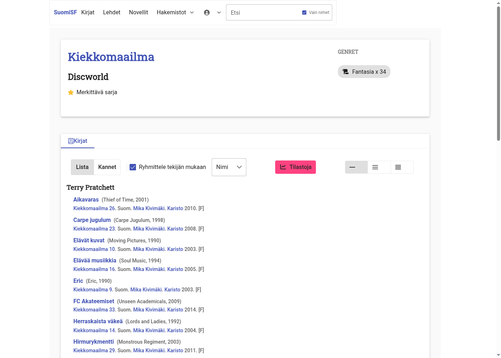 | 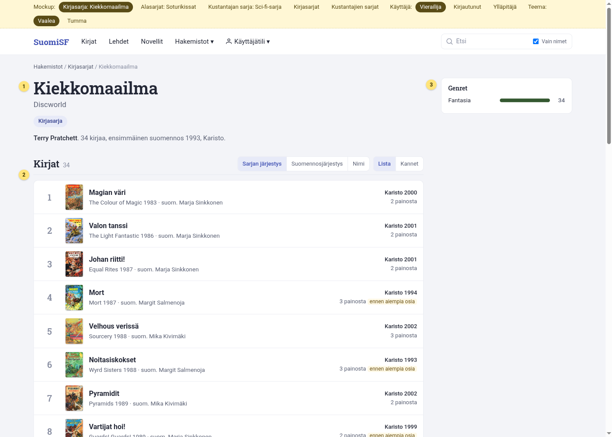 | 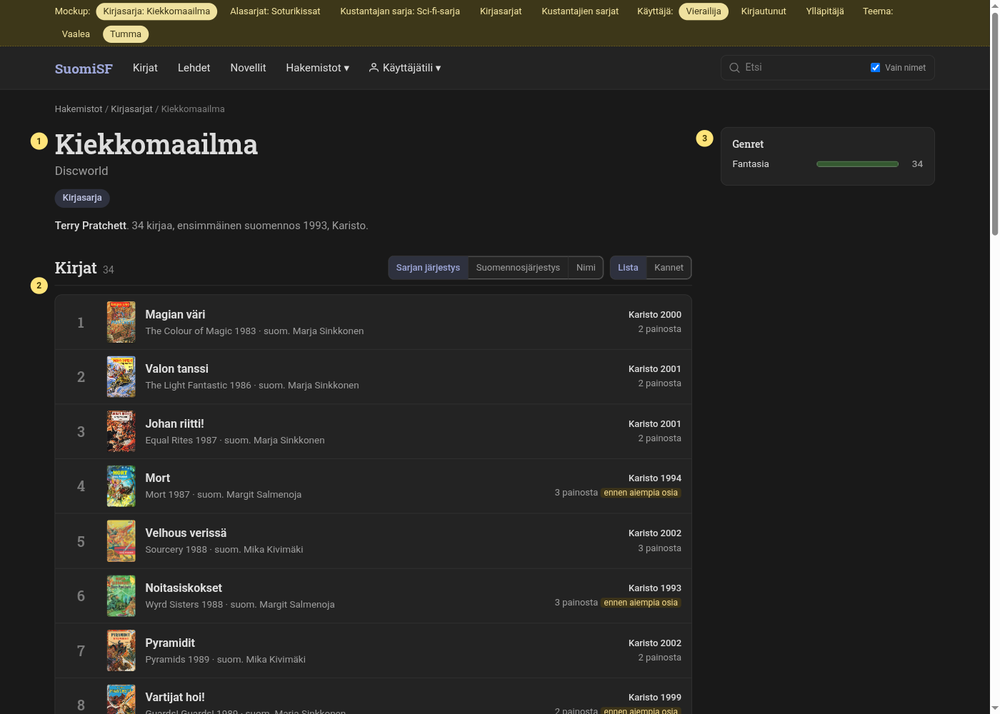 |
| 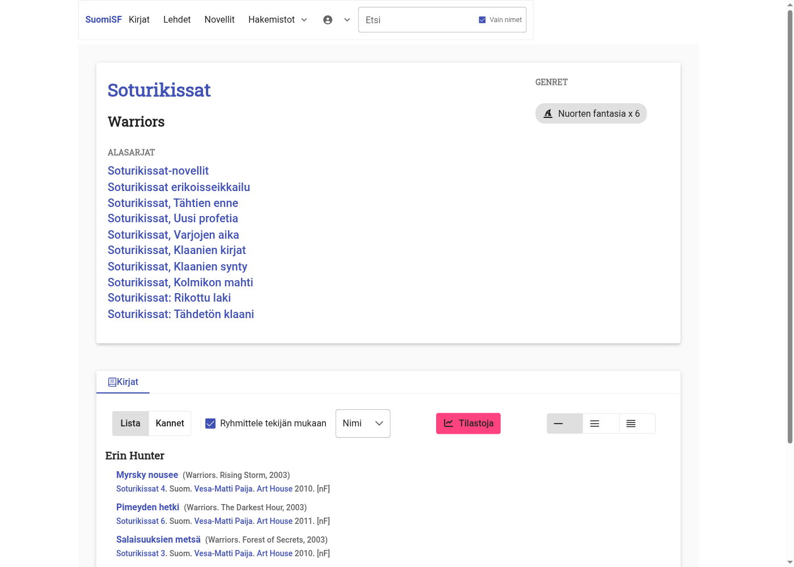 | 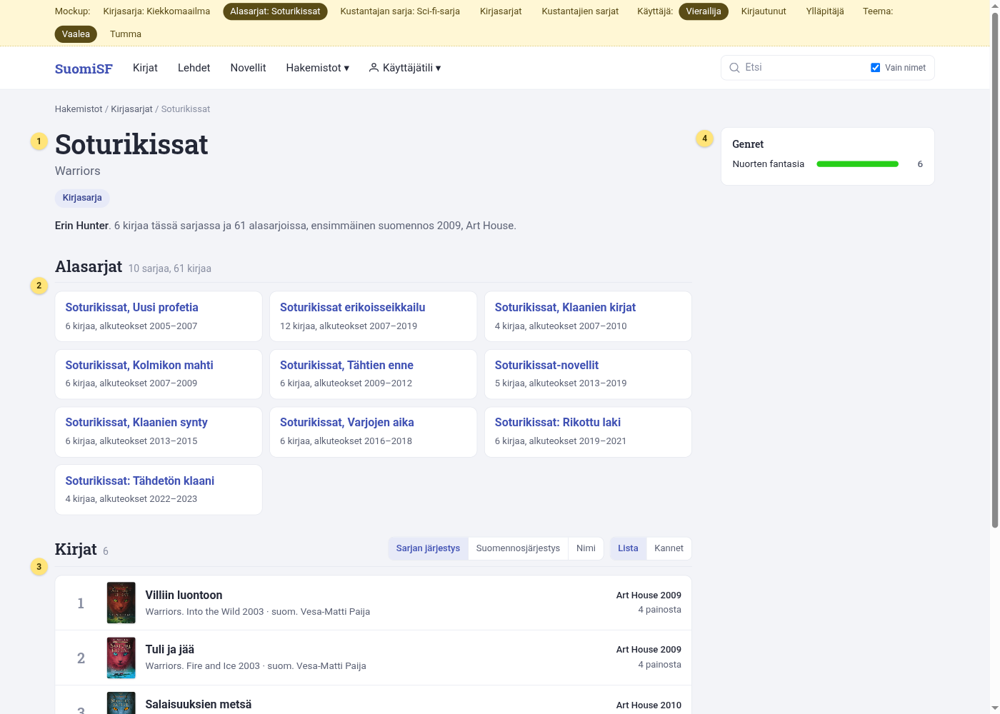 | 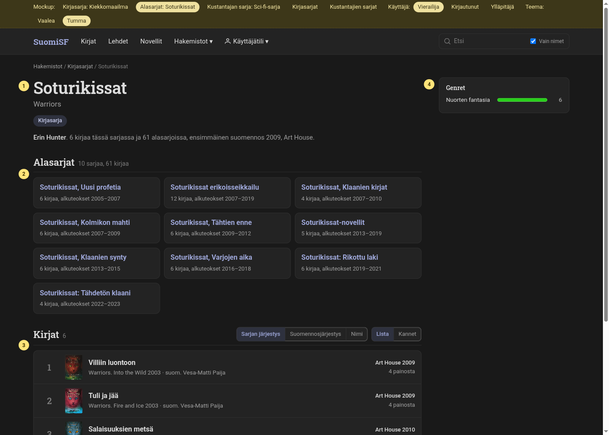 |
| 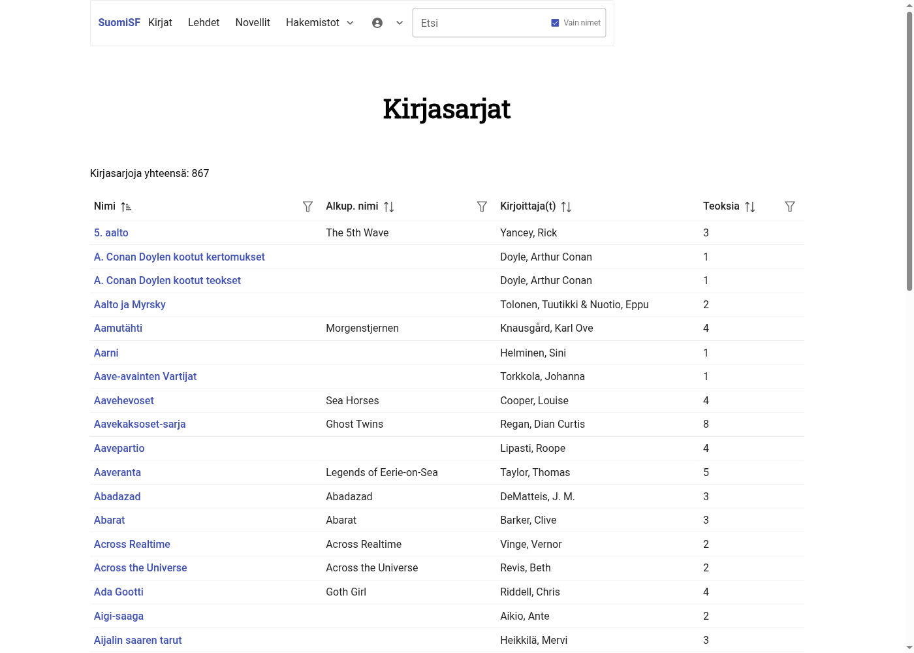 | 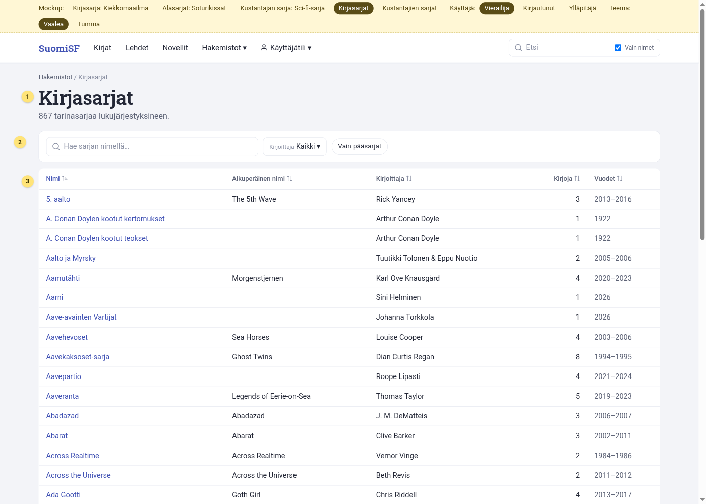 | 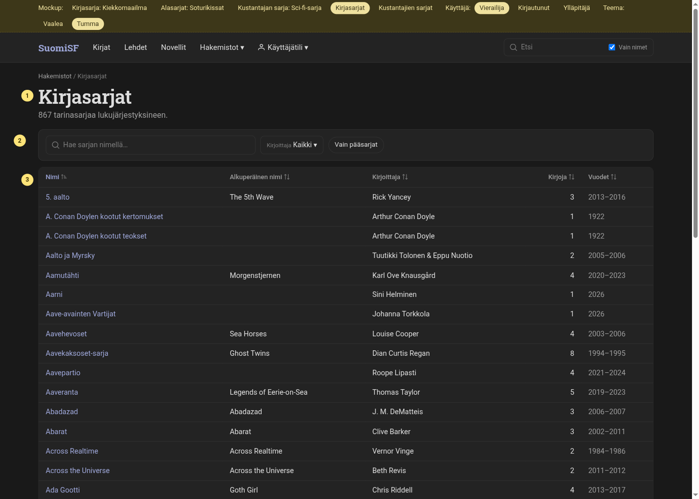 |
| 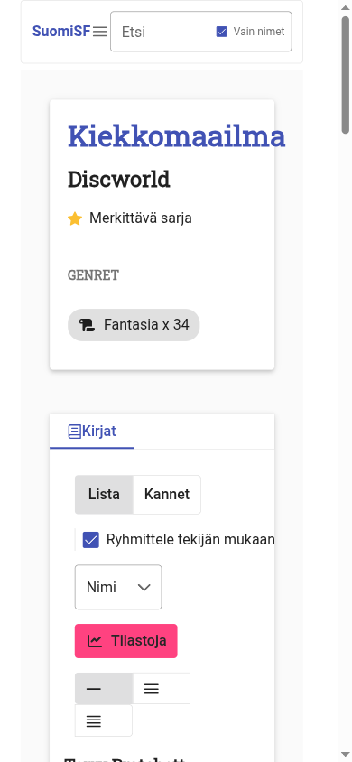 | 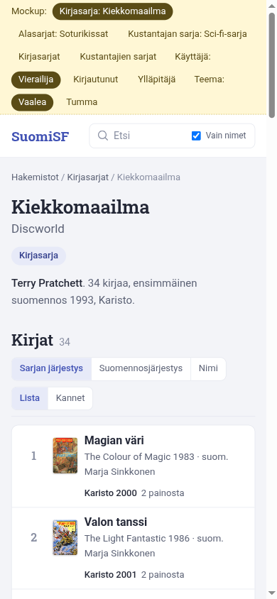 | 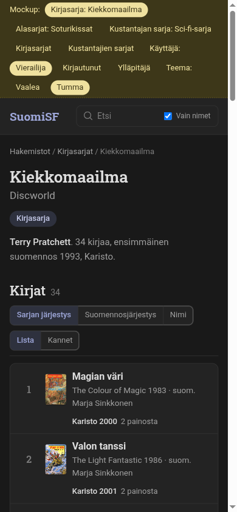 |

More: [before, whole Discworld page](../images/bookseries/before-bs-discworld-full.png) · [after, whole page](../images/bookseries/after-bs-full.png) ·
[after, Finnish publication order, logged in](../images/bookseries/after-bs-finnish-user.png) ([dark](../images/bookseries/after-bs-finnish-user-dark.png)).

## What's wrong today

1. **Books are in title order, not reading order.** Discworld starts with no. 26 "Aikavaras"; the series number is buried in each line
   ("Kiekkomaailma 26. Suom. …"). The order a reader needs is lost.
2. **Nothing shows that the series was published out of order in Finnish:** "Mort" (no. 4) and "Noitasiskokset" (no. 6) came out in 1993–94,
   no. 1 only in 2000.
3. **Subseries are a bare list of large links** (Soturikissat has ten) with no book counts or years, and nothing adds them up.
4. **The header says little:** no author, no number of books, no publisher or years. The original name is an `<h2>` that is always rendered,
   empty when there's no original name (the condition before it does nothing: `{data.orig_name && data.orig_name !== ''} <h2>…`).
5. **One "Kirjat" tab,** a "group by author" checkbox for a one-author series, the pink "Tilastoja" button, text lines with genre codes.
6. **List page:** 867 series in a `DataTable` with filters in the header cells; 3.6 s to load (the API returns every work of every series to count them);
   no years. The "Merkittävä sarja" flag is set on only 1 of 867 book series.

## Proposed layout

1. **Header:** name, original name (only when there is one), a "Kirjasarja" chip, one line of facts:
   authors, number of books (and how many in subseries), first Finnish publication year and publishers. The description under it.
   A subseries shows "Osa sarjaa …" linking to its parent.
2. **Alasarjat** (when the series has subseries): one card per subseries with its book count and the original publication years, oldest first,
   plus the total in the heading ("10 sarjaa, 61 kirjaa").
3. **Books in reading order by default:** a big series number, cover, title, original title and year, translator; on the right the first Finnish
   edition (publisher, year) and the printing count. A book that came out in Finnish before lower-numbered ones gets a small
   "ennen aiempia osia" note. Order toggle: **Sarjan järjestys** (default) / **Suomennosjärjestys** / **Nimi**; view **Lista** / **Kannet**
   (the cover grid shows the number on each cover). Logged-in users keep the ★ for books they own.
4. **Sidebar:** genre bars and links. Admins keep the SpeedDial (new series, edit, delete).
5. **List page:** filter bar (name, author, "Vain pääsarjat"), table with name, original name, authors, number of books and
   years; subseries show "osa sarjaa …" under the name; every column sorts; state in the URL; cards on a phone.

## Shared principles used or added

Uses: compact rows, title next to every cover, genre bars and colours, filters above lists, state in the URL, empty values last,
real main menu per role, dark theme, page width.

New rule from this plan:
- A list that has a natural order (series number, issue number) shows that order by default; title order is an option.

## Implementation steps

1. **Backend:** a light list endpoint (name, original name, authors, book count, year span, parent) instead of whole works;
   series pages return each book's first Finnish edition, printing count and translators (or the page derives them from the editions it already gets).
   Subseries with their book counts and year spans.
2. **Series page:** header facts, subseries cards, ordered book rows (shared compact row with a number column), order and view toggles in the URL.
   Pure `seriesOrder(works, order)` and `publishedBeforeEarlier(works)` with Vitest tests (Discworld fixture: Mort and Noitasiskokset flagged).
3. **Fix the empty `<h2>`** (render only when `orig_name` is set).
4. **List page:** filter bar and table from the people list pattern.
5. **Tests and wiki:** Playwright for default reading order, the toggles in the URL, subseries cards; update `SuomiSF‐ohje.md`.

## Tests

- Vitest: series-number sort with missing or non-numeric numbers last; "published before earlier volumes" detection.
- Playwright: Discworld opens in reading order (no. 1 first); Suomennosjärjestys puts Noitasiskokset (1993) first; Soturikissat shows ten subseries cards
  with counts; list filters and sorting survive reload.

## Open questions

_None._

## Decisions

2026-11-22, project owner:
- The backend changes (light list endpoint, first edition and printing count per book, subseries counts) are fine.
- Keep the "ennen aiempia osia" note.
- Remove "Merkittävä sarja" from the UI for now (header chip, list marker, filter); the data stays in the database.
- Series open in the list view; text always comes first in a bibliography, covers are an option.
