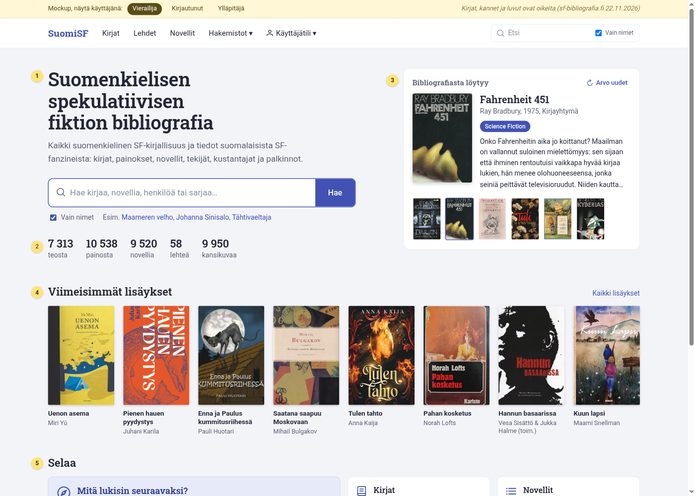
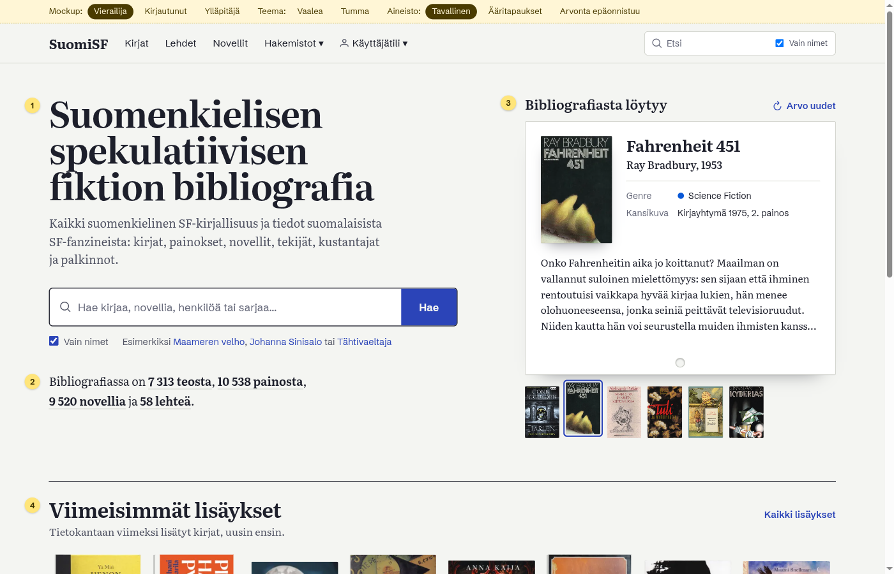
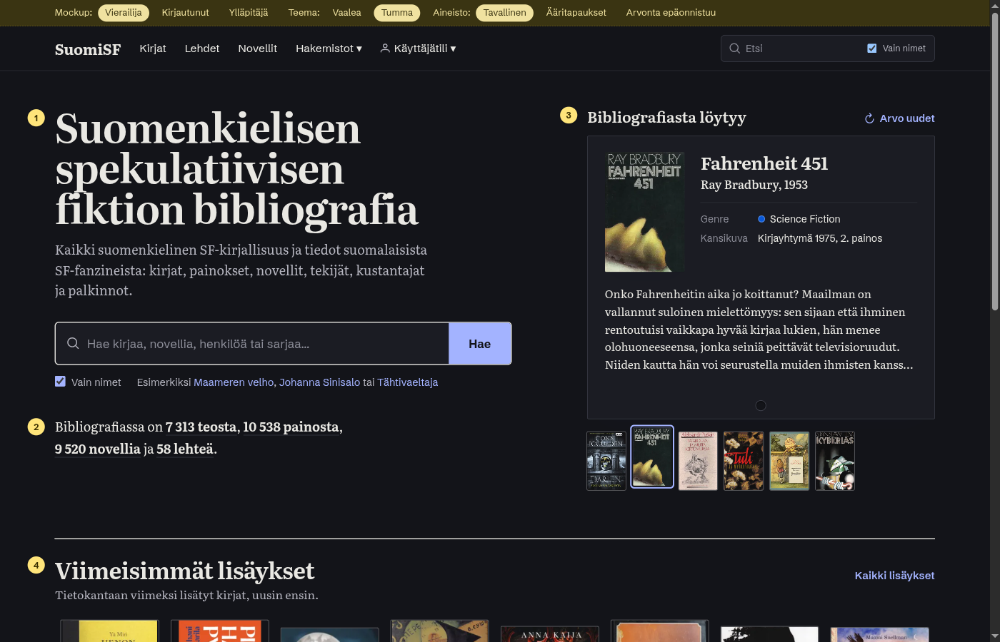
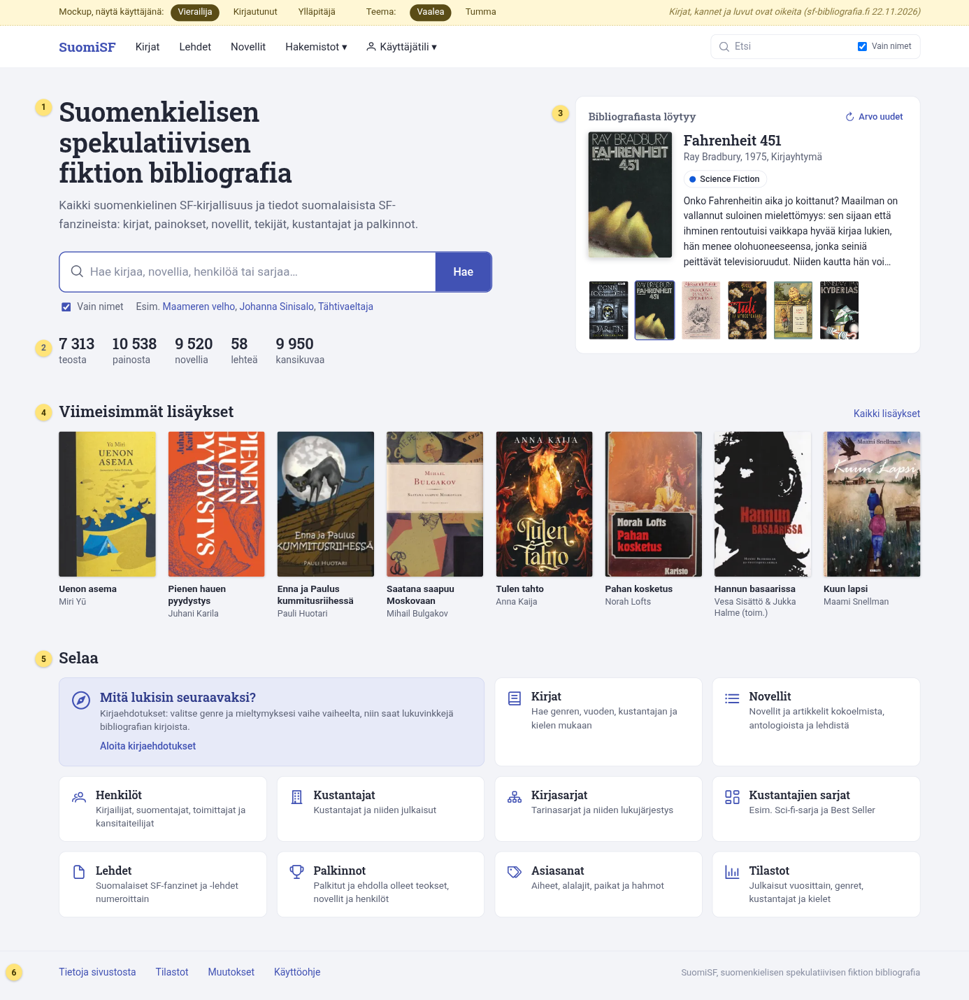
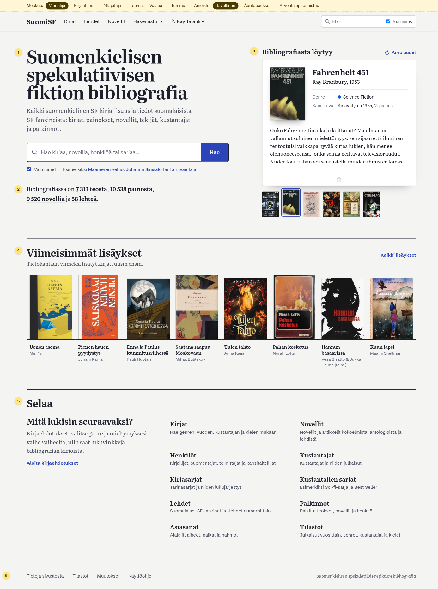
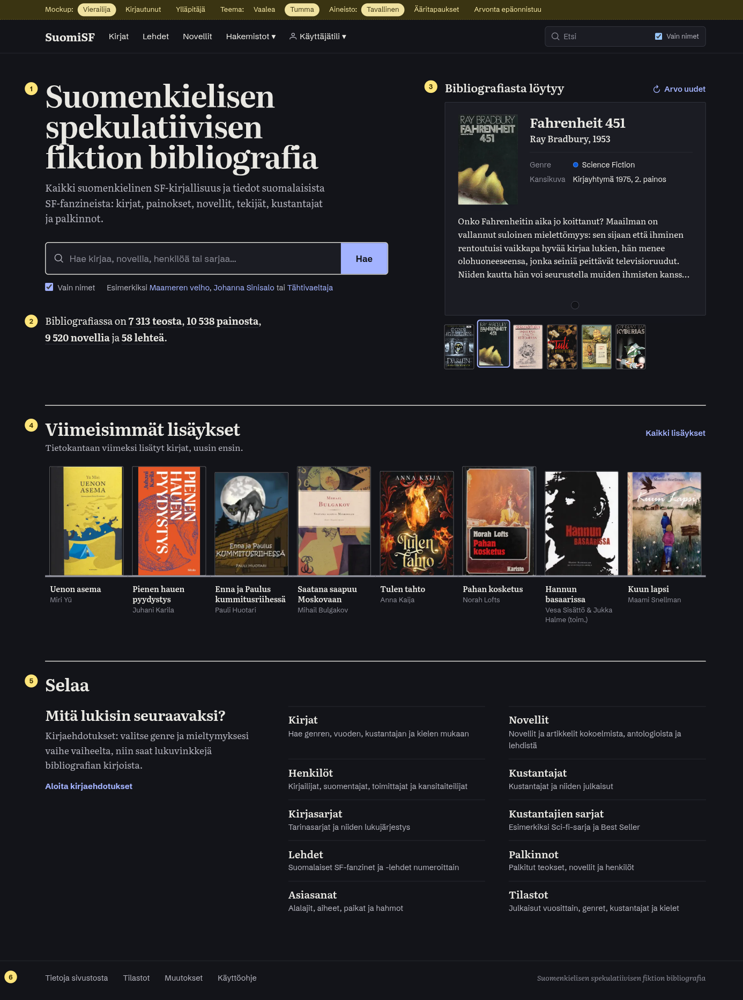
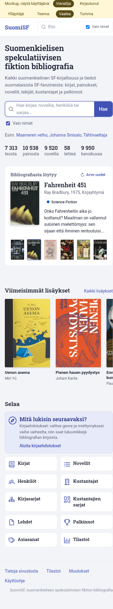
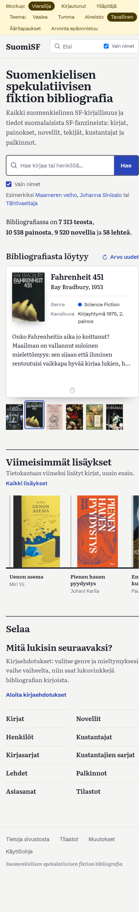
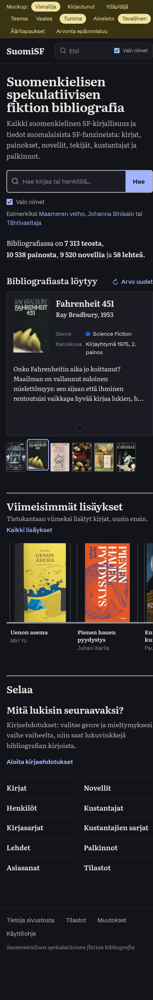

# Front page: visual identity proposal

**Route:** `/` · **Builds on:** the agreed [front page plan](front-page.md) (all its behaviour stays: search with "Vain nimet" and fixed examples,
the four counts and their link targets, one featured pick that swaps on click without moving the page, "Arvo uudet", eight latest additions with
titles and authors, Kirjaehdotukset first and in the same tab, no counts on the ways in, the same main menu, separate loading and errors, missing data)
**Companions:** [work-identity.md](work-identity.md) and [person-identity.md](person-identity.md), the same identity on the work and person pages
(same tokens, fonts and rules)
**Status:** Proposal · **Updated:** 2026-11-23
**Mockup:** [`../mockups/front-identity.html`](../mockups/front-identity.html) with the same [`front-data.js`](../mockups/front-data.js) as the agreed
mockup (real books, covers and counts): `?data=x` the real worst cases (the longest title, anthologies with three editors, a 5th printing,
a book without a cover), `?data=err` the random picks request failing. The yellow bar also switches visitor / logged in / admin and light / dark.

Like the work and person proposals, this changes how the page **looks**, not what it does.

| Agreed design (current plan) | This proposal, light | This proposal, dark |
|---|---|---|
|  |  |  |
|  |  |  |
|  |  |  |

More: [worst cases](../images/front-identity/extremes.png) · [worst cases, phone](../images/front-identity/extremes-mobile.png)
· [random picks failed](../images/front-identity/error.png) · [admin](../images/front-identity/admin.png)
· [1,000 px](../images/front-identity/desktop-1000.png) (each also `-dark`).

## Starting point

- **The front page's job:** let people search, show what the bibliography holds, and give every way in.
- **Vernacular it borrows from:** the library's catalogue hall. The catalogue enquiry (the search), one **catalogue card** drawn from the drawer
  (an index card with the hole for the drawer rod at its foot), and the **new-acquisitions shelf** where new books stand face out.
  The shelf stands on the same ink board as the work page's shelf of printings, so the two pages look related.

## Design plan

Tokens and type are the work proposal's ([colour and type](work-identity.md#design-plan)): the site's own background (white, or the dark theme's; the grey paper was dropped on 2026-11-24, see the work proposal's decisions), ink `#1D1F2B` / `#E9E8E3`,
catalogue blue `#2B44B8` / `#A3B3FF`, Literata for reading and headings, Schibsted Grotesk for the interface. Nothing new apart from the shadow
of the card's rod hole.

```
 SuomiSF  Kirjat Lehdet Novellit Hakemistot ▾ Käyttäjätili ▾                    [ Etsi          ☑ Vain nimet ]
──────────────────────────────────────────────────────────────────────────────────────────────────────────────
 Suomenkielisen spekulatiivisen                  Bibliografiasta löytyy                       Arvo uudet
 fiktion bibliografia                            ┌──────────────────────────────────────────────┐
 Kaikki suomenkielinen SF-kirjallisuus …         │ ┌──────┐ Fahrenheit 451                        │
 ┏━━━━━━━━━━━━━━━━━━━━━━━━━━━━━━━━━━━━┳━━━━━┓    │ │cover │ Ray Bradbury, 1953                    │
 ┃ 🔍 Hae kirjaa, novellia, henkilöä… ┃ Hae ┃    │ │      │ ─────────────────────                 │
 ┗━━━━━━━━━━━━━━━━━━━━━━━━━━━━━━━━━━━━┻━━━━━┛    │ │      │ Genre      ● Science Fiction          │
 ☑ Vain nimet  Esimerkiksi Maameren velho, …     │ └──────┘ Kansikuva  Kirjayhtymä 1975, 2. painos│
                                                 │ Description in Literata, five lines …        │
 Bibliografiassa on 7 313 teosta, 10 538         │                      ◯                       │
 painosta, 9 520 novellia ja 58 lehteä.          └──────────────────────────────────────────────┘
                                                  ▭ ▣ ▭ ▭ ▭ ▭   the other picks; the chosen one lifts
━━━━━━━━━━━━━━━━━━━━━━━━━━━━━━━━━━━━━━━━━━━━━━━━━━━━━━━━━━━━━━━━━━━━━━━━━━━━━━━━━━━━━━━━━━━━━━━━━━━━━━━━━━━━━━
 Viimeisimmät lisäykset                                                                   Kaikki lisäykset
 Tietokantaan viimeksi lisätyt kirjat, uusin ensin.
  ▉▉   ▉▉   ▉▉   ▉▉   ▉▉   ▉▉   ▉▉   ▉▉     covers face out, natural proportions
 ▔▔▔▔▔▔▔▔▔▔▔▔▔▔▔▔▔▔▔▔▔▔▔▔▔▔▔▔▔▔▔▔▔▔▔▔▔▔▔    the work page's ink board
  title, author under each
━━━━━━━━━━━━━━━━━━━━━━━━━━━━━━━━━━━━━━━━━━━━━━━━━━━━━━━━━━━━━━━━━━━━━━━━━━━━━━━━━━━━━━━━━━━━━━━━━━━━━━━━━━━━━━
 Selaa
 Mitä lukisin seuraavaksi?          ─────────────────────────   ─────────────────────────
 Kirjaehdotukset: valitse …         Kirjat                      Novellit
 Aloita kirjaehdotukset             Hae genren, vuoden, …       Novellit ja artikkelit …
                                    ─────────────────────────   ─────────────────────────
                                    Henkilöt …                  Kustantajat …
```

Left-aligned throughout. **Principles:**
1. **One bold element, the catalogue card.** It is the only box on the page, and it is a box because a catalogue card is one.
   Everything else is quiet: rules instead of tiles, text instead of chips.
2. **The holdings as a sentence,** not four big numbers with small labels.
3. **Commas, not middle dots** ("Kirjayhtymä 1975, 2. painos"; "Esimerkiksi Maameren velho, Johanna Sinisalo tai Tähtivaeltaja").
4. **No decorative motion.** The only movement answers the reader: the chosen thumbnail and a hovered book on the shelf lift 6 px,
   as a picked spine does on the work page (none with reduced motion).

## Checked against generic defaults

- **Big number with a small label** is the most common way to show stats, and the agreed mockup uses it. Here the counts are one sentence with
  the same four links.
- **A grid of tiles with an icon each** is the card kit from any dashboard. The ways in are an index instead: names in the reading face,
  one line each, rules between, no icons.
- **A full-width hero image or a starfield** would fit any SF site. The page opens with the search and a real book instead.
- **Card-catalogue kitsch** (drawer fronts, brass label holders, typewriter type) was considered and dropped. One detail is kept: the rod hole at the
  foot of the card, small enough to read as "catalogue card" without becoming a costume.

## What changes, section by section (numbers match the mockup)

1. **Search:** the title in Literata at 56 px (three lines), the intro in Literata at 18 px, the search field with a 2 px ink frame and a catalogue-blue
   "Hae". The examples read as a sentence: "Esimerkiksi Maameren velho, Johanna Sinisalo tai Tähtivaeltaja".
2. **Counts:** "Bibliografiassa on 7 313 teosta, 10 538 painosta, 9 520 novellia ja 58 lehteä." Each number with its noun is a link to the agreed target.
3. **The catalogue card:** a white sheet with a thin rule and the rod hole; title in Literata at 25 px; author and the work's year; a label column
   (Genre as a dot with its name, Kansikuva with the printing); the description across the full card width, five lines, with its source.
   The other picks stand under the card; the chosen one lifts with a blue ring. As agreed, all picks share one grid cell, so swapping never moves the page.
4. **The new-acquisitions shelf:** a 2 px ink rule, the heading in Literata at 32 px with one sentence ("Tietokantaan viimeksi lisätyt kirjat, uusin ensin.",
   the latest additions page's own line). The covers keep their own proportions and stand on the 4 px ink board; title (Literata) and author under the
   board, two lines each, "ym." after two names as agreed. **A book without a cover** is a plain cloth binding in the spine colour, as a printing without
   a cover is on the work page's shelf: no icon and no text on it, the title is under it like every other book.
5. **Selaa as an index:** Kirjaehdotukset as a lead paragraph on the left ("Mitä lukisin seuraavaksi?" with "Aloita kirjaehdotukset"), the ten ways in
   as a two-column index on the right. On a phone: the lead, then the names in two columns without descriptions (as agreed).
6. **Footer:** text links; the site's name in Literata italic.

**Widths:** below 1,100 px the card moves under the search (up to 620 px wide) and the shelf holds four books per board, two boards
([screenshot](../images/front-identity/desktop-1000.png)). **Phone:** title 31 px, the short placeholder, the card with an 88 px cover,
the shelf scrolls sideways with two books and the edge of a third in view.

**Long words:** Finnish compounds such as *äyriäiskauhukertomuksia* are wider than a phone's text column, and browsers don't hyphenate Finnish
reliably, so titles may break inside a word as a last resort (`hyphens: auto; overflow-wrap: anywhere`). Under the shelf the type and column width are
set so that no title in the real data breaks inside a word (checked on desktop, 1,000 px and phone with both data sets).

## Page heights (visitor, measured 2026-11-23, mockup bar excluded)

| | Agreed mockup | This proposal | Change |
|---|---|---|---|
| Desktop 1,400 px | 1,417 px | 1,826 px | +29% |
| Phone 390 px | 2,039 px | 2,322 px | +14% |
| Desktop, worst cases | 1,468 px | 1,855 px | +26% |
| Phone, worst cases | 2,043 px | 2,390 px | +17% |

The increase comes from the larger title and intro, the labels under the shelf board, and the index with its descriptions. The search is still on the
first screen on a phone (its lower edge at 378 px without the mockup bar).

## What this changes in agreed decisions

Each can be taken separately (the first three are shared with the work and person proposals):
1. **Fonts and colours** instead of Roboto / Roboto Slab and the PrimeReact indigo themes (a site-wide theme layer).
2. **Boxes:** the browse tiles become an index without icons; the featured box becomes the catalogue card.
3. **Chips:** genre chips become a dot with the genre's name.
4. **Counts** become one sentence (same four numbers, same links).
5. Page height grows by about 29% on desktop and 14% on a phone.

Unchanged: everything the front page plan decided (see "Builds on" above).

## Open questions

- Adopt the identity for the whole site, for the front, person and work pages as a trial, or not at all? (Same question as on the other two proposals.)
- The rod hole on the card: a fitting detail, or a gimmick?
- The counts as a sentence, or as separate numbers?

## Decisions

2026-11-24, project owner:
- The page background stays the site's own (white or the dark theme's), not the grey paper; reasons in the
  [work proposal's decisions](work-identity.md#decisions). The mockup and its screenshots still show the grey paper.
