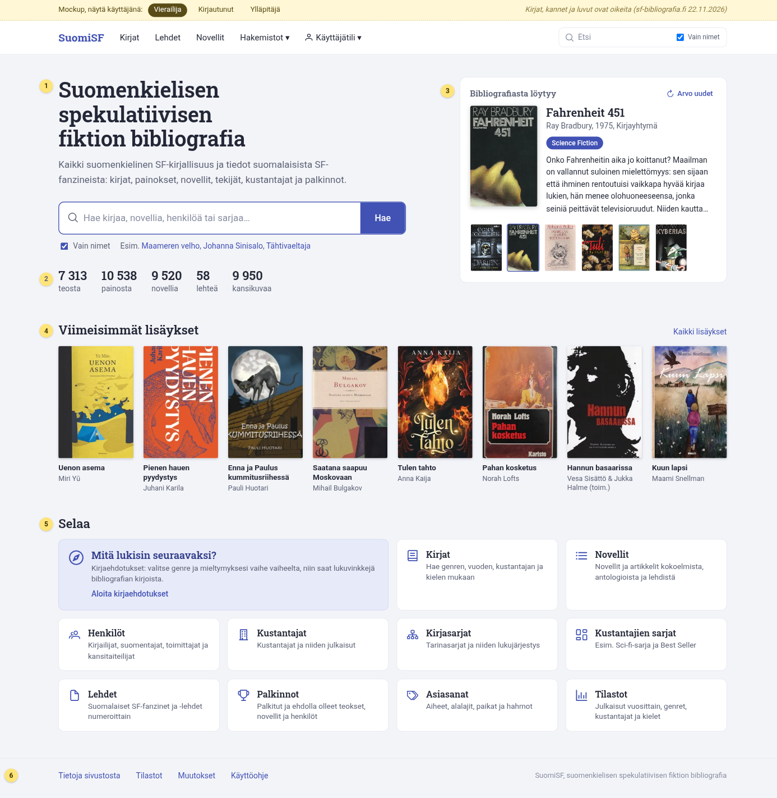

# Front page

**Route:** `/` · **Code:** `src/home-alt.tsx` (route `/` in `src/index.tsx`), `src/components/image-accordion.tsx`, styles `.home-alt-*` in `src/App.css`;
backend `/api/frontpagedata`, `/api/frontpage/latest`, `/api/frontpage/random` in `../suomisf/app/api.py`
**Status:** Proposal, first review done · **Updated:** 2026-11-22
**Sample page:** https://www.sf-bibliografia.fi/
**Mockup:** [`../mockups/front-page.html`](../mockups/front-page.html) with [`front-data.js`](../mockups/front-data.js) next to it.
Books, covers and counts are real (live API, 22.11.2026). The yellow bar switches between visitor, logged-in user and admin.

| Before | After (mockup) |
|---|---|
|  |  |
|  |  |

More: [first screen at 1400 px](../images/front-page/after-desktop.png), [admin view with the Ylläpito menu](../images/front-page/after-admin-full.png),
[today's hover panel on a random pick](../images/front-page/before-hover.png).

## What's wrong today

The page is already tidy and short (1,090 px on desktop). The problems are about what it helps people do.

1. **Search is the most common task, but it's the smallest thing on the page:** a box in the nav bar. The page itself has no search.
2. **The ways in are buried in a sentence.** Nine links (book search, short story search, fanzines, people, publishers, book series,
   publisher series, awards, tags) sit inside one long paragraph. On a phone that paragraph fills the whole first screen.
3. **Covers without titles.** Neither "Viimeisimmät lisäykset" nor "Bibliografiasta löytyy" shows a title or author. On a desktop you can hover;
   on a phone you see only covers.
4. **The random picks hide their best part.** Hovering a cover opens a rich panel (description, genres, tags) that covers the whole row
   ([screenshot](../images/front-page/before-hover.png)). Nobody knows to hover, and on touch it needs an extra tap.
5. **The book-suggestion wizard is hidden.** "Kirjaehdotukset" (`/suggestions`), the friendliest feature for a casual visitor,
   is only in the Hakemistot menu and opens in a new tab.
6. **The stats are a dead end.** Five numbers in uppercase labels with decorative rules; they don't link anywhere.
7. **Nothing for logged-in users or admins**, apart from the Kirjasampo note on random picks for admins.
8. **The nav bar (940 px) doesn't line up with the content (812 px)**, and the content is narrower than on other pages (site-wide issue).

## Proposed layout

```
┌ nav (same width as content) ──────────────────────────────────────────┐
├───────────────────────────────────────────────────────────────────────┤
│ Suomenkielisen spekulatiivisen         │ Bibliografiasta löytyy  ↻ Arvo │
│ fiktion bibliografia                   │ ┌────┐ Fahrenheit 451          │
│ One-sentence intro                     │ │    │ Ray Bradbury, 1975      │
│ [🔍 Hae kirjaa, novellia, henkilöä… ][Hae]│ │    │ (Science Fiction)       │
│ ☑ Vain nimet   Esim. Maameren velho, …  │ └────┘ description, 5 lines   │
│ 7 313 teosta  10 538 painosta  9 520 …  │ ▫ ▫ ▣ ▫ ▫ ▫  (click to swap)  │
├───────────────────────────────────────────────────────────────────────┤
│ Viimeisimmät lisäykset                                 Kaikki lisäykset │
│ ▭ ▭ ▭ ▭ ▭ ▭ ▭ ▭   with title and author under each cover               │
│ Selaa                                                                   │
│ [ Mitä lukisin seuraavaksi? (Kirjaehdotukset) ] [Kirjat] [Novellit]     │
│ [Henkilöt] [Kustantajat] [Kirjasarjat] [Kustantajien sarjat]            │
│ [Lehdet] [Palkinnot] [Asiasanat] [Tilastot]                             │
├ footer: Tietoja sivustosta · Tilastot · Muutokset · Käyttöohje ─────────┤
```

The numbers 1–6 in the mockup screenshots match the sections below.

1. **Hero with search** on the same background as the rest of the page. The title stays; the long paragraph becomes one sentence.
   A large search box (the same AutoComplete and the same "Vain nimet" setting as the menu search, shared through `localStorage`),
   a "Hae" button, and three fixed example searches. The main menu stays as it is on every page, including its own search box
   and, for admins, the Ylläpito menu.
2. **Counts under the search,** without uppercase labels or decorative rules. Each count links to its index
   (teokset → book index, novellit → short story index, lehdet → magazines, kansikuvat → statistics).
3. **"Bibliografiasta löytyy" as one featured book** instead of a hover row: cover, title, author, year, publisher, genre chips and
   five lines of description, always visible. The other picks are small thumbnails under it; clicking one swaps the featured book
   (works the same on touch). "Arvo uudet" fetches a new set from `/api/frontpage/random`. Admins keep today's Kirjasampo note on the featured book.
4. **"Viimeisimmät lisäykset" with titles and authors** under every cover, 8 covers instead of 6 (the endpoint allows up to 20).
   On a phone the row scrolls sideways instead of stacking into a tall two-column grid. "Kaikki lisäykset" replaces "Katso kaikki →".
5. **"Selaa": tiles for every way in.** Each tile has an icon, a name and one line saying what you find there; no counts on tiles
   (the totals are under the search). The first, wider tile promotes **Kirjaehdotukset** ("Mitä lukisin seuraavaksi?"), which opens in
   the same tab like every other link (the menu item loses its `target="_blank"` too). On a phone the tiles go two per row without the descriptions.
   Personal and admin links stay in the main menu (user menu and Ylläpito), so the front page has no separate boxes for them.
6. **Footer** with Tietoja sivustosta, Tilastot, Muutokset and a link to the user guide (the GitHub wiki).

Measured: desktop 1,422 px (was 1,090, but now with titles, a description and the browse tiles); phone 2,004 px (was 2,071)
with the search on the first screen.

## Shared principles used or added

Uses from [principles.md](../principles.md): nav and content at the same width, no uppercase labels, one chip style per meaning,
genre colours, phone layout rules.

New rules from this plan:
- On the front page, the hero sits on the same background as the rest of the page; no separate coloured band (agreed for this page).
- The main menu is the same on every page, and admins always see the Ylläpito menu (agreed).
- Every cover shown in a list has its title and author next to it; nothing important is hover-only.
- Numbers shown to visitors link to the list or statistics behind them.
- Show-a-sample sections (random picks) work by click or tap, not hover.

## Implementation steps

1. **Hero and search**: rework the top of `home-alt.tsx`. Pull the search box out of `mainmenu.tsx` into a shared `SearchBox`
   component (AutoComplete, "Vain nimet", Enter behaviour) so the nav and the hero use the same code.
2. **Featured pick**: new `featured-pick.tsx` replacing `ImageAccordion` on the front page (it's used nowhere else, so it can be removed).
   "Arvo uudet" refetches with React Query (`queryKey: ["frontpage","random", n]`).
3. **Latest additions**: titles and authors under covers in `CoverGrid`; `LATEST_COUNT` 6 → 8; sideways scroll on a phone.
4. **Browse tiles**: new `browse-tiles.tsx` with the tile list in one array (route, icon, name, description). No backend change.
   Remove `target: '_blank'` from the Kirjaehdotukset items in `mainmenu.tsx`.
5. **Footer.**
6. **Remove the uppercase/rule styles** (`.home-alt-stat`, `.home-alt-section-title`) from `App.css`; align widths with the nav.
7. **Tests and wiki**: update `tests/anon/front-page-popups.spec.ts` (it tests today's hover panel), add checks for the hero search and tiles;
   update the front page part of `SuomiSF‐ohje.md` and its screenshot.

## Tests

- Vitest: tile list renders every route; counts formatted with `fi-FI`; featured-pick swap logic.
- Playwright: hero search finds a work and shares "Vain nimet" with the nav search; clicking a thumbnail swaps the featured book;
  "Arvo uudet" loads a new set; latest covers show titles; every tile links to the right route and Kirjaehdotukset opens in the same tab;
  admin sees the Ylläpito menu and the Kirjasampo note; visitor sees neither.
- a11y: one `h1`, search has a label and `role="search"`, thumbnails are buttons with labels.

## Open questions

- Anything else you'd want on the front page, for example this year's new books by publication year (needs a new endpoint)?

## Decisions

2026-11-22, project owner:
- No separate background colour for the hero; one background for the whole page.
- The main menu keeps the admin (Ylläpito) menu on every page for admins.
- Example searches are fixed.
- No counts on the browse tiles.
- Kirjaehdotukset opens in the same tab.
- The menu search box stays visible on the front page.
