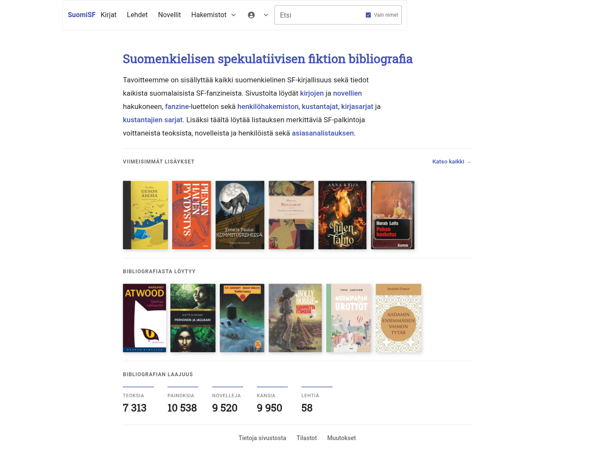
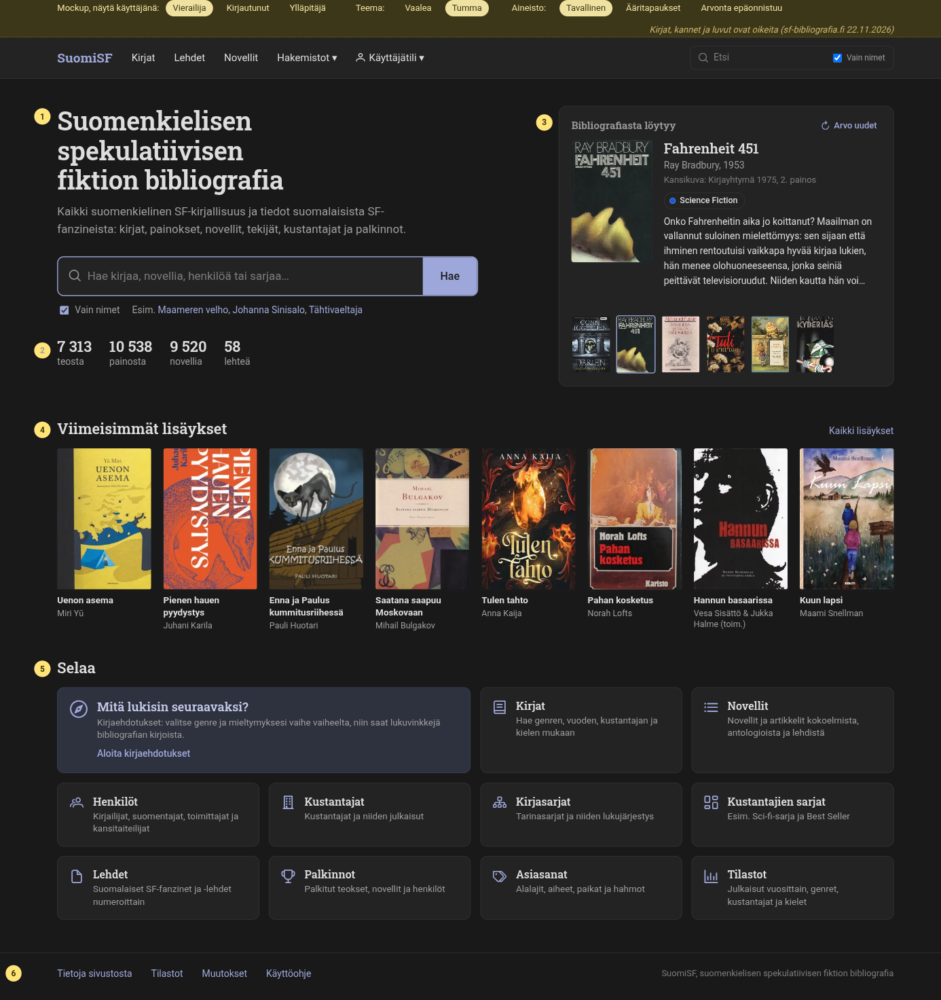
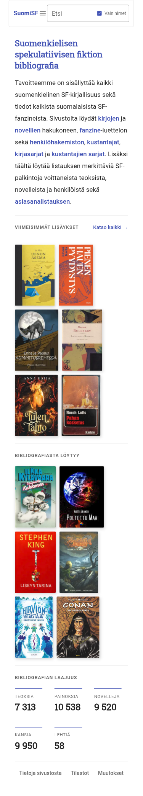
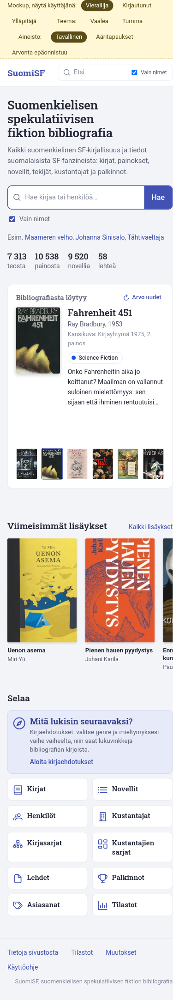
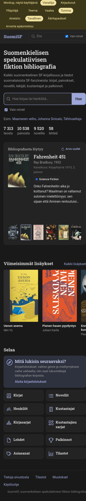

# Front page

**Route:** `/` · **Code:** `src/home-alt.tsx` (route `/` in `src/index.tsx`), `src/components/image-accordion.tsx`, styles `.home-alt-*` in `src/App.css`;
backend `/api/frontpagedata`, `/api/frontpage/latest`, `/api/frontpage/random` in `../suomisf/app/api.py`
**Status:** Agreed (revised 2026-11-23) · **Updated:** 2026-11-23
**Sample page:** https://www.sf-bibliografia.fi/
**Mockup:** [`../mockups/front-page.html`](../mockups/front-page.html) with [`front-data.js`](../mockups/front-data.js) next to it.
Books, covers and counts are real (live API, 22.11.2026). The yellow bar switches between visitor, logged-in user and admin, light and dark,
and the data: `?data=x` shows the real worst cases (the longest title, anthologies with three editors, a 5th printing, a book without a cover),
`?data=err` shows the random picks request failing while the rest of the page works.

| Before | After (mockup, light) | After (mockup, dark) |
|---|---|---|
|  |  |  |
|  |  |  |

More: [first screen at 1400 px](../images/front-page/after-desktop.png), [admin view with the Ylläpito menu](../images/front-page/after-admin-full.png),
[today's hover panel on a random pick](../images/front-page/before-hover.png).
Dark theme: [first screen](../images/front-page/after-desktop-dark.png), [whole page](../images/front-page/after-desktop-full-dark.png), [admin](../images/front-page/after-admin-full-dark.png), [phone](../images/front-page/after-mobile-full-dark.png).
Worst cases: [desktop](../images/front-page/after-extremes.png) ([dark](../images/front-page/after-extremes-dark.png)),
[phone](../images/front-page/after-extremes-mobile.png) ([dark](../images/front-page/after-extremes-mobile-dark.png)),
[random picks failed](../images/front-page/after-error.png) ([dark](../images/front-page/after-error-dark.png)).

## What's wrong today

The page is already tidy and short (1,090 px on desktop). The problems are about what it helps people do.

1. **Search is the most common task, but it's the smallest thing on the page:** a box in the nav bar. The page itself has no search.
2. **The ways in are buried in a sentence.** Nine links (book search, short story search, fanzines, people, publishers, book series,
   publisher series, awards, tags) sit inside one long paragraph. On a phone that paragraph fills the whole first screen.
3. **Covers without titles.** Neither "Viimeisimmät lisäykset" nor "Bibliografiasta löytyy" shows a title or author. On a desktop you can hover;
   on a phone you see only covers.
4. **The random picks hide their best part.** Hovering a cover opens a rich panel (description, genres, tags) that covers the whole row
   ([screenshot](../images/front-page/before-hover.png)). Nobody knows to hover, and on touch it needs an extra tap.
5. **The book-suggestion wizard is hidden.** "Kirjaehdotukset" (`/suggestions`), the friendliest feature for a casual visitor,
   is only in the Hakemistot menu and opens in a new tab.
6. **The stats are a dead end.** Five numbers in uppercase labels with decorative rules; they don't link anywhere.
7. **Nothing for logged-in users or admins**, apart from the Kirjasampo note on random picks for admins.
8. **The nav bar (940 px) doesn't line up with the content (812 px)**, and the content is narrower than on other pages (site-wide issue).

## Proposed layout

```
┌ nav (same width as content) ──────────────────────────────────────────┐
├───────────────────────────────────────────────────────────────────────┤
│ Suomenkielisen spekulatiivisen         │ Bibliografiasta löytyy  ↻ Arvo │
│ fiktion bibliografia                   │ ┌────┐ Fahrenheit 451          │
│ One-sentence intro                     │ │    │ Ray Bradbury, 1975      │
│ [🔍 Hae kirjaa, novellia, henkilöä… ][Hae]│ │    │ (Science Fiction)       │
│ ☑ Vain nimet   Esim. Maameren velho, …  │ └────┘ description, 5 lines   │
│ 7 313 teosta  10 538 painosta  9 520 …  │ ▫ ▫ ▣ ▫ ▫ ▫  (click to swap)  │
├───────────────────────────────────────────────────────────────────────┤
│ Viimeisimmät lisäykset                                 Kaikki lisäykset │
│ ▭ ▭ ▭ ▭ ▭ ▭ ▭ ▭   with title and author under each cover               │
│ Selaa                                                                   │
│ [ Mitä lukisin seuraavaksi? (Kirjaehdotukset) ] [Kirjat] [Novellit]     │
│ [Henkilöt] [Kustantajat] [Kirjasarjat] [Kustantajien sarjat]            │
│ [Lehdet] [Palkinnot] [Asiasanat] [Tilastot]                             │
├ footer: Tietoja sivustosta · Tilastot · Muutokset · Käyttöohje ─────────┤
```

The numbers 1–6 in the mockup screenshots match the sections below.

1. **Hero with search** on the same background as the rest of the page. The title stays; the long paragraph becomes one sentence.
   A large search box (the same AutoComplete and the same "Vain nimet" setting as the menu search, shared through `localStorage`),
   a "Hae" button, and three fixed example searches. The main menu stays as it is on every page, including its own search box
   and, for admins, the Ylläpito menu.
2. **Counts under the search,** without uppercase labels or decorative rules. Each count links to a page that shows **the same number**:

   | Count | Counts | Links to |
   |---|---|---|
   | 7 313 teosta | every work | `/bookindex` (header "Kaikki bibliografian 7 313 teosta", agreed book index plan) |
   | 10 538 painosta | every printing | `/stats?tab=julkaisut` (Julkaisut ajallisesti, "Kaikki painokset") |
   | 9 520 novellia | story types Novelli, Pitkä novelli, Pienoisromaani (not poems, articles, forewords) | `/shortstoryindex?tyyppi=novelli,pitka-novelli,pienoisromaani`, so the list total matches |
   | 58 lehteä | every magazine | `/magazines` |

   The cover count ("9 950 kansikuvaa") is dropped: no page lists every cover (decided).
3. **"Bibliografiasta löytyy" as one featured book** instead of a hover row: cover, title, author, year, genre chips and
   five lines of description, always visible. The other picks are small thumbnails under it; clicking one swaps the featured book
   (works the same on touch). "Arvo uudet" fetches a new set from `/api/frontpage/random`. Admins keep today's Kirjasampo note on the featured book.
   - **Year:** the year after the author is the work's year (the original year, as in every list). The cover is a random printing
     (the endpoint picks one of the work's covers on purpose), so it gets its own line: "Kansikuva: Kirjayhtymä 1975, 2. painos".
     Before, the line read "Ray Bradbury, 1975, Kirjayhtymä" for a 1953 book; in the mockup's own six picks three covers are later printings
     (Fahrenheit 451 2nd, Darien 2nd, Liisan seikkailut 4th), and 21 of 180 sampled picks were.
   - **Links:** title and cover open `/editions/:id` for the printing shown, which the agreed work plan turns into the work page with that printing
     highlighted and its cover in the header.
   - **Description source** in small text under the clamped description when the work has one ("Kuvaus: Takakansi"; 129 of 180 sampled picks).
   - **The box does not change height when you swap:** all picks are rendered in one grid cell and only the chosen one is visible, so the box is as
     tall as the tallest pick in the set. Before, swapping moved everything below by up to 92 px on a phone and 23 px on desktop with today's six picks
     (75 px with the worst cases). "Arvo uudet" may change the height once; that is the reader's own action. The covers of all six load at once, so swaps are instant.
   - Thumbnails are toggle buttons (`aria-pressed`, label "Näytä <title>"); focus stays on the thumbnail. "Arvo uudet" announces the new set in a polite live region.
4. **"Viimeisimmät lisäykset" with titles and authors** under every cover, 8 covers instead of 6 (the endpoint allows up to 20).
   On a phone the row scrolls sideways instead of stacking into a tall two-column grid. "Kaikki lisäykset" replaces "Katso kaikki →" and opens `/latest`
   (its Teokset tab, which lists one row per work like this row does).
   - **Title** up to two lines, **author** up to two lines; under a cover there is room for two names, so three or more become "Matleena Sopanen ym. (toim.)"
     (the work page has them all). Names in natural order ("Vesa Sisättö & Jukka Halme (toim.)"). The longest real titles in the row (47 characters,
     "Mustan Kuun salamieli, osa 1 : Puuhkisten laulu") fit in two lines; every cover in a row has the same height.
   - **A book without a cover** keeps the row aligned: the same 2:3 frame in the placeholder colour with a book icon, no text inside, title and author
     under it as for every cover. (The endpoint already prefers a printing that has a cover; none of the latest 200 printings lacked one today, but new
     entries can be added before their cover, like Satujen maan taistelu in the mockup.)
5. **"Selaa": tiles for every way in.** The Palkinnot tile says "Palkitut teokset, novellit ja henkilöt" (the awards plan shows winners only)
   and Asiasanat starts with Alalajit, the group the tags page opens on. Each tile has an icon, a name and one line saying what you find there; no counts on tiles
   (the totals are under the search). The first, wider tile promotes **Kirjaehdotukset** ("Mitä lukisin seuraavaksi?"), which opens in
   the same tab like every other link (the menu item loses its `target="_blank"` too). On a phone the tiles go two per row without the descriptions.
   Personal and admin links stay in the main menu (user menu and Ylläpito), so the front page has no separate boxes for them.
6. **Footer** with Tietoja sivustosta, Tilastot, Muutokset and a link to the user guide (the GitHub wiki).

Hero search: Enter or "Hae" opens `/search?q=<term>` with `&titles=1` when "Vain nimet" is on (the agreed search plan's URL); the checkbox's
default comes from the shared `localStorage` setting. On a phone the placeholder is "Hae kirjaa tai henkilöä…" (the long one is cut off in a 390 px input).

**Loading, errors and missing data**
- The three requests load **separately**: counts, random picks and latest additions each show their own skeleton at their final size and their own
  error with "Yritä uudelleen" (agreed errors rule). Today one `Promise.all` waits for the slowest request and one failure hides the whole page.
- A failed counts request hides the counts line (the search still works); failed picks show the message in the box; failed latest additions show it in the row.
- Random picks come only from works with a description (already) **and a cover** (backend step 0; 0 of 180 sampled picks lacked one, but the query allows it).
  If a category has no eligible work the set is shorter; fewer than two picks hides the thumbnails.
- Genres are always there (picks are chosen by genre). No tags are shown, so works without tags look the same.

**URL and sticky bars:** the front page has no view state in the URL: the random set is random by design, and the chosen pick only means something
inside that set. React Query keeps the set while the reader moves around the site, so the back button returns to the same six; a reload draws a new set.
Nothing sticks on the front page (it has no tab row; the main menu scrolls away as on every page).

Measured (2026-11-23, with the stacked picks, the printing line and the description source): desktop 1,472 px (was 1,090; first version of this plan 1,429);
phone 2,166 px (was 2,071; first version 1,983), with the search on the first screen. Worst cases: 1,523 px and 2,170 px.

## Shared principles used or added

Uses from [principles.md](../principles.md): nav and content at the same width, no uppercase labels, one chip style per meaning,
genre colours, phone layout rules.

New rules from this plan:
- On the front page, the hero sits on the same background as the rest of the page; no separate coloured band (agreed for this page).
- The main menu is the same on every page, and admins always see the Ylläpito menu (agreed).
- Every cover shown in a list has its title and author next to it; nothing important is hover-only.
- Numbers shown to visitors link to the list or statistics behind them.
- Show-a-sample sections (random picks) work by click or tap, not hover.

## Implementation steps

0. **Backend** (agreed): drop the unused `latest` list from `/api/frontpagedata`: it loads every edition (10,538) to find four that no page
   uses; the response takes 0.40 s, the latest endpoint 0.10 s (live, 2026-11-23). Random picks only from works with a cover, and only the fields the
   box shows (`only=`, as the latest endpoint does): today 29–32 KB with owners, wishlists and contributions for six books.
   The `covers` count can go too: only the front page used it (update `tests/api/test_misc.py` and the snapshot).
1. **Hero and search**: rework the top of `home-alt.tsx`. Pull the search box out of `mainmenu.tsx` into a shared `SearchBox`
   component (AutoComplete, "Vain nimet", Enter behaviour) so the nav and the hero use the same code.
2. **Featured pick**: new `featured-pick.tsx` replacing `ImageAccordion` on the front page (it's used nowhere else, so it can be removed).
   "Arvo uudet" refetches with React Query (`queryKey: ["frontpage","random", n]`, `staleTime: Infinity` so back returns to the same set).
   Picks stacked in one grid cell; original year plus the "Kansikuva:" line; description source. The three requests become three queries with their own
   loading and error states (replacing the `Promise.all` in `home-alt.tsx`).
3. **Latest additions**: titles and authors under covers in `CoverGrid` (two-line clamps, "ym." after two names); `LATEST_COUNT` 6 → 8;
   sideways scroll on a phone; the no-cover frame.
4. **Browse tiles**: new `browse-tiles.tsx` with the tile list in one array (route, icon, name, description). No backend change.
   Remove `target: '_blank'` from the Kirjaehdotukset items in `mainmenu.tsx`.
5. **Footer.**
6. **Remove the uppercase/rule styles** (`.home-alt-stat`, `.home-alt-section-title`) from `App.css`; align widths with the nav.
7. **Tests and wiki**: update `tests/anon/front-page-popups.spec.ts` (it tests today's hover panel), add checks for the hero search and tiles;
   update the front page part of `SuomiSF‐ohje.md` and its screenshot.

## Tests

- Vitest: tile list renders every route; counts formatted with `fi-FI` and linked to the targets in the table; featured-pick swap logic;
  name shortening ("ym." after two names, "(toim.)" kept); printing line only says "N. painos" from the 2nd printing on.
- Playwright: swapping picks doesn't move the latest row (same `top` before and after); a failed random request shows the message and the rest
  of the page; hero search finds a work and shares "Vain nimet" with the nav search; clicking a thumbnail swaps the featured book;
  "Arvo uudet" loads a new set; latest covers show titles; every tile links to the right route and Kirjaehdotukset opens in the same tab;
  admin sees the Ylläpito menu and the Kirjasampo note; visitor sees neither.
- a11y: one `h1`, search has a label and `role="search"`, thumbnails are buttons with labels.

## Second check (2026-11-23)

Checked against the rules agreed after this plan (missing data, errors, URL state, sticky bars, text first) and against real worst cases.
Fixed in the plan and the mockup without changing what was agreed: the count targets (painokset and novellit pointed at lists with other totals),
the featured year (printing year shown as the book's year), the jumping pick box, long author lists under covers, the cover-less frame,
separate loading and errors, the hero search URL, the phone placeholder, the Palkinnot tile (said "ehdolla olleet"), the description source,
and the URL/sticky statement.

## Open questions

_None._

## Decisions

2026-11-22, project owner:
- No separate background colour for the hero; one background for the whole page.
- The main menu keeps the admin (Ylläpito) menu on every page for admins.
- Example searches are fixed.
- No counts on the browse tiles.
- Kirjaehdotukset opens in the same tab.
- The menu search box stays visible on the front page.
- Nothing else to add to the front page for now.

2026-11-23, project owner (second check):
- Backend step 0 is fine: drop `latest` from `/api/frontpagedata`; random picks only from works with a cover, with a lighter payload.
- Drop the cover count from the front page.
- The front page keeps its cover rows: it is the landing page, an exception to the text-first rule (now written into the rule).
