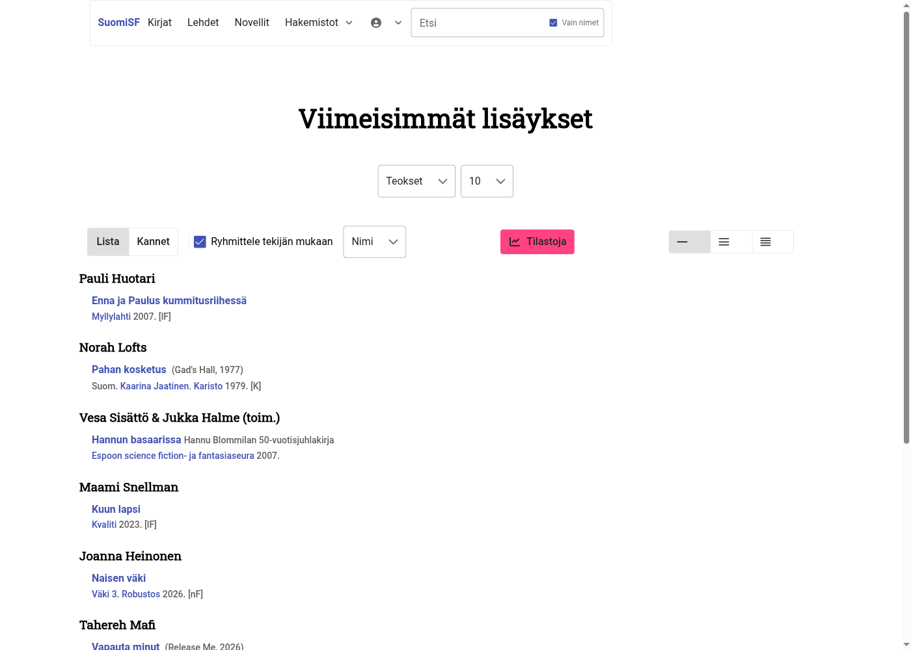
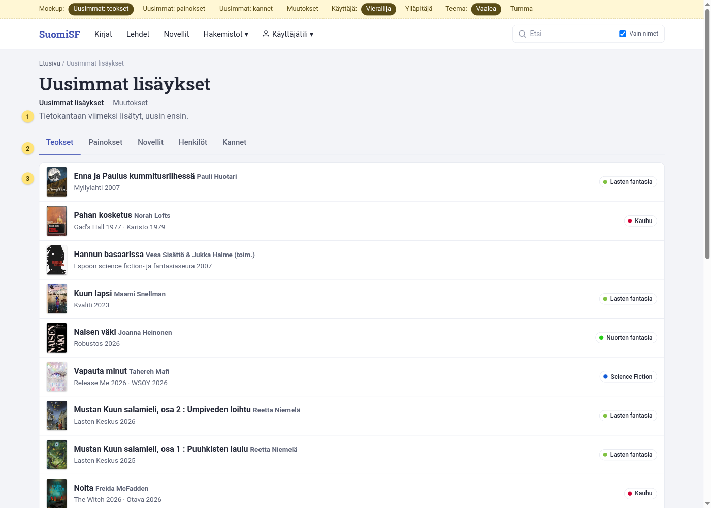
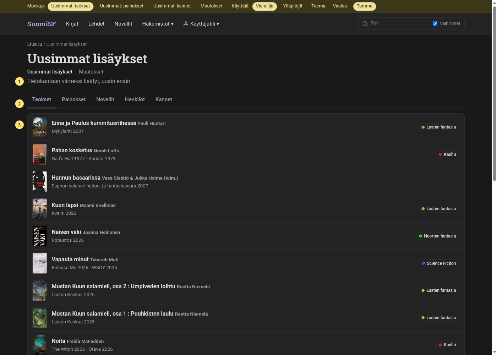
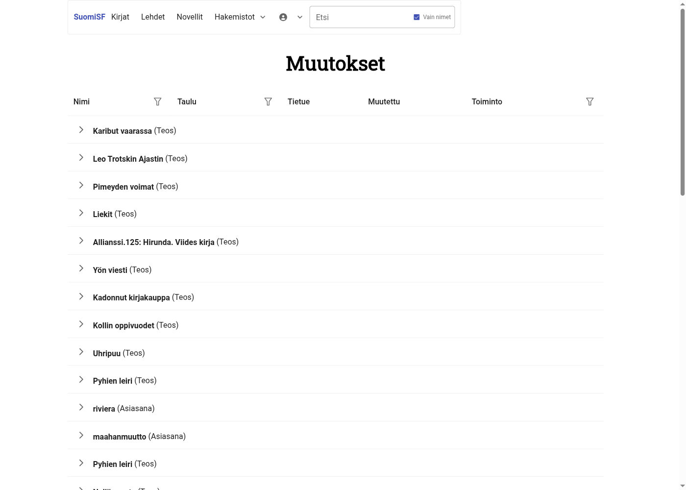
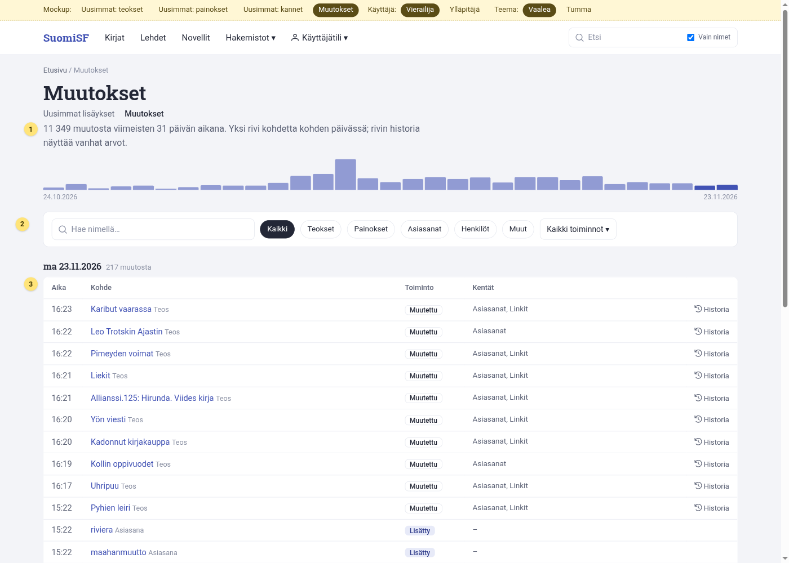
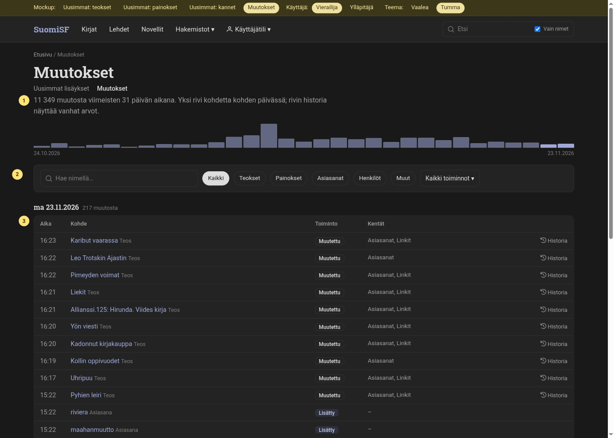
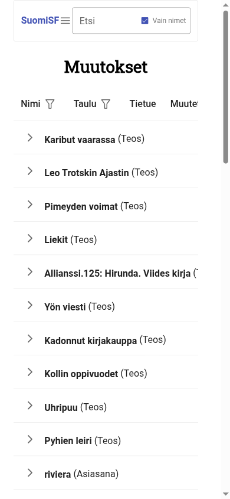
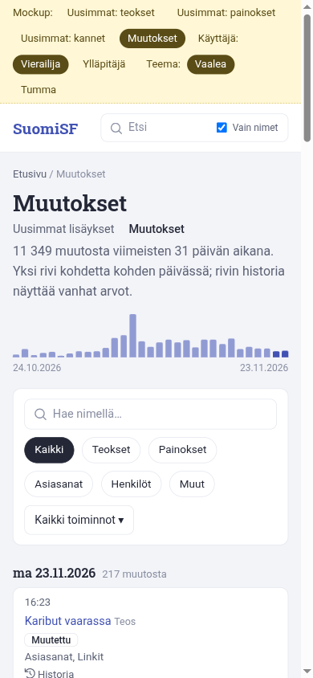
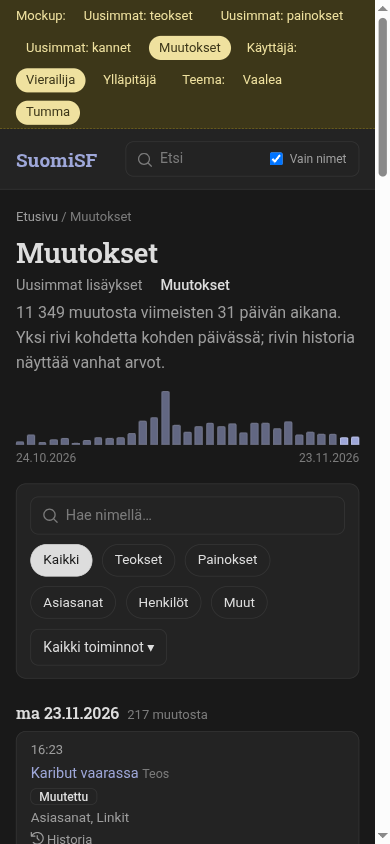

# Latest additions and changes

**Routes:** `/latest` and `/changes` · **Code:** `src/features/latest/routes/latest-additions.tsx`, `src/features/*/components/*-latest.tsx`,
`src/features/changes/routes/changes-page.tsx`, `change-history-dialog.tsx`; backend `GET /api/latest/<type>/<count>`, `/api/changes` (`app/impl.py: get_changes`)
**Status:** Agreed · **Updated:** 2026-11-23
**Samples:** live data on 2026-11-23: the 20 newest works, editions and covers, and the change log (11,349 rows from 24.10.–23.11.2026).
**Mockup:** [`../mockups/latest.html`](../mockups/latest.html) with [`latest-data.js`](../mockups/latest-data.js) (real data): `?v=works`, `?v=editions`,
`?v=covers`, `?v=changes`. The yellow bar switches visitor / admin and light / dark.

| Before | After (mockup, light) | After (mockup, dark) |
|---|---|---|
|  |  |  |
|  |  |  |
|  |  |  |

More: after: [painokset](../images/latest/after-latest-editions.png) ([dark](../images/latest/after-latest-editions-dark.png)),
[kannet](../images/latest/after-latest-covers.png) ([dark](../images/latest/after-latest-covers-dark.png)),
[changes as admin](../images/latest/after-changes-admin.png) ([dark](../images/latest/after-changes-admin-dark.png)) ·
phones: [latest before](../images/latest/before-latest-mobile.png), [latest after](../images/latest/after-latest-mobile.png) ([dark](../images/latest/after-latest-mobile-dark.png)).

## What's wrong today

**Latest additions (`/latest`)**
1. **Two dropdowns decide what you see** (type, and 10 / 20 / 50 / 100); neither is in the URL, so a link always opens on 10 works.
2. **The works list is the author-grouped text list** with "Ryhmittele tekijän mukaan", sort and density buttons, which hides the order of addition,
   the one thing this page is about.
3. Centred title; the page is linked only from the front page ("Uusimmat" section).

**Changes (`/changes`)**
4. **One 2.9 MB response with every log row** from the last 30 days (11,349 rows), sorted and grouped in the browser.
5. **Rows are grouped by name and collapsed:** the page is a list of names ("Karibut vaarassa (Teos)") that must be opened one by one,
   and the same work appears again further down ("Pyhien leiri" twice). Field names, dates and the action are inside the groups.
6. **Filters sit in column headers**, the date is the raw ISO string, "Taulu" and "Tietue" are database words.
7. **The API returns the editor's user name and the old value to everyone**; the page is public and linked from the front page footer.

## Proposed layout

**Shared header:** breadcrumb, title, and a two-link switch "Uusimmat lisäykset | Muutokset", so the two pages find each other.

**Latest additions**
1. One sentence: "Tietokantaan viimeksi lisätyt, uusin ensin."
2. **Tabs** Teokset, Painokset, Novellit, Henkilöt, Kannet, in the URL (`/latest?tyyppi=painokset`).
3. **Compact rows in order of addition** (the shared row: cover, title, author, original title and year, publisher, genre chips).
   Painokset show the printing and laitos as chips; Henkilöt show roles and counts; **Kannet is the one cover grid** (covers are the content there).
4. **"Näytä seuraavat 20"** instead of the count dropdown.

**Changes**
1. A count sentence and a **bar per day** for the period (31 bars), so busy days stand out; clicking a bar jumps to that day.
2. Filter bar: name search, type chips (Kaikki, Teokset, Painokset, Asiasanat, Henkilöt, Muut), action (Lisätty / Muutettu / Poistettu);
   admins also get a user select. Filters in the URL.
3. **A feed grouped by day,** newest first: one row per object, action and user per day, with time, the object (linked unless deleted) and its type,
   the action as a chip, and the changed fields joined ("Asiasanat, Linkit"). **"Historia"** opens the change history dialog (agreed rule)
   for old values. The user column is shown to admins only.
4. "Vanhemmat muutokset" loads the next days (paged on the server).

## Shared principles used or added

Uses: tabs with counts and state in the URL, compact rows, text first (Kannet only where covers are the content), filters above lists,
large lists paged on the server, change history as a dialog, dark theme, page width, mixed-case titles.

No new rules.

## Implementation steps

1. **Backend:**
   - `/api/latest/<type>` takes `offset` and `count` so the page can load more.
   - `/api/changes` adds paging by day, a name search (`q`), grouping (object, day, action, user with the fields joined) and per-day counts.
     It already filters by `period`, `table`, `action`, `field` and `userid`.
   - The user name and old values are returned to admins only (decided).
2. **Latest page:** tabs in the URL, the shared rows, load more.
3. **Changes page:** day bars, filter bar, day feed with the history dialog; mapping of table names to Finnish plural labels.
4. **Tests and wiki:** Playwright for tabs and filters in the URL, load more, the history dialog; update `SuomiSF‐ohje.md`.

## Tests

- Backend: grouping joins fields; per-day counts add up to the total; a visitor gets no user names or old values.
- Playwright: `/latest?tyyppi=painokset` opens on Painokset; "Näytä seuraavat 20" adds 20 rows; `/changes` shows today first;
  the Asiasanat chip filters to tags; a visitor doesn't see the Käyttäjä column, an admin does; Historia opens the dialog.

## Open questions

_None._

## Decisions

2026-11-23, project owner:
- The backend change (paging, name search, grouping and day counts for changes; offset for latest) is fine.
- The change log stays public without user names and old values; admins see everything.
- `/latest` and `/changes` stay two pages, linked by the switch.
