# Magazines, magazine and issue

**Routes:** `/magazines`, `/magazines/:id`, `/issues/:id` · **Code:** `src/features/magazine/routes/magazines-page.tsx`, `magazine-page.tsx`,
`src/features/issue/routes/issue-page.tsx`; backend `GET /api/magazines`, `/api/magazines/:id`, `/api/issues/:id`
**Status:** Agreed · **Updated:** 2026-11-22
**Samples:** the list (58 magazines), Tähtivaeltaja (168 issues, https://www.sf-bibliografia.fi/magazines/47) and its issue 2/2000 (https://www.sf-bibliografia.fi/issues/767).
**Mockup:** [`../mockups/magazines.html`](../mockups/magazines.html) with [`magazines-data.js`](../mockups/magazines-data.js) (real data): `?v=list`, `?v=mag`, `?v=issue`.
The yellow bar switches visitor / admin and light / dark.

| Before | After (mockup, light) | After (mockup, dark) |
|---|---|---|
| 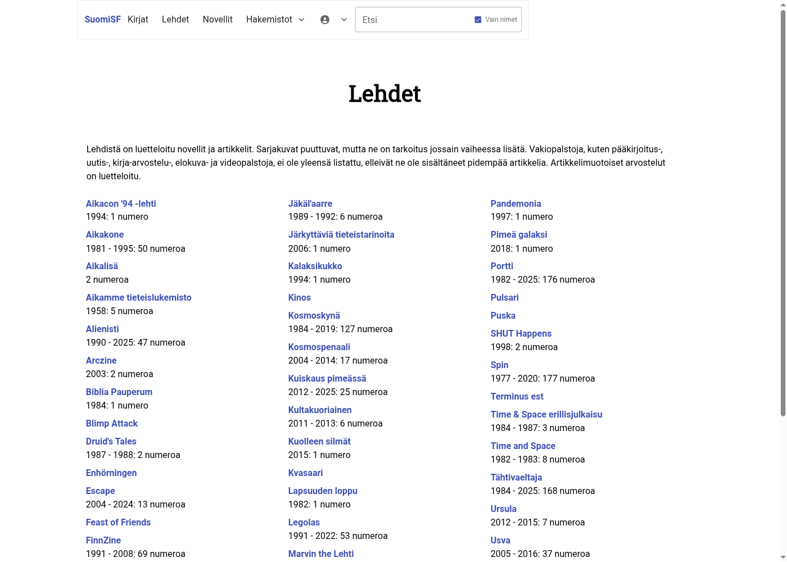 | 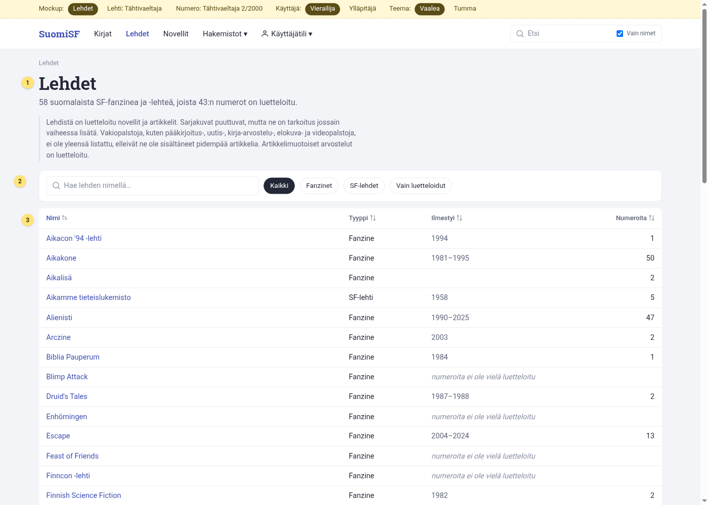 | 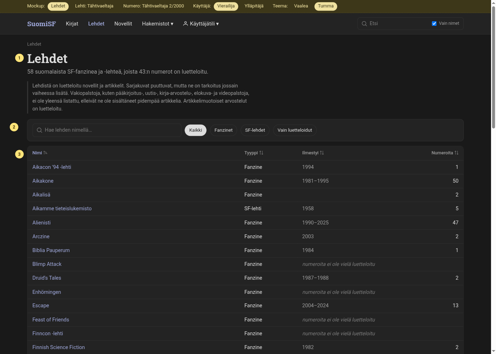 |
| 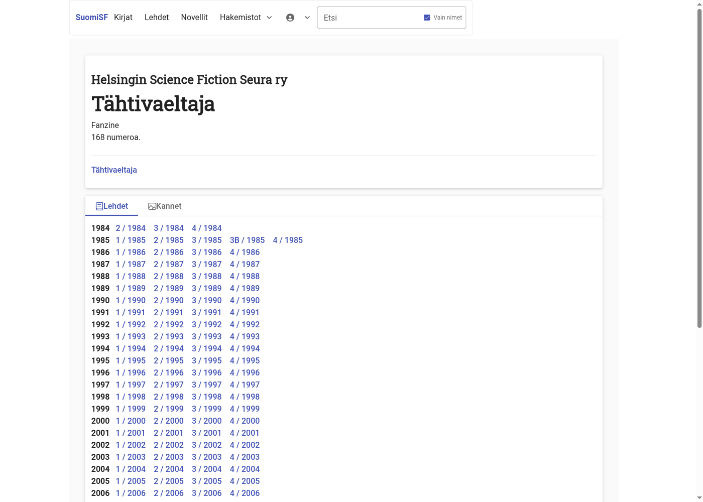 | 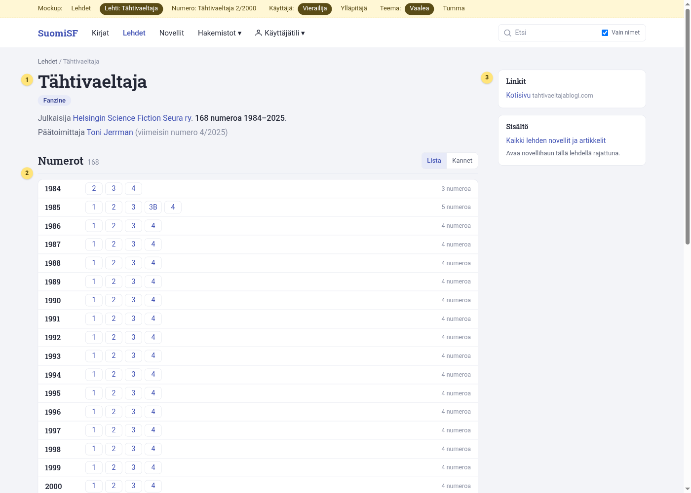 | 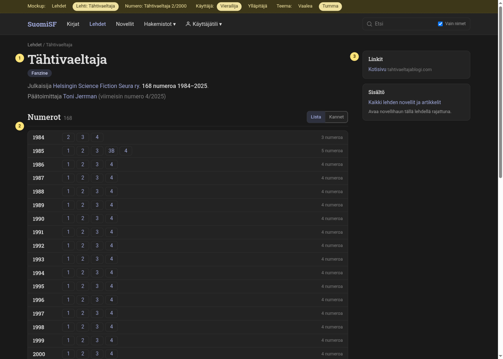 |
| 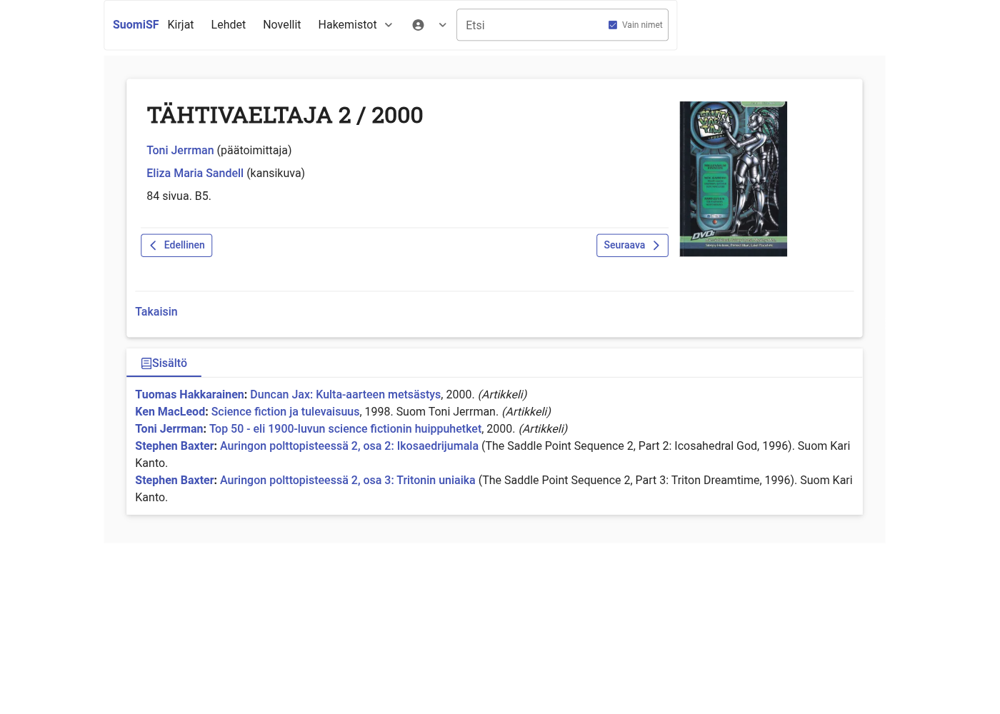 | 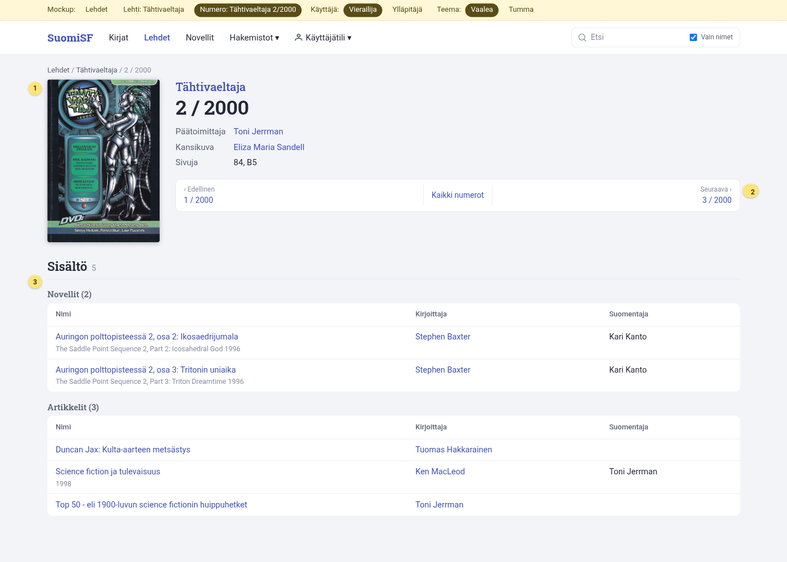 | 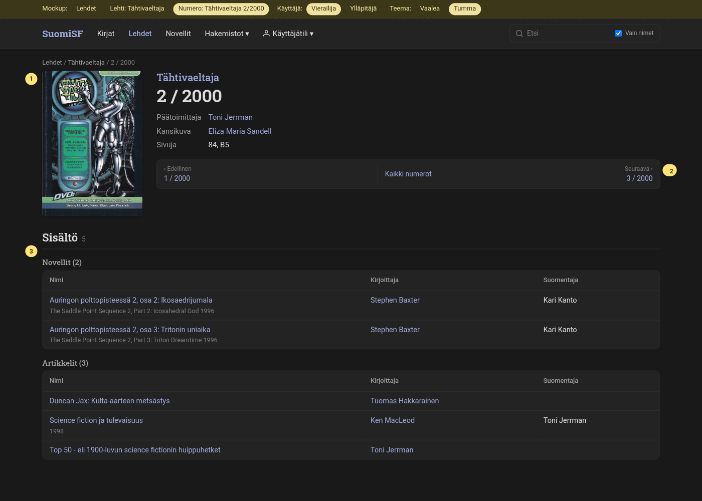 |
| 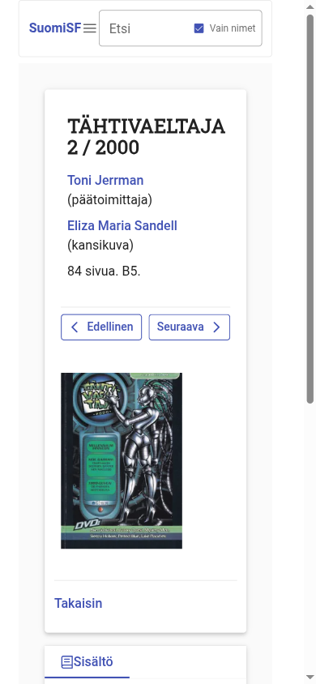 | 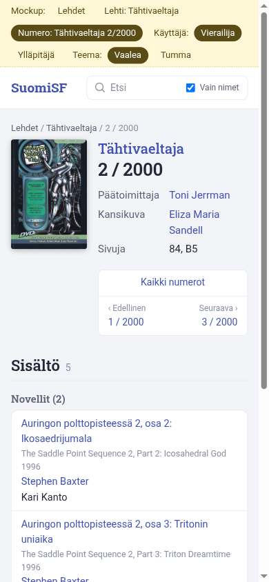 | 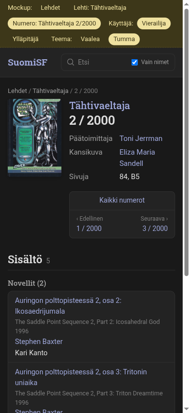 |

More: [before, covers tab](../images/magazines/before-magazine-covers.png) · [after, Kannet view](../images/magazines/after-magazine-covers.png) ([dark](../images/magazines/after-magazine-covers-dark.png)) ·
phones: [list](../images/magazines/after-list-mobile.png), [magazine](../images/magazines/after-magazine-mobile.png) ([before](../images/magazines/before-magazine-mobile.png), [before list](../images/magazines/before-list-mobile.png)).

## What's wrong today

**List (`/magazines`)**
1. **Three alphabetical columns** of names with "1984 - 2025: 168 numeroa" under each: no type, no sorting (most issues, longest running), no search.
2. **Magazines with no catalogued issues** (15 of 58, e.g. Blimp Attack, Enhörningen) show only a name with nothing under it, so they look broken.
3. Centred title; the intro paragraph is good and stays.

**Magazine (`/magazines/:id`)**
4. **Every issue link repeats the year** that is already the row label ("1984 2 / 1984 3 / 1984 …").
5. **The publisher isn't a link;** the homepage link is labelled with the magazine's own name, so it doesn't say where it goes.
6. **"Kannet" is a wall of images without numbers** or years.
7. Little else: no years in the header, nothing about the contents.

**Issue (`/issues/:id`)**
8. **Uppercase title** ("TÄHTIVAELTAJA 2 / 2000"), the magazine name not a link, a "Takaisin" link that just goes back in history.
9. **Previous / next are bare buttons** that don't say which issue they lead to.
10. **Contents in a "Sisältö" tab as text lines** ("Ken MacLeod: Science fiction ja tulevaisuus, 1998. Suom Toni Jerrman. (Artikkeli)"), stories and articles mixed.

## Proposed layout

**List**
1. Header "Lehdet" with a count sentence ("58 … joista 43:n numerot on luetteloitu") and the existing intro as a quiet note.
2. Filter bar: name search, type chips (Kaikki, Fanzinet, SF-lehdet), "Vain luetteloidut".
3. Table: name, type, years, number of issues; every column sorts; magazines without issues say "numeroita ei ole vielä luetteloitu" instead of an empty row.
   State in the URL; cards on a phone.

**Magazine**
1. Header: name, type chip, one line: publisher (linked), number of issues and years, ISSN; a second line with the **current editor**
   (the editor of the latest issue, e.g. "Päätoimittaja Toni Jerrman (viimeisin numero 4/2025)"); the description under it.
2. **Issues by year, numbers only:** one row per year with the issue numbers as small buttons (the full name in the tooltip) and the count on the right.
   **Lista** is the default (text first); **Kannet** shows the covers by year with the number under each.
3. Sidebar: "Kotisivu" with the address shown, and "Kaikki lehden novellit ja artikkelit", which opens the short story index filtered by this magazine.

**Issue**
1. Header: cover on the left, magazine name (linked) above the issue number, editor and cover artist as labelled rows ("Päätoimittaja", "Kansikuva"),
   pages and size; breadcrumb instead of "Takaisin".
2. **Named navigation:** "‹ Edellinen 1 / 2000 | Kaikki numerot | Seuraava 3 / 2000 ›".
3. **Contents grouped by type** (Novellit, Artikkelit, Runot…) as tables with title (original title and year under it), author and translator.
   All groups use the same column widths. Admins keep the SpeedDial (edit issue, edit contents, delete).

## Shared principles used or added

Uses: filters above lists, state in the URL, natural order (issues in number order), text first (Lista default, Kannet as an option),
named previous / next (as on the work page's series navigator), tabular data as tables and cards on a phone, mixed-case titles, dark theme, page width.

No new rules.

## Implementation steps

1. **Backend:** the list response adds the year span and issue count per magazine (it already returns all issues; a lighter response would do).
   The magazine response adds the current editor (the "Päätoimittaja" of the latest issue).
2. **List page:** the shared filter bar and table; the empty-magazine text.
3. **Magazine page:** header facts, year rows with short issue numbers (pure `shortIssueNumber("2 / 1984")` → "2", Vitest), Lista / Kannet in the URL.
4. **Issue page:** header with labelled people, named previous / next, contents grouped by type in tables.
5. **Tests and wiki:** Playwright for the list filters, the year rows, the named navigation and the content groups; update `SuomiSF‐ohje.md`.

## Tests

- Vitest: `shortIssueNumber` ("2 / 1984" → "2", "3B / 1985" → "3B", odd formats unchanged), grouping contents by type.
- Playwright: Tähtivaeltaja shows its current editor; the list sorts by issue count; empty magazines show the note; Tähtivaeltaja opens in Lista with 1984 as the first row; the issue page links
  to 1 / 2000 and 3 / 2000 by name; contents show "Novellit (2)" and "Artikkelit (3)".

## Open questions

_None._

## Decisions

2026-11-22, project owner:
- The backend change (year span and issue count in the list, current editor in the magazine response) is fine.
- No editors over time; the magazine page shows only the current editor.
