# Login, password and FAQ

**Routes:** `/login`, `/register` (missing today), `/forgot-password`, `/reset-password`, `/faq` · **Code:** `src/features/user/components/login-view.tsx`,
`register-view.tsx`, `forgot-password-view.tsx`, `reset-password-view.tsx`, `src/features/user/utils/password-rules.ts`, `src/components/mainmenu.tsx`
(login and register dialogs), `src/faq.tsx`; backend `app/impl_users.py`
**Status:** Agreed · **Updated:** 2026-11-23
**Samples:** https://www.sf-bibliografia.fi/login, /forgot-password, /reset-password without a token, /faq.
The suggestions page (`/suggestions`) was in this plan's original scope; it stays as it is for now (decided).
**Mockup:** [`../mockups/misc.html`](../mockups/misc.html): `?v=login`, `?v=register`, `?v=forgot`, `?v=faq`. The yellow bar switches light / dark.

| Before | After (mockup, light) | After (mockup, dark) |
|---|---|---|
| 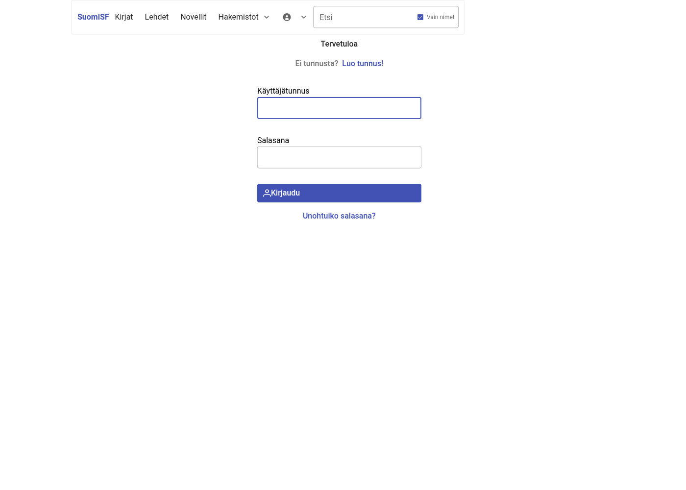 | 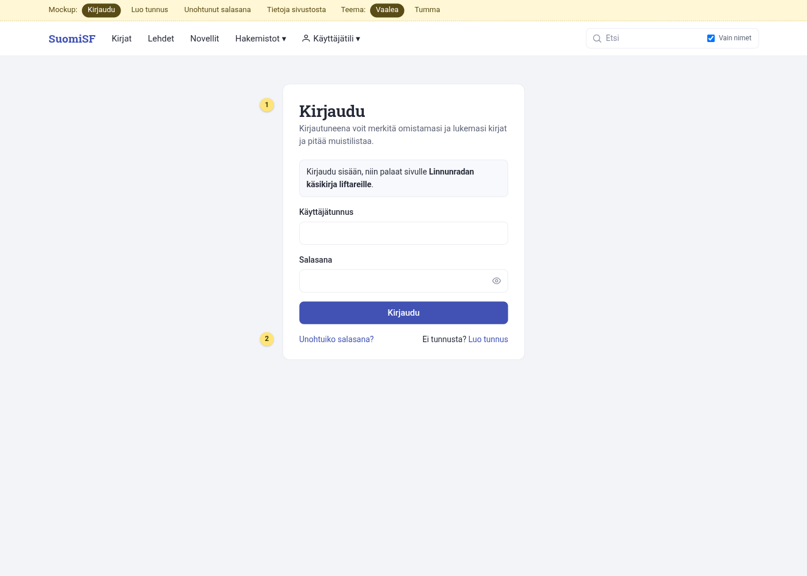 | 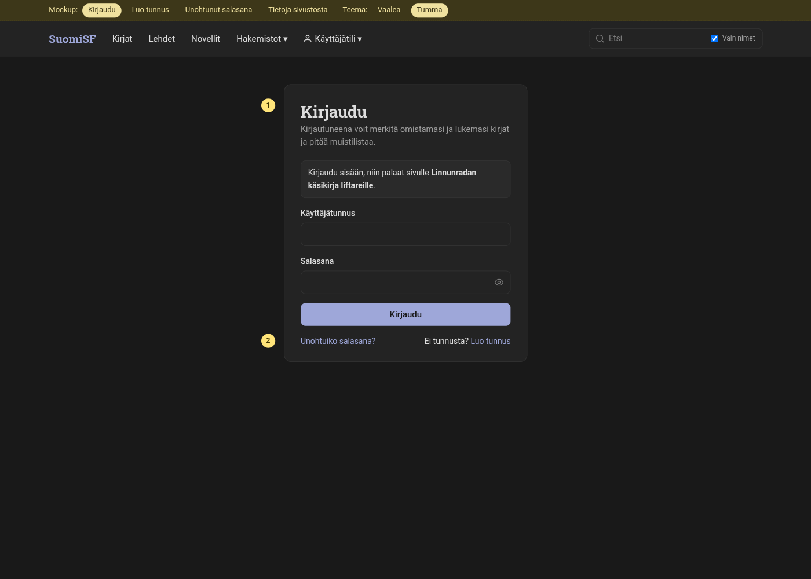 |
| 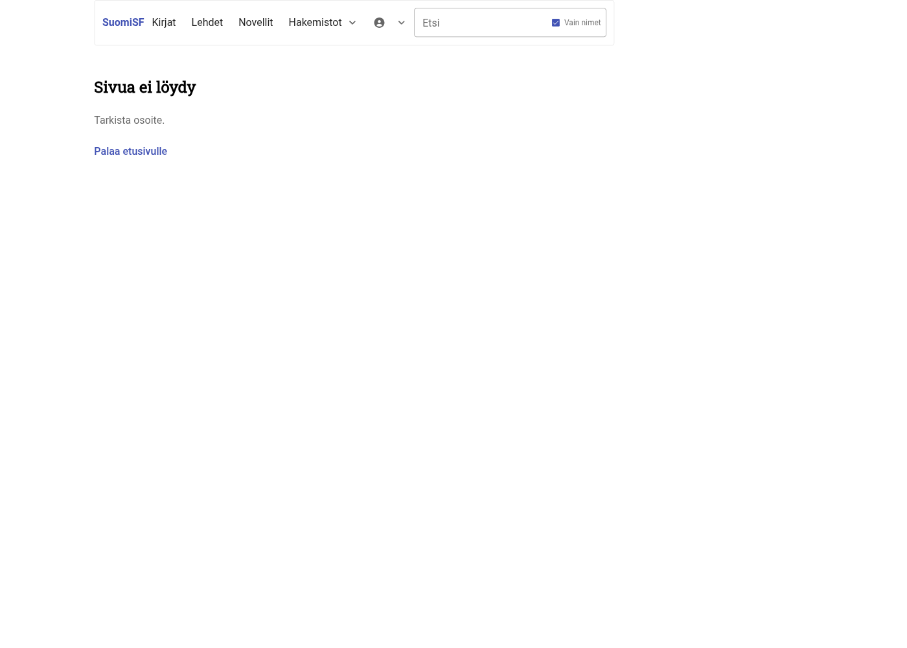 | 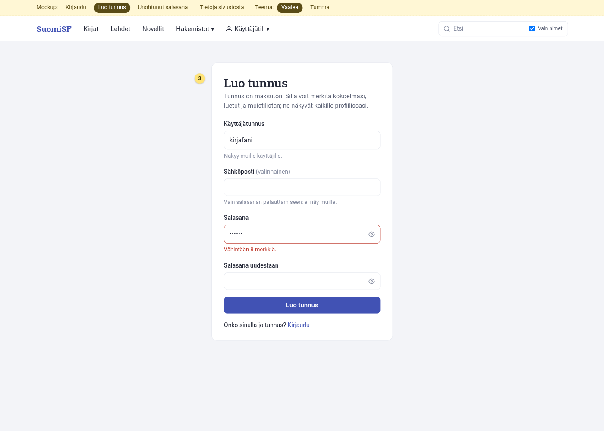 | 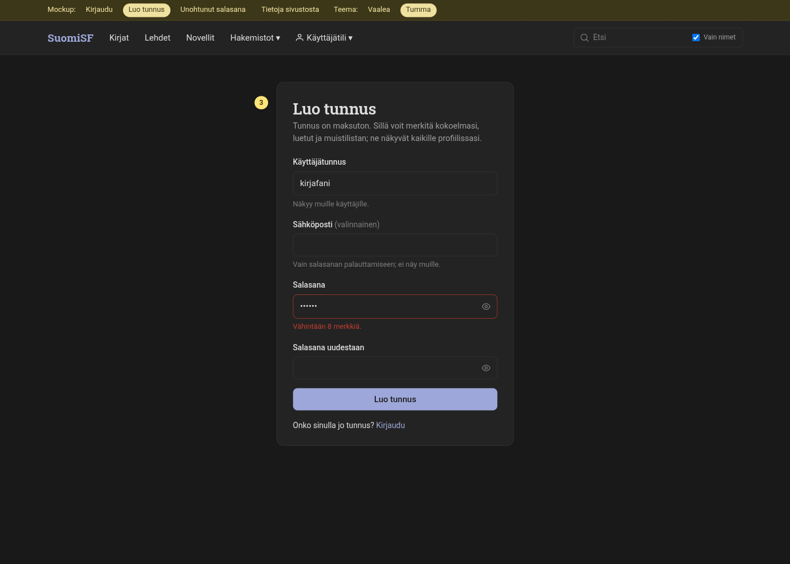 |
| 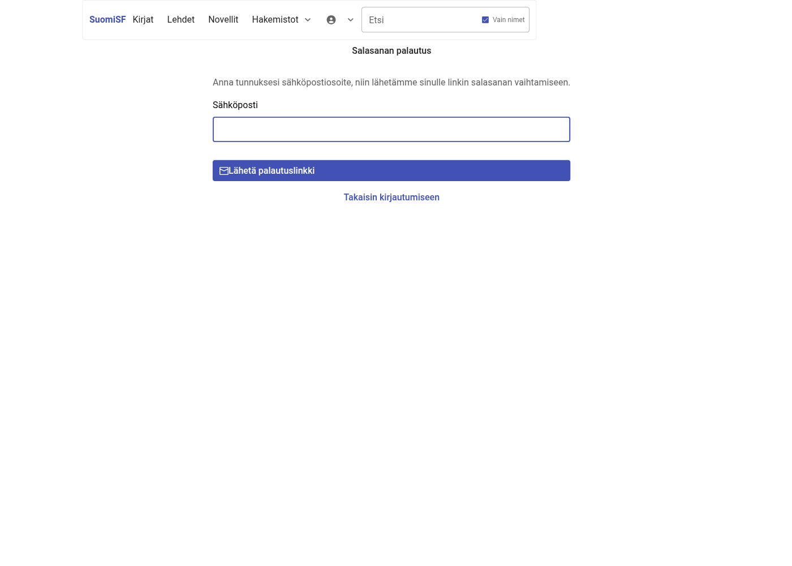 | 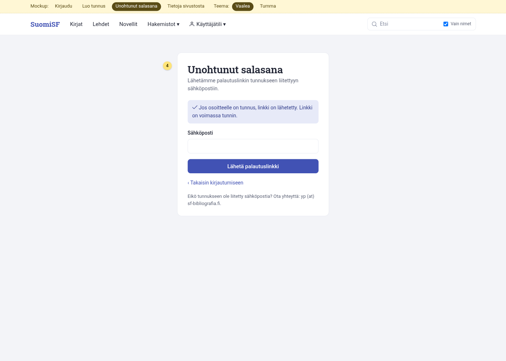 | 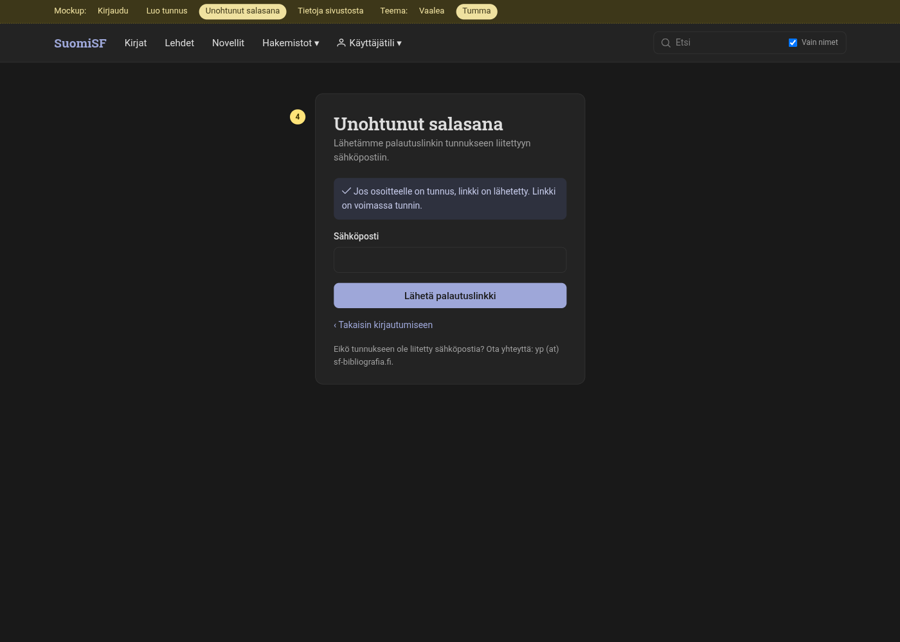 |
| 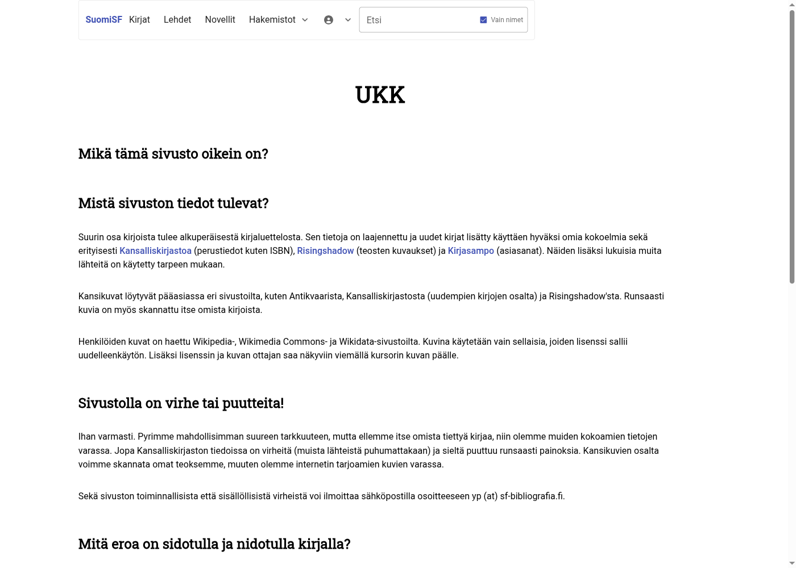 | 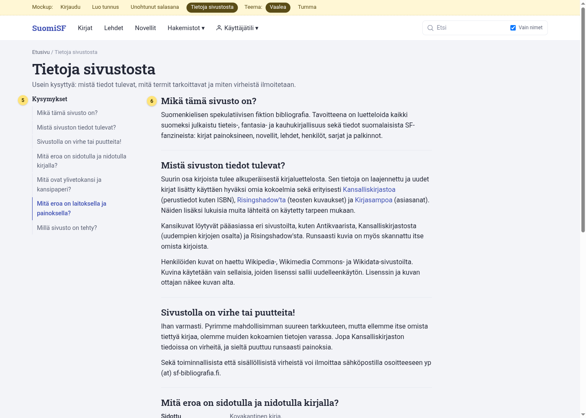 | 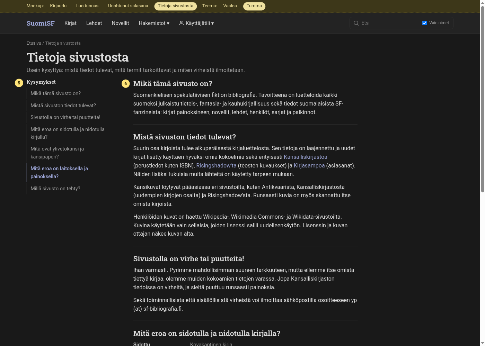 |
| 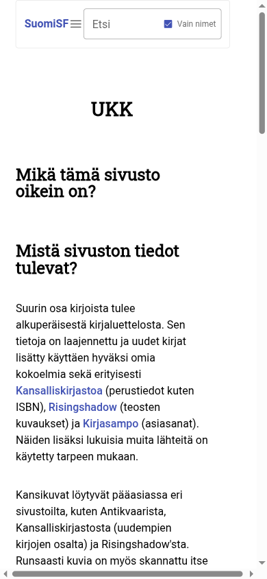 | 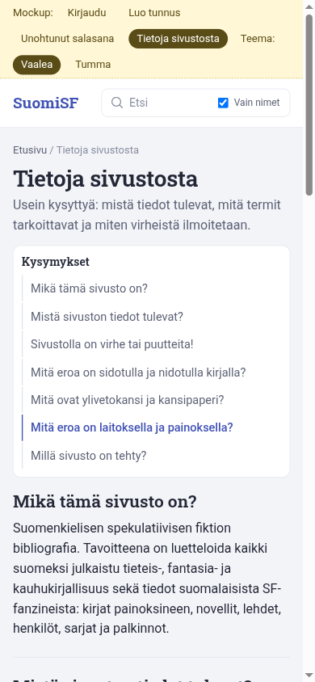 | 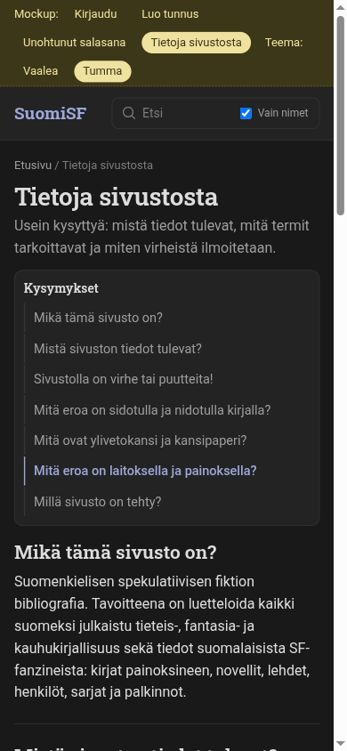 |

More: phones: [login before](../images/misc/before-login-mobile.png), [login after](../images/misc/after-login-mobile.png) ([dark](../images/misc/after-login-mobile-dark.png)) ·
[reset page without a token, before](../images/misc/before-reset-notoken.png).

## What's wrong today

**Login and account**
1. **"Luo tunnus!" is a dead link:** the login page and the login dialog link to `/register`, which has no route and shows "Sivua ei löydy".
   Registering works only from the Käyttäjätili menu's dialog.
2. **Login is both a page and a dialog** with the same content; the page has a small "Tervetuloa" title and no word on what an account is for.
3. After logging in from the page, the user doesn't return to where they were.
4. Register: the email label says it is for password reset but not that it is optional or hidden from others; the password rule (8–128 characters)
   shows only after a failed attempt.

**FAQ (`/faq`)**
5. **The first question, "Mikä tämä sivusto oikein on?", has no answer** (the heading is there, the text isn't).
6. **The title is the abbreviation "UKK"** while the front page links to it as "Tietoja sivustosta"; centred title; 1,996 px of headings and
   paragraphs with no list of questions and no links to a single answer.
7. Definitions (sidottu / nidottu, ylivetokansi / kansipaperi, laitos / painos) are buried in prose.

## Proposed layout

**Account pages:** one centred card per task (Kirjaudu, Luo tunnus, Unohtunut salasana, Aseta uusi salasana), same width and parts:
title, one sentence on what the page is for, fields with hints, one primary button, links to the other tasks.
1. **Kirjaudu:** "Kirjautuneena voit merkitä omistamasi ja lukemasi kirjat ja pitää muistilistaa." When the user came from another page,
   a note says where they'll return ("…niin palaat sivulle *Linnunradan käsikirja liftareille*"), and they do (`/login?paluu=…`).
   Show / hide password.
2. Links: "Unohtuiko salasana?" and "Ei tunnusta? Luo tunnus" (fixed, to a real `/register` route).
3. **Luo tunnus:** hints under the fields ("Näkyy muille käyttäjille", "Valinnainen. Vain salasanan palauttamiseen; ei näy muille"),
   the password rule shown before submitting, errors under the field. States that collections are public (agreed in the users plan).
4. **Unohtunut salasana:** the existing neutral confirmation (the reply doesn't reveal whether the address exists), plus "Linkki on voimassa tunnin"
   (the backend's `PASSWORD_RESET_MAX_AGE`, 3,600 s) and what to do if the account has no email.
   The menu's Kirjaudu and Luo tunnus open these pages instead of dialogs (decided).

**Tietoja sivustosta (`/faq`)**
5. Title "Tietoja sivustosta" (as the front page link), a one-line intro, and a **list of questions** on the left that links to each answer
   and marks the one in view; on a phone it sits above the answers.
6. **Answers in a readable column** (about 72 characters a line), each with an anchor (`/faq#laitos`) so an answer can be linked from elsewhere,
   for example from the edition table's "Laitos" heading. The missing first answer is written (the front page's description, shortened).
   Term pairs become short definition lists, with the longer explanation kept as text.

## Shared principles used or added

Uses: main menu the same on every page, mixed-case titles, errors with a message, in-app navigation, dark theme, page width.

No new rules.

## Implementation steps

1. **Routes:** add `/register`; `/login` and `/register` take a return path; the menu links to the pages and the two dialogs in `mainmenu.tsx` are removed.
2. **Account card:** one small layout component for the four account pages; show / hide password; field hints from `password-rules.ts`.
3. **FAQ:** move the content to a data list (id, question, answer) so the question list and anchors come from one place; write the first answer.
4. **Tests and wiki:** Playwright for the register link, return after login, FAQ anchors; Vitest for the field hints; update `SuomiSF‐ohje.md`.

## Tests

- Playwright: "Luo tunnus" on `/login` opens `/register`; logging in from a work page returns to it; `/faq#laitos` scrolls to that answer;
  every FAQ question has an answer.
- Vitest: the register form shows "Vähintään 8 merkkiä" before submitting a 6-character password.

## Open questions

_None._

## Decisions

2026-11-23, project owner:
- Kirjaudu and Luo tunnus in the menu open the account pages; the login and register dialogs go.
- The first FAQ answer is written as in the mockup.
- The suggestions page (`/suggestions`) stays as it is for now.
