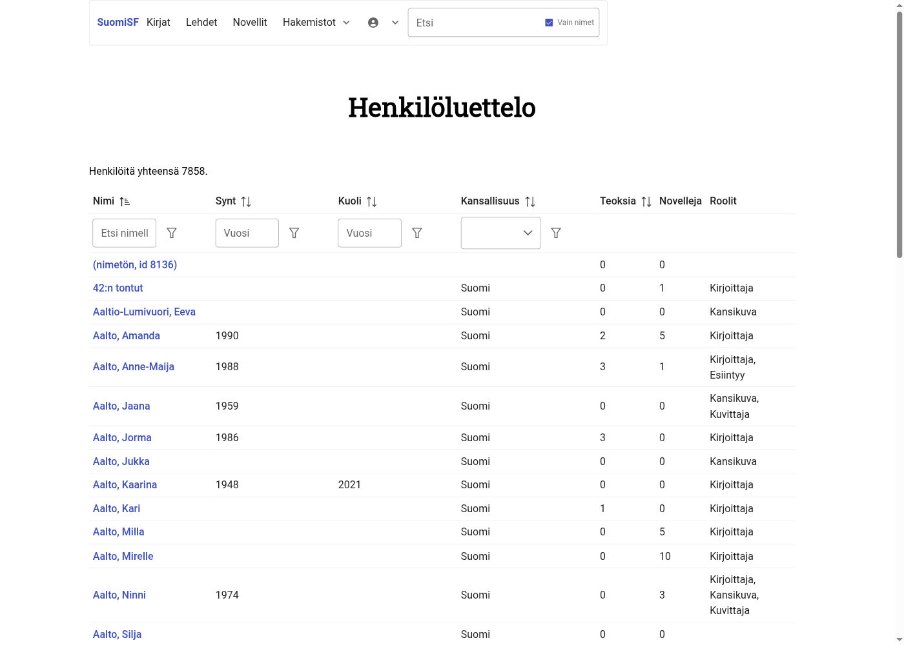
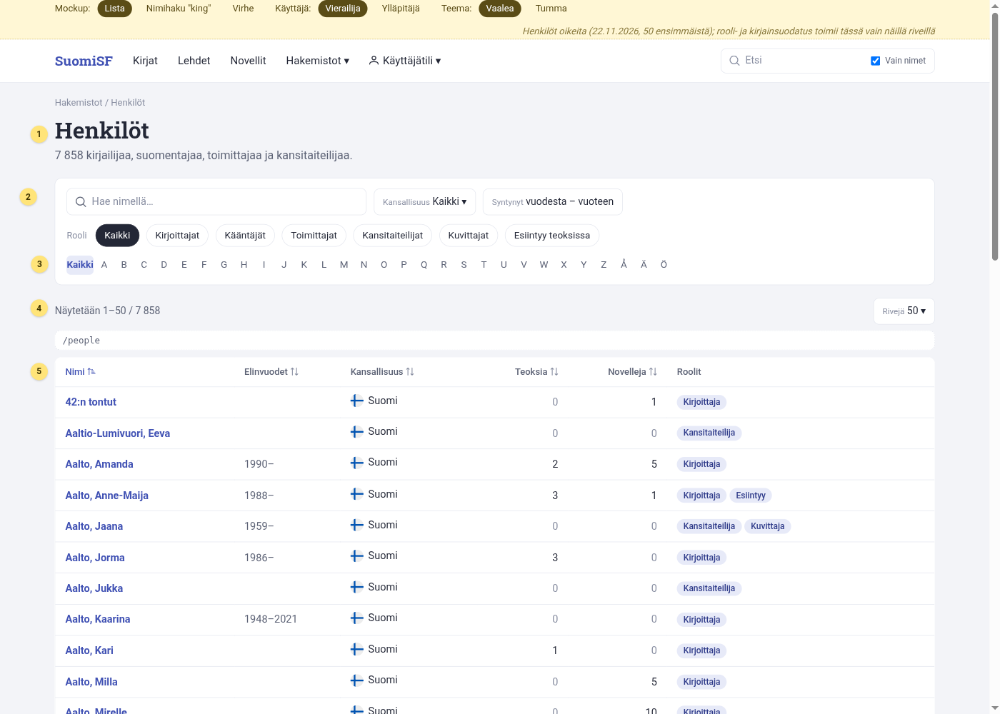
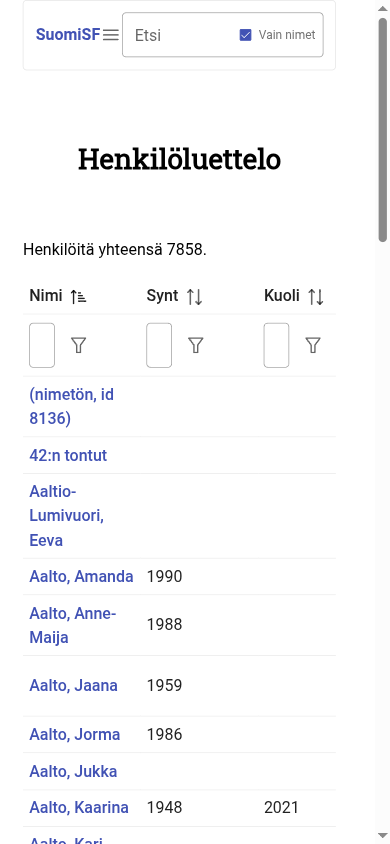
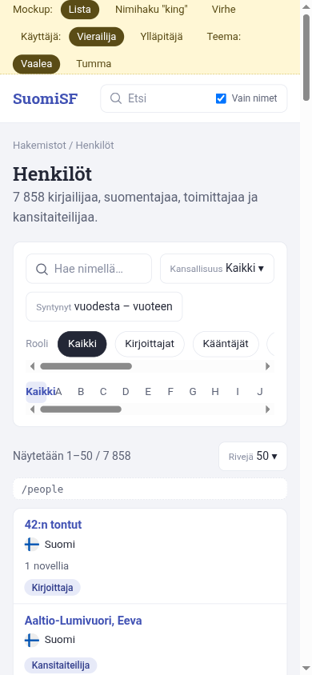

# People list

**Route:** `/people` · **Code:** `src/features/person/routes/people-page.tsx` (PrimeReact `DataTable`, lazy loading);
backend `GET /api/people/` in `../suomisf/app/impl_people.py` (`list_people`, `_filter_person_query`)
**Status:** Agreed · **Updated:** 2026-11-22
**Sample:** https://www.sf-bibliografia.fi/people (7,858 people).
**Mockup:** [`../mockups/people.html`](../mockups/people.html) with [`people-data.js`](../mockups/people-data.js): the first 50 people and a name search for "king",
real data. The yellow bar switches list / name search / error, visitor / admin, light / dark. In the mockup the role and letter filters
only work on those 50 rows.

| Before | After (mockup) |
|---|---|
|  |  |
|  |  |

More: [before, stuck after sorting by Teoksia](../images/people-list/before-sort-stuck.png) · [after, translators sorted by birth year](../images/people-list/after-filtered.png) ·
[after, name search](../images/people-list/after-search.png) · [after, error message](../images/people-list/after-error.png) ·
[after, admin (nameless record shown)](../images/people-list/after-admin.png) · [after, whole page](../images/people-list/after-desktop-full.png).
Dark theme: [list](../images/people-list/after-desktop-dark.png), [filtered](../images/people-list/after-filtered-dark.png),
[phone](../images/people-list/after-mobile-dark.png), [error](../images/people-list/after-error-dark.png).

## Bugs found on the live site

These are fixed as part of the people list update (decided), not separately:

1. **Sorting by "Teoksia" breaks the page.** The API returns *500 Internal Server Error*, and the table stays covered by its loading overlay
   until the page is reloaded ([screenshot](../images/people-list/before-sort-stuck.png)).
   - Backend: the `workcount` sort does `.join(Person.works).order_by(func.count(Work.id))` without a `GROUP BY`, which PostgreSQL rejects.
     The query runs after the `try` block (when the page is sliced), so the error isn't caught. It also ignores the sort direction.
   - Frontend: `getPeople()` catches the error but never calls `setLoading(false)`, so the spinner never goes away.
2. **The roles filter returns 500 for every role** (`filters_roles_value=Kääntäjä` etc.). The page has no control for it, so nobody hits it today,
   but the redesign needs it.
3. **Sorting by nationality ignores the direction** (always A–Ö), and **year sorts put empty years first** when sorting newest first.
4. **Filter parameters must come in a fixed order:** a `filters_X_matchMode` before its `filters_X_value` gives a 500. PrimeReact happens to send
   them in the right order, but the API should accept either.

## What's wrong today

5. **Nothing is remembered.** Filters, sort and page live only in component state, so reload, back and shared links all start over
   (agreed rule: keep them in the URL).
6. **No way to filter by role**, the main reason to open this list ("all translators", "cover artists"), although the backend has a roles filter.
7. **Filters squeezed into column headers:** small inputs with funnel buttons; birth and death years only match an exact year.
8. **Unusable on a phone:** only three columns fit, the rest scroll sideways, and the filter inputs shrink to slivers.
9. **"Teoksia 0"** for translators and cover artists looks like an error: the count only covers works the person wrote.
10. **A record with no name** sorts first as "(nimetön, id 8136)" for every visitor.
11. **Name search matches anywhere** in the name ("king" finds Kingsley Amis, Buckingham, Hawking), and there's no way to jump to a letter.
12. Centred uppercase-style title and "Henkilöitä yhteensä 7858." without a thousands separator.

## Proposed layout

```
Hakemistot / Henkilöt
Henkilöt
7 858 kirjailijaa, suomentajaa, toimittajaa ja kansitaiteilijaa.
┌──────────────────────────────────────────────────────────────────────────┐
│ [🔍 Hae nimellä…          ] [Kansallisuus: Kaikki ▾] [Syntynyt: vuodesta – vuoteen] │
│ Rooli (Kaikki) (Kirjoittajat) (Kääntäjät) (Toimittajat) (Kansitaiteilijat) …     │
│ Kaikki A B C D E F G H I J K L M N O P Q R S T U V W X Y Z Å Ä Ö                  │
└──────────────────────────────────────────────────────────────────────────┘
Näytetään 1–50 / 7 858                                         [Rivejä 50 ▾]
/people?rooli=kaantaja&jarjestys=-syntynyt
 Nimi ↑         Elinvuodet   Kansallisuus    Teoksia  Novelleja  Roolit
 Aalto, Amanda  1990–        ● Suomi               2          5  (Kirjoittaja)
 Aalto, Jaana   1959–        ● Suomi               0          0  (Kansitaiteilija)(Kuvittaja)
Sivu 1 / 158                                       [1] 2 3 … 158 ›
```

The numbers 1–6 in the mockup screenshots match the sections below.

1. **Header:** "Henkilöt" left-aligned like other pages, with a one-line description and the total (`fi-FI` thousands separator).
2. **Filter bar above the table** instead of inputs in the column headers: name search, nationality, birth-year range, and **role chips**
   (Kirjoittajat, Kääntäjät, Toimittajat, Kansitaiteilijat, Kuvittajat, Esiintyy teoksissa). "Tyhjennä rajaukset" appears when anything is set.
3. **Letter bar A–Ö:** jumps to names starting with that letter (needs a "starts with" match in the backend).
4. **Everything in the URL** with readable values: `/people?rooli=kaantaja&kirjain=a&jarjestys=-syntynyt&sivu=2`.
   Reload, back and shared links keep the view (agreed rule). Rows per page: 50 / 100 / 200.
5. **Table:** name, life years together ("1922–1995"; "1990–" for the living), nationality with the same round flag as the person page,
   works and short stories (zero in grey, not hidden), roles as role chips (agreed chip style). **Translators, editors, cover artists and illustrators
   get counts too** (translations, edited books, covers, illustrated books; decided). The count columns follow the role filter: with "Kääntäjät"
   selected the table shows and sorts by "Käännöksiä", with "Kansitaiteilijat" by "Kansia"; with no role selected it shows works and short stories.
   On a phone the card lists every count that isn't zero. No portraits in the list (decided). Every column with data sorts both ways,
   empty values always last. On a phone each person is a small card: name and years, nationality, counts that aren't zero, role chips.
   The nameless record shows only to admins, marked "nimetön henkilö (id …)", so it can be fixed.
6. **Errors say what happened:** if loading fails, the table is replaced by a message with "Yritä uudelleen" and "palaa nimijärjestykseen",
   instead of a spinner that never stops ([screenshot](../images/people-list/after-error.png)).

## Shared principles used or added

Uses from [principles.md](../principles.md): state in the URL, filter pills, role chips, tabular data as a table on desktop and cards on a phone,
main menu per role, dark theme, page width, no uppercase titles.

New rules from this plan:
- Filters sit in a bar above a list, not inside column headers.
- Sorting puts empty values last in both directions.
- A failed request shows a message with a way to retry; a loading indicator never stays up after an error.

## Implementation steps

1. **Backend fixes and new counts** (bugs 1–4): add per-person counts for translations, edited books, covers and illustrations to the list response
   (and as sort fields); sort by every count with a grouped subquery and the requested direction; fix the roles filter;
   honour the direction for nationality; `NULLS LAST` for every sort; accept filter parameters in any order. Add a `startsWith` match mode
   for the name (letter bar) and a range for birth year. Tests in the backend for each sort and filter.
2. **Frontend error handling**: `setLoading(false)` and an error message in `people-page.tsx`, so a failed request can't freeze the page.
3. **URL state**: read and write filters, sort, page and rows with `useSearchParams` (pure `peopleParamsToQuery` / `queryToPeopleParams`, Vitest tests).
4. **Filter bar and letter bar** with PrimeReact `InputText`, `Dropdown`, `SelectButton`; remove the header filters.
5. **Table and phone cards**: keep `DataTable` (lazy, paginator) with `responsiveLayout="stack"`, or a plain table; life-years, flag and role-chip templates.
6. **Tests and wiki**: Playwright for sorting every column, the role filter, URL state surviving reload and back, the error message, and the phone layout;
   update the people list part of `SuomiSF‐ohje.md`.

## Tests

- Backend: sorting by name, years, nationality and every count in both directions with empty values last; the new role counts; roles filter; parameter order.
- Vitest: URL ↔ params round trip, life-years formatting ("1990–", "?–1950").
- Playwright: sort by Teoksia shows the most prolific first; with "Kääntäjät" selected the table sorts by Käännöksiä; role chip filters and appears in the URL; reload keeps the view; a failing request shows the message;
  a visitor doesn't see the nameless record, an admin does; no sideways scroll on a phone.

## Open questions

_None._

## Decisions

2026-11-22, project owner:
- The bugs (Teoksia sort, stuck spinner, roles filter, sort direction and empty values, parameter order) are fixed as part of the people list update.
- Translators, editors, cover artists and illustrators get counts for their own work (backend change); the count columns follow the role filter.
- No portraits in lists.

The mockup doesn't show the new role counts: the list API doesn't return them yet, and invented numbers would be misleading.
