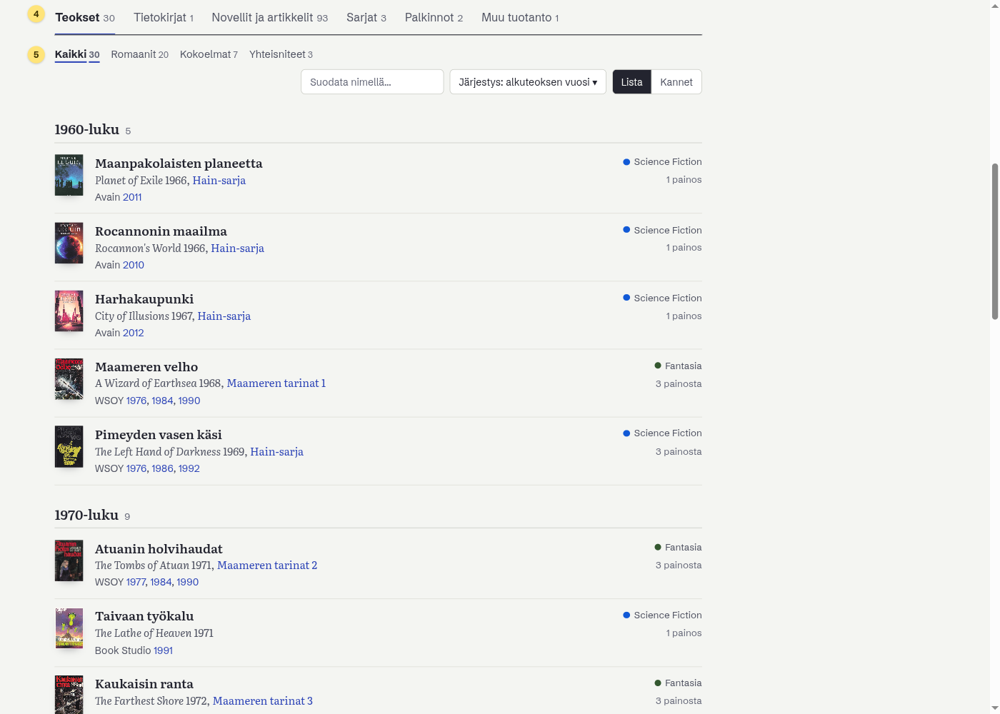
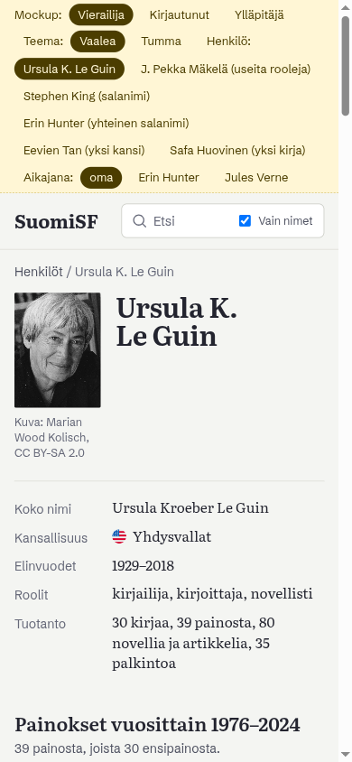
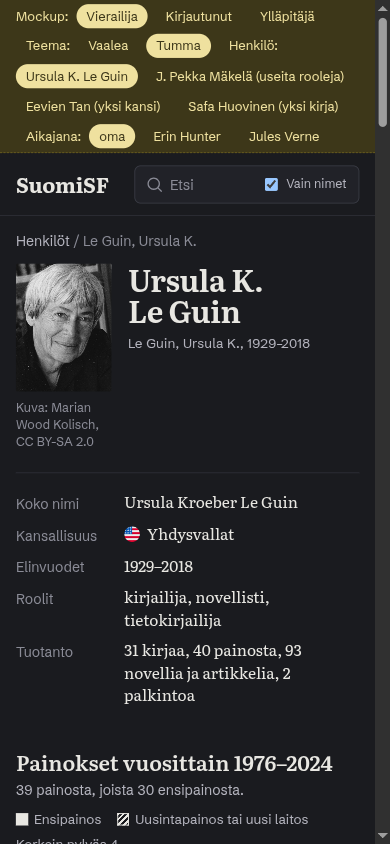

# Person page: visual identity proposal

**Route:** `/people/:id` · **Builds on:** the agreed [person plan](person.md) (all its behaviour stays: bar-height timeline, main tabs by kind of record,
role tabs as a second row, toolbar inside the tab, compact rows, URL state, the phone filter sheet, only the tab row sticky, missing data hidden)
**Companions:** [work-identity.md](work-identity.md) and [front-identity.md](front-identity.md), the same identity on the work page and the front page (same tokens, fonts and rules)
**Status:** Proposal; implemented as an admin-only trial of the person page (2026-11-24, see [person.md](person.md#implementation-2026-11-24-an-admin-only-trial)) · **Updated:** 2026-11-24
**Mockup:** [`../mockups/person-identity.html`](../mockups/person-identity.html) with [`person-identity-data.js`](../mockups/person-identity-data.js) and the shared
[`timeline-data.js`](../mockups/timeline-data.js), real data: `?p=leguin` Ursula K. Le Guin, `?p=jpm` J. Pekka Mäkelä (writer and translator, no portrait), `?p=king` Stephen King (pen name Richard Bachman),
`?p=hunter` Erin Hunter (a pen name shared by eight writers), `&osio=henkilosta` the Henkilöstä tab (books and articles about the person),
`?p=tan` Eevien Tan and `?p=huo` Safa Huovinen (one cover each, from the sparse data check). `&tl=hunter` and `&tl=verne` swap in the timeline worst cases;
`&rooli=Kääntänyt` opens Mäkelä's translations. The yellow bar also switches visitor / logged in / admin and light / dark.

Like the work page proposal, this changes how the page **looks**, not what it does.

| Agreed design (current plan) | This proposal, light | This proposal, dark |
|---|---|---|
|  |  |  |
|  |  |  |
|  |  |  |

More: [role tabs, Mäkelä](../images/person-identity/roles.png) · [his translations](../images/person-identity/roles-translations.png)
· [timeline, Erin Hunter](../images/person-identity/timeline-hunter.png) · [timeline, Jules Verne](../images/person-identity/timeline-verne.png)
· [one cover, Eevien Tan](../images/person-identity/sparse-tan.png) · [one book, Safa Huovinen](../images/person-identity/sparse-huo.png)
· [1,000 px](../images/person-identity/desktop-1000.png) · [phone, toolbar folded](../images/person-identity/mobile-toolbar.png)
· [phone, only the tab row sticks](../images/person-identity/mobile-scrolled.png) · [whole page](../images/person-identity/desktop-full.png)
· [pen name, Stephen King](../images/person-identity/king.png) · [his books as Richard Bachman](../images/person-identity/king-pen-name.png)
· [shared pen name, Erin Hunter](../images/person-identity/hunter.png) · [Henkilöstä, Le Guin](../images/person-identity/about.png)
· [Henkilöstä, King](../images/person-identity/about-king.png) (each also `-dark`).

## Starting point

- **The person page's job:** say who the person is, show their Finnish publishing history at a glance, then list their books by role.
- **Vernacular it borrows from:** the library **authority record**: one name and labelled facts. The page shows the name as people read it;
  the catalogue's surname-first heading with dates was dropped (decided 2026-11-24): the years are in the facts, and the name once is enough.

## What changes, section by section (numbers match the mockup)

1. **The record:** name in Literata at 56 px, then a labelled list: Koko nimi, **Salanimi / Salanimet** (names this person used, as links, then
   the free-text other names), **Oikea henkilö / Oikeat henkilöt** (on a pen name's record: Erin Hunter lists eight writers), Kansallisuus,
   Elinvuodet, Roolit, Tuotanto. **The agreed stats box becomes the "Tuotanto" line** ("30 kirjaa, 39 painosta, 80 novellia ja artikkelia,
   35 palkintoa"), and the role chips become plain text ("kirjailija, kirjoittaja, novellisti", the live page's names and order). Counts and roles follow the person plan's
   [counts and roles](person.md#proposed-layout) rule (own contributions only, awards for books and stories included). Portrait 168 px with its credit;
   without a portrait the record is one column.
2. **The timeline is the page's one bold element,** drawn in ink: first editions solid, reprints hatched, the picked year in catalogue blue,
   a 2 px ink base line. Behaviour exactly as agreed (all book editions in any role, bins for long spans, a stated scale, a text legend, bars as buttons).
3. **Bio** in the reading face at 18 px, 66 characters a line, clamped to five lines, source after the toggle.
4. **Tabs** as text with counts on a 2 px ink rule; the active tab is bold with a catalogue-blue underline. **Role tabs** (only with more than one role)
   are a small segmented control under them, "Rooli: Kirjoittanut 7 | Kääntänyt 28 | Kansikuva 1".
5. **Toolbar:** type filters as text links with counts (the active one underlined in blue), name filter, sort, Lista / Kannet.
   **The list reads like catalogue entries:** decade headings in Literata on a rule; each row has the title in the reading face, the original title in italics
   with its year and series, then the printings in the interface face ("WSOY 1976, 1984, 1990", each year a link), genre as a dot with its name, and the
   printing count. For translations, the row shows the author and the original year instead. A book published under a pen name adds
   ", nimellä Richard Bachman".
6. **Sidebar without boxes:** genre bars, the most common tags as a comma-separated list with counts, links in two columns, the change history link.

**Sparse people** (Eevien Tan, Safa Huovinen): no portrait column, only the facts that exist, a one-sentence summary instead of the timeline, a heading
("Kansikuvat, 1 kirja") instead of tabs, no toolbar; the sidebar has only links. Same rules as the agreed missing data rule.

**Phone:** portrait 96 px beside the name, the facts full width under them, the timeline at 80 px, only the tab row sticks, the toolbar folds into
"Suodata ja järjestä", and each row's genre and count wrap under the text.

## Page heights (Le Guin, visitor, measured 2026-11-24)

| | Agreed mockup | This proposal | Change |
|---|---|---|---|
| Desktop 1,400 px | 4,032 px | 4,305 px | +7% |
| Phone 390 px | 5,261 px | 6,183 px | +18% |

A smaller increase than on the work page: moving the stats box into the facts list saves space that the larger type uses.

## What this changes in agreed decisions

Each can be taken separately (the first three are shared with the work page proposal):
1. **Fonts and colours** instead of Roboto / Roboto Slab and the PrimeReact indigo themes (a site-wide theme layer).
2. **Boxes:** the sidebar's stats, genre, tag and link boxes lose their frames.
3. **Chips:** roles and tags become text; type filters become text links (the agreed "filter = pill that turns dark when on" rule).
4. **The stats box** moves into the record as the "Tuotanto" line.
5. Page height grows by 8% on desktop and 19% on a phone.

Unchanged: everything the person plan decided about the timeline, tabs, role tabs, filters, URL state, sticky bars, the phone filter sheet and missing data.

## Open questions

- Adopt the identity for the whole site, for the person and work pages as a trial, or not at all? (Same question as on the work page proposal.)
- Roles as text instead of chips?

## Decisions

2026-11-24, project owner:
- No second name line under the heading ("Le Guin, Ursula K., 1929–2018"): the years are in the facts and the name once is enough.
- Pen names belong in the record; counts and roles as decided in the person plan.
- The page uses the site's own background (white, or dark under the dark theme), in the trial and after launch; the grey paper
  `#F4F5F2` / `#131419` is dropped: in the trial it sat as a grey box inside the white menu and margins. Reasons in the
  [work proposal's decisions](work-identity.md#decisions). The mockup and its screenshots still show the grey paper.
