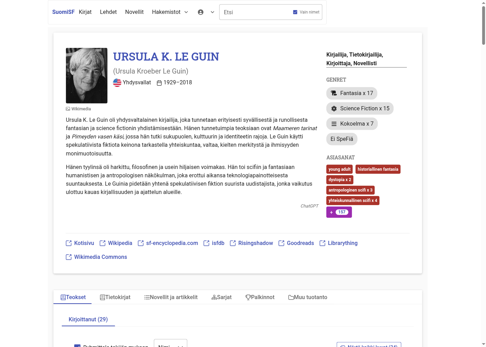
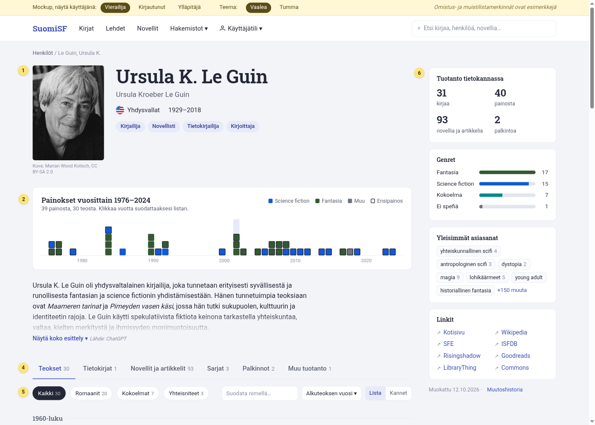
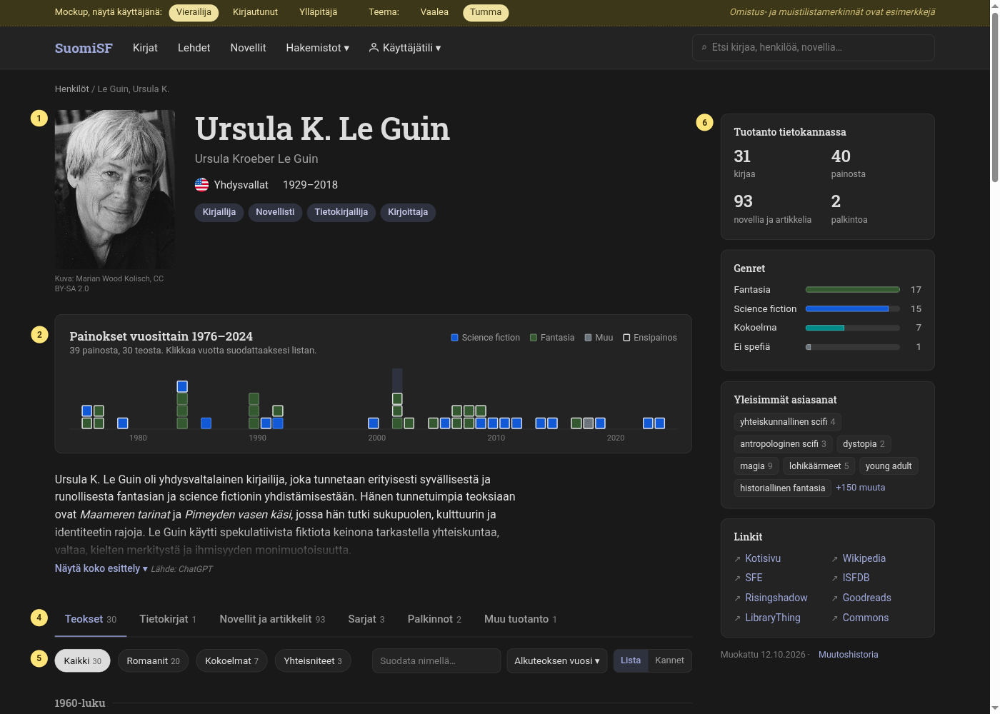
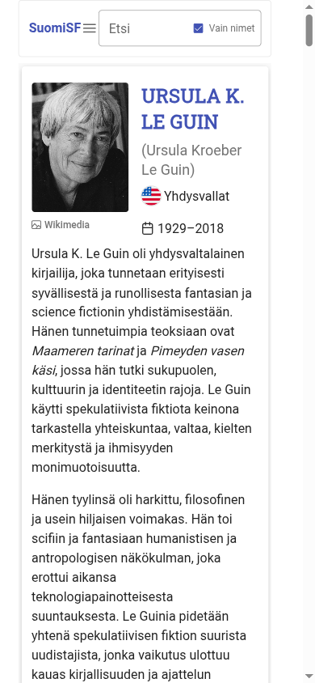
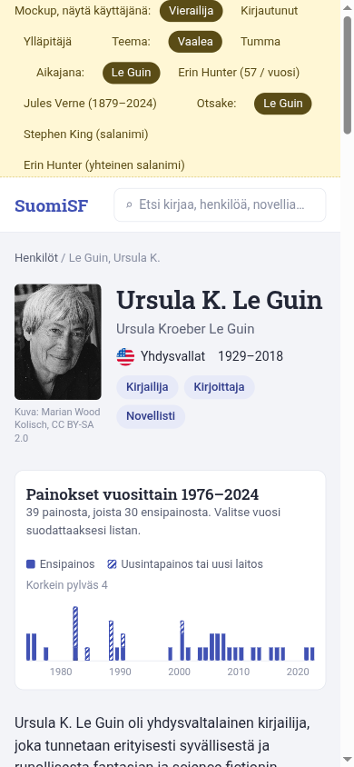

# Person page

**Route:** `/people/:id` · **Code:** `src/features/person/routes/person-page.tsx`, `src/features/person/components/person-details.tsx`, `src/components/contributor-book-control.tsx`
**Status:** Agreed · **Updated:** 2026-11-22
**Sample page:** Ursula K. Le Guin, https://www.sf-bibliografia.fi/people/2435
**Mockup:** [`../mockups/person.html`](../mockups/person.html), built with real Le Guin data from the live API (download and open it in a browser; covers load from the live site).
The yellow bar at the top switches between visitor, logged-in user and admin; ownership and wishlist marks are made-up examples.

| Before | After (mockup, light) | After (mockup, dark) |
|---|---|---|
|  |  |  |
|  |  |  |

Full mockup page: [after-desktop-full.png](../images/person/after-desktop-full.png). Current works list: [before-works.png](../images/person/before-works.png).
Dark theme: [desktop](../images/person/after-desktop-dark.png), [whole page](../images/person/after-desktop-full-dark.png), [phone](../images/person/after-mobile-dark.png), [book list as admin](../images/person/after-admin-list-dark.png).
Book list as admin: [after-admin-list.png](../images/person/after-admin-list.png) (owned ★ and wishlist marks on editions, edit pencil after each title).

## What's wrong today (measured on Le Guin)

1. **Too long.** The page is 8,651 px tall on desktop and 17,391 px on a phone. Each book is a ~260 px card
   (cover carousel, edition list, genre chip, collapsed tags). The mockup is 4,062 / 5,314 px.
   People with long lists go much further: Erin Hunter (94 works, 195 editions) is 26,797 px on desktop and 57,285 px on a phone today,
   Stephen King (88 works, 152 stories) 23,023 / 46,143 px. There is no height budget; compact rows (about 76 px instead of 260 px per book)
   cut those lists to roughly a third, and the sticky tab row and filters keep them usable.
2. **Two rows of tabs.** Main tabs (Teokset, Tietokirjat…), then role subtabs (Kirjoittanut (29)) inside.
   Tab icons sit right against the labels. Tab labels show no counts.
3. **No summary.** You can't see how much exists or when it came out in Finnish without scrolling the whole list.
4. **Noisy header sidebar.** Roles in bold text with an underline, large grey genre chips ("Fantasia x 17"),
   red tag chips, and a purple "+157" button: three different chip styles next to each other.
5. **Bio pushes everything down,** especially on a phone (the whole first screen). `CollapsibleHtml` already exists but isn't used here.
6. **Eight external links take a full-width row.**
7. **The nav bar (940 px) is narrower than the content (1060 px),** so the two don't line up.
8. **Sorting is by name only.** For a bibliography, original year and Finnish year are the useful orders.
9. **Name in uppercase** makes long names hard to read and wrap badly on mobile.

## Proposed layout

```
┌ nav (same width as content) ─────────────────────────────────────────┐
│ Henkilöt / Le Guin, Ursula K.                                         │
├──────────────────────────────────────────────┬───────────────────────┤
│ [photo] Ursula K. Le Guin                     │ Tuotanto tietokannassa │
│         Ursula Kroeber Le Guin                │  31 kirjaa  40 painosta│
│         🇺🇸 Yhdysvallat  1929–2018              │  93 novellia 2 palk.  │
│         (Kirjailija)(Novellisti)…             ├───────────────────────┤
│ ┌ Painokset vuosittain 1976–2024 ──────────┐ │ Genret (bars)          │
│ │ ▮▮ ▮   ▮▮▮   ▮ ▮▮      ▮▮▮▮▮▮▮▮▮  ▮▮ ▮▮  │ │ Yleisimmät asiasanat   │
│ └──────────────────────────────────────────┘ │ Linkit (2 columns)     │
│ Bio, 4 lines … Näytä koko esittely ▾          │ Muokattu · Muutoshist. │
│ Teokset 30 | Tietokirjat 1 | Novellit 93 | …  │   (scrolls with page,  │
│ (Kaikki)(Romaanit)(Kokoelmat)…  [filter][sort][Lista|Kannet]          │
│ ── 1960-luku ──                               │    below on phone)     │
│ [cover] Maameren velho          F  3 painosta │                       │
│         A Wizard of Earthsea 1968 · Maameren tarinat 1                 │
│         WSOY 1976, 1984, 1990                 │                       │
└──────────────────────────────────────────────┴───────────────────────┘
```

The numbers 1–6 in the mockup screenshots match the sections below.

1. **Header.** Mixed-case name in Roboto Slab, larger portrait (168 px, 96 px on phone) with credit under it,
   nationality and years on one line, roles as small soft chips. "Myös" / "Oikea henkilö" stay under it.
2. **Publication timeline, "Painokset vuosittain" (new, the one distinctive element).** One block per Finnish edition per year,
   coloured by genre (SF / fantasy / other), outlined if it's that book's first Finnish edition. Hover shows the titles;
   clicking a year filters the list below. This shows a person's Finnish publishing history in one look
   (for Le Guin: the WSOY 1970s–90s wave, then Avain and Vaskikirjat from 2010). Hidden when there are fewer than ~3 editions.
3. **Bio** clamped to 4–5 lines with `CollapsibleHtml`, source label next to the toggle.
4. **One row of tabs with counts:** Teokset / Tietokirjat / Novellit ja artikkelit / Sarjat / Lehdet / Palkinnot / Muu tuotanto
   (each only when it has content). Tietokirjat stays its own tab, as today. Tab state goes in the URL (`?tab=novellit`)
   so links and the back button work.
5. **Toolbar instead of subtabs.** Type chips with counts (Kaikki, Romaanit, Kokoelmat, Yhteisniteet);
   role chips appear only when the person has more than one role (Kirjoittanut / Toimittanut / Kääntänyt / Kansikuva);
   filter by name; sort (original year, Finnish year, name); view toggle **Lista** (compact rows, default) / **Kannet**
   (cover grid, replaces "Näytä kaikki kuvat"). Grouped by decade when sorted by year, by series when "Ryhmittele sarjoittain" is on.
6. **Sidebar.** Stats box, genre bars (replace the chip pile), top 8 tags in one neutral style with counts plus "+N muuta",
   links in 2 columns, last-edited date with a link to the change history (`get-person-changes.ts` already exists).

**Compact row:** 44×64 cover thumb, title, original title + year + series link, "WSOY 1976, 1984, 1990"
(each year links to its edition), genre badges and edition count on the right. Tags move to the work page.
That takes the row from ~260 px to ~76 px. Compact rows are the default; "Kannet" is the cover grid.
Keeps today's role-specific parts of `ContributorWorkControl`: **logged-in users** see ★ before each edition they own and a bookmark
before each one on their wishlist; **admins** get a pencil after the title that opens the work's edit dialog, and the page's SpeedDial.
The main menu is the real one for each role (Ylläpito menu for admins).

**Visual rules:** keep the current indigo primary and Roboto / Roboto Slab, light grey page with white surfaces,
one chip style per meaning (role = soft indigo, tag = outlined neutral, filter = pill that turns dark when on).
Genre colour (SF indigo, fantasy rust, other grey) is used only in the timeline, genre bars and badges.

## Shared principles used or added

This is the first plan, so it proposes most of the rules in [principles.md](../principles.md): one tab row with counts, compact rows,
chip styles, genre colours, facts sidebar, clamped bio, URL state. New rule only here: the publication timeline,
which could be reused on publisher and series pages.

## Implementation steps (each one a small PR)

All of it is frontend; the `/people/<id>` response already has editions with `pubyear`, genres and covers. No backend change is needed.

1. **Header and bio**: `person-details.tsx`. Mixed-case name, portrait size, role chips (move `getDerivedRoles` out
   of `person-page.tsx` into `person/utils.ts` with Vitest tests), `CollapsibleHtml` for the bio. Align the nav width in `mainmenu.tsx`.
2. **Sidebar**: new `person-sidebar.tsx` (stats, `GenreBars`, top tags, links). Use the PrimeReact `Chip`/`Tag` components.
   Two columns via PrimeFlex `lg:col-8` / `lg:col-4`; the sidebar scrolls with the page (not sticky).
3. **Timeline**: new `publication-timeline.tsx`. A pure `binEditionsByYear(person)` function with Vitest tests from a captured
   fixture (Le Guin's API response in `src/test/fixtures/`). Plain CSS grid, no chart library (chart.js would be heavy for this
   and less accessible). Bars are buttons with `aria-label="1984: 4 painosta"`.
4. **Single tab row + toolbar**: rework `ContributorBookControl` (only the Person page uses it). PrimeReact `SelectButton`
   for chips and the Lista/Kannet toggle, `Dropdown` for sort, `InputText` for the filter. URL state through `useSearchParams`.
5. **Compact row view**: new `work-row.tsx`. The current card stays available as the cover view.
6. **Mobile and accessibility pass**: 390 px check, focus rings, no sideways scroll; update `tests/anon/person-tabs.spec.ts` and `a11y.spec.ts`.
7. **Wiki**: update the person-page section in `SuomiSF‐ohje.md` and retake its screenshots (repo rule).

## Tests

Vitest for the pure functions (roles, binning, sorting/grouping), Playwright for tabs, filters, timeline year filter and the URL state;
owned and wishlist marks for a logged-in user, the edit pencil and SpeedDial for an admin, neither for a visitor.

## Open questions

_None._

## Decisions

2026-11-22, project owner:
- Name in mixed case.
- Compact rows are the default book list; the cover grid is a toggle.
- Tietokirjat stays its own tab.
- Clicking a year in the "Painokset vuosittain" timeline filters the book list to that year; clicking again clears it.
- The sidebar scrolls with the page; it is not sticky.
- The tab row may stick to the top of the screen while scrolling the book list.
- No page-height budget: long lists (Erin Hunter, Stephen King) are normal.
