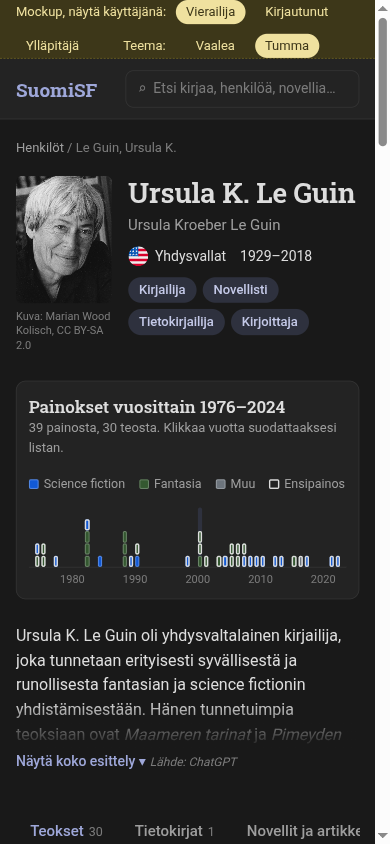
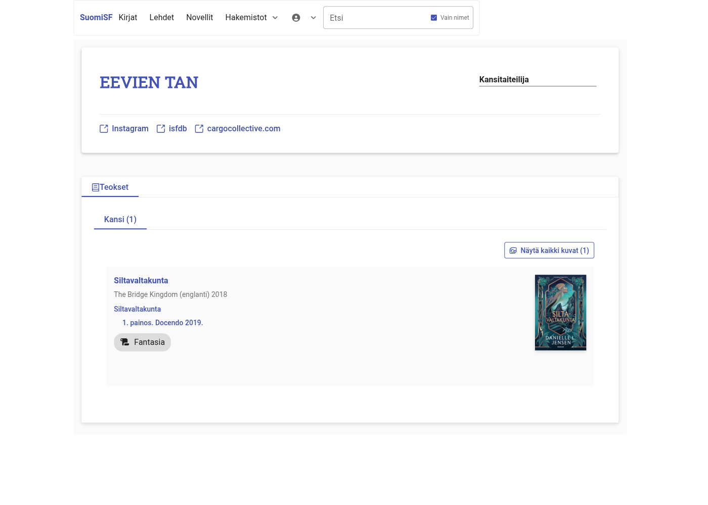
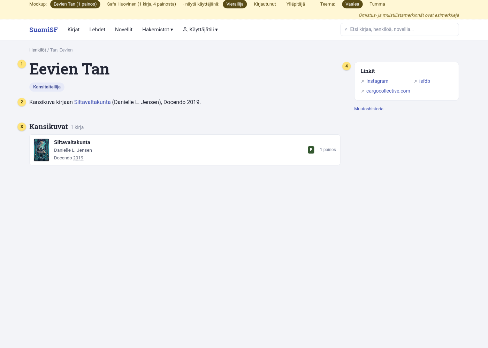
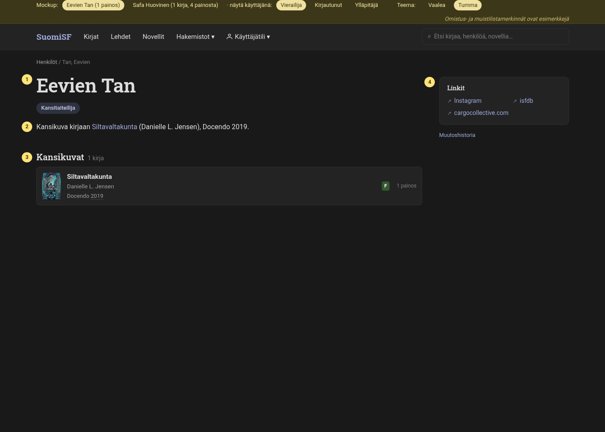
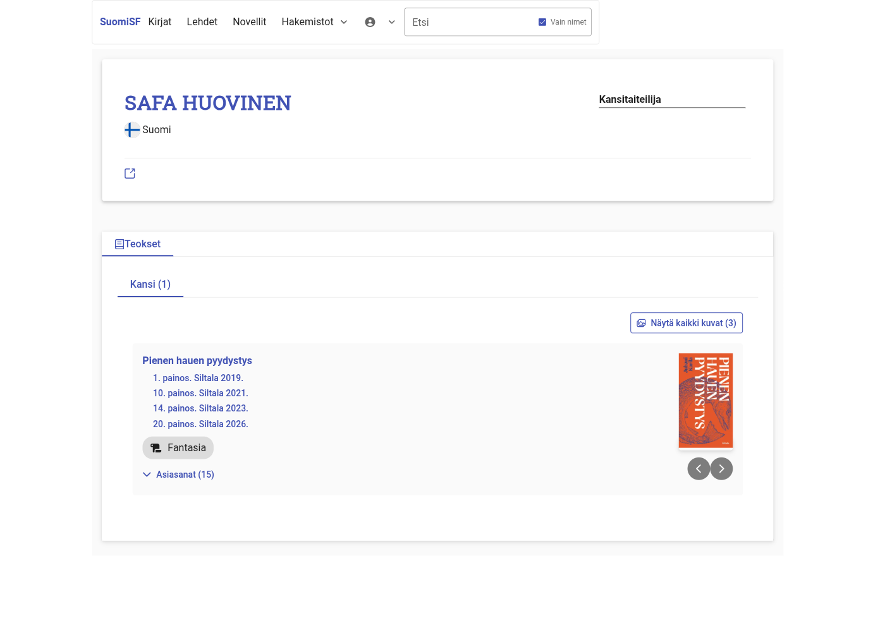
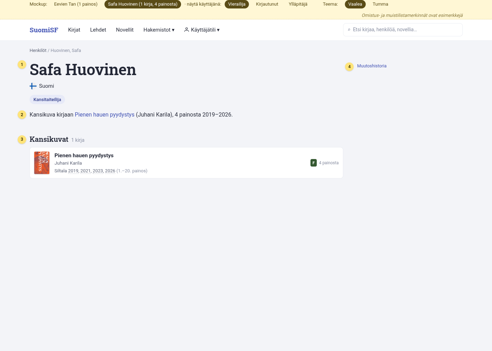
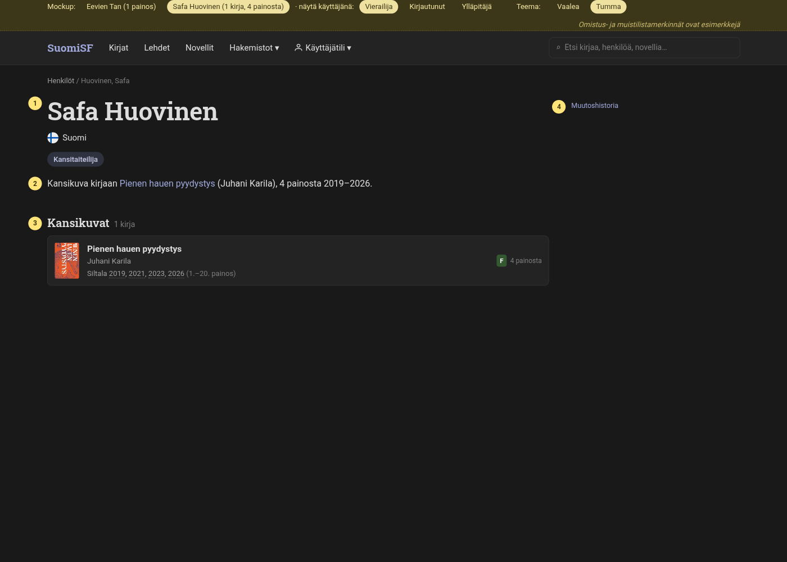
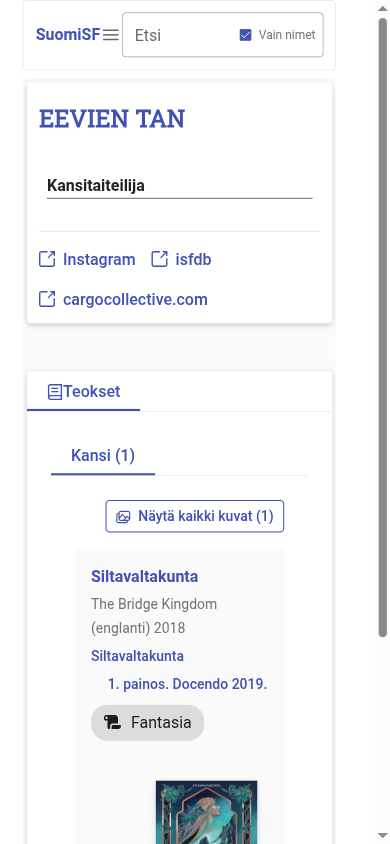
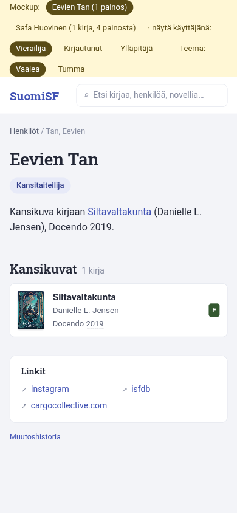
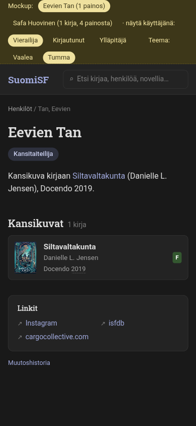

# Person page

**Route:** `/people/:id` · **Code:** `src/features/person/routes/person-page.tsx`, `src/features/person/components/person-details.tsx`, `src/components/contributor-book-control.tsx`
**Status:** Agreed (revised 2026-11-23) · **Updated:** 2026-11-23
**Sample page:** Ursula K. Le Guin, https://www.sf-bibliografia.fi/people/2435
**Mockup:** [`../mockups/person.html`](../mockups/person.html), built with real Le Guin data from the live API (download and open it in a browser; covers load from the live site).
The yellow bar at the top switches between visitor, logged-in user and admin; ownership and wishlist marks are made-up examples.

| Before | After (mockup, light) | After (mockup, dark) |
|---|---|---|
|  |  |  |
|  |  |  |

Full mockup page: [after-desktop-full.png](../images/person/after-desktop-full.png). Current works list: [before-works.png](../images/person/before-works.png).
Dark theme: [desktop](../images/person/after-desktop-dark.png), [whole page](../images/person/after-desktop-full-dark.png), [phone](../images/person/after-mobile-dark.png), [book list as admin](../images/person/after-admin-list-dark.png).
Book list as admin: [after-admin-list.png](../images/person/after-admin-list.png) (owned ★ and wishlist marks on editions, edit pencil after each title).

## What's wrong today (measured on Le Guin)

1. **Too long.** The page is 8,651 px tall on desktop and 17,391 px on a phone. Each book is a ~260 px card
   (cover carousel, edition list, genre chip, collapsed tags). The mockup is 4,062 / 5,314 px.
   People with long lists go much further: Erin Hunter (94 works, 195 editions) is 26,797 px on desktop and 57,285 px on a phone today,
   Stephen King (88 works, 152 stories) 23,023 / 46,143 px. There is no height budget; compact rows (about 76 px instead of 260 px per book)
   cut those lists to roughly a third, and the sticky tab row and filters keep them usable.
2. **Two rows of tabs that look the same.** Main tabs (Teokset, Tietokirjat…), then full-size role subtabs (Kirjoittanut (29)) inside, even when there is only one role.
   Tab icons sit right against the labels. Tab labels show no counts.
3. **No summary.** You can't see how much exists or when it came out in Finnish without scrolling the whole list.
4. **Noisy header sidebar.** Roles in bold text with an underline, large grey genre chips ("Fantasia x 17"),
   red tag chips, and a purple "+157" button: three different chip styles next to each other.
5. **Bio pushes everything down,** especially on a phone (the whole first screen). `CollapsibleHtml` already exists but isn't used here.
6. **Eight external links take a full-width row.**
7. **The nav bar (940 px) is narrower than the content (1060 px),** so the two don't line up.
8. **Sorting is by name only.** For a bibliography, original year and Finnish year are the useful orders.
9. **Name in uppercase** makes long names hard to read and wrap badly on mobile.

## Proposed layout

```
┌ nav (same width as content) ─────────────────────────────────────────┐
│ Henkilöt / Le Guin, Ursula K.                                         │
├──────────────────────────────────────────────┬───────────────────────┤
│ [photo] Ursula K. Le Guin                     │ Tuotanto tietokannassa │
│         Ursula Kroeber Le Guin                │  31 kirjaa  40 painosta│
│         🇺🇸 Yhdysvallat  1929–2018              │  93 novellia 2 palk.  │
│         (Kirjailija)(Novellisti)…             ├───────────────────────┤
│ ┌ Painokset vuosittain 1976–2024 ──────────┐ │ Genret (bars)          │
│ │ ▮▮ ▮   ▮▮▮   ▮ ▮▮      ▮▮▮▮▮▮▮▮▮  ▮▮ ▮▮  │ │ Yleisimmät asiasanat   │
│ └──────────────────────────────────────────┘ │ Linkit (2 columns)     │
│ Bio, 4 lines … Näytä koko esittely ▾          │ Muokattu · Muutoshist. │
│ Teokset 30 | Tietokirjat 1 | Novellit 93 | …  │   (scrolls with page,  │
│ (Kaikki)(Romaanit)(Kokoelmat)…  [filter][sort][Lista|Kannet]          │
│ ── 1960-luku ──                               │    below on phone)     │
│ [cover] Maameren velho          F  3 painosta │                       │
│         A Wizard of Earthsea 1968 · Maameren tarinat 1                 │
│         WSOY 1976, 1984, 1990                 │                       │
└──────────────────────────────────────────────┴───────────────────────┘
```

The numbers 1–6 in the mockup screenshots match the sections below.

1. **Header.** Mixed-case name in Roboto Slab, larger portrait (168 px, 96 px on phone) with credit under it,
   nationality and years on one line, roles as small soft chips. "Myös" / "Oikea henkilö" stay under it.
2. **Publication timeline, "Painokset vuosittain" (new, the one distinctive element).** Revised 2026-11-23 after review: the first
   version drew one block per edition, which breaks for prolific authors (Erin Hunter has 195 editions, 57 of them in 2023).
   - **What it counts:** every Finnish **book edition** in the database in which the person has any role (author, editor, translator,
     cover, illustrator), each edition once even if they have several roles. Reprints (painokset) and new versions (laitokset) count.
     Short stories and magazine issues are not in it.
   - **Bar height** = editions that year, on a linear scale shared by all bars; "Korkein pylväs 57" is shown next to the legend.
   - **Two parts per bar, told apart by fill, not colour:** solid = first Finnish edition of a work (ensipainos), hatched = reprint or new version.
     One hue (the primary colour), so it works for colour-blind readers and in both themes. **No genre colours in the timeline:** genre is shown
     in the sidebar's genre bars and in each row's genre badge, both with text.
   - **A legend is always visible** ("Ensipainos", "Uusintapainos tai uusi laitos") and the summary says "195 painosta, joista 94 ensipainosta".
   - **Long spans:** one bar per year when every bar can be at least 6 px wide; otherwise bars of 2, 5 or 10 years (Jules Verne 1879–2024:
     2 years a bar on desktop, 5 on a phone), stated in the summary ("Yksi pylväs = 5 vuotta"). Axis labels on round years at least 44 px apart.
   - **Each bar is a button** with an accessible name ("1984: 4 painosta, joista 2 ensipainosta") and a tooltip listing up to five titles and "+N muuta".
     Clicking selects the year (or the bin's years) as a list filter; clicking it again, or the filter's ×, clears it.
   - **Shown from 5 editions up** (see Sparse data); below that a sentence replaces it.

   Screenshots: [Le Guin](../images/person/after-timeline-leguin.png), [Erin Hunter](../images/person/after-timeline-hunter.png),
   [Jules Verne](../images/person/after-timeline-verne.png), [Verne on a phone](../images/person/after-timeline-verne-mobile.png)
   (each also `-dark`). The mockup's yellow bar switches the timeline between these three (`?tl=hunter`, `?tl=verne`).
3. **Bio** clamped to 4–5 lines with `CollapsibleHtml`, source label next to the toggle.
4. **Two levels of tabs, each with one job** (revised 2026-11-23; role tabs kept, decided):
   - **Main tabs = what kind of record:** **Teokset** (fiction books), **Tietokirjat** (non-fiction books, its own tab as decided),
     **Novellit ja artikkelit**, **Sarjat**, **Lehdet** (magazines they edited), **Palkinnot**, **Muu tuotanto** (as today).
     A tab shows only when it has content; with only one tab, the row isn't shown (a heading with the count instead).
   - **Role tabs = the person's role,** inside Teokset, Tietokirjat and Novellit ja artikkelit, as today's subtabs:
     Kirjoittanut, Toimittanut, Kääntänyt, Kansikuva, Kuvittanut, each with its count. Drawn as a smaller second row (a segmented control,
     not a second full tab bar) directly under the main tabs, and **only when the person has more than one role in that tab**
     (Le Guin: none; a translator who also writes: two).
   - **All tab counts are fixed totals** and never change with filters. The toolbar never filters by role or by kind of record,
     so there is exactly one way to do each.
   - Changing a main tab or a role tab clears the type, name and year filters; sort and view stay.
5. **The toolbar filters inside the current tab only:**

   | Control | In which tabs | Behaviour |
   |---|---|---|
   | Type chips | Teokset (Romaanit, Kokoelmat, Yhteisniteet…), Novellit ja artikkelit (Novellit, Artikkelit, Runot…) | One at a time, "Kaikki" first; only types that occur |
   | Year | Teokset, Tietokirjat, Novellit ja artikkelit | Set from the timeline; shown as a removable chip "1984 ×" |
   | Name filter | All list tabs | Filters as you type |
   | Sort | All list tabs | Original year (default), Finnish year, name; tabs offer only orders that make sense |
   | Lista / Kannet | Teokset, Tietokirjat | Kannet is the cover grid |

   Groups combine with AND. **Chip counts are faceted:** each chip shows how many items it would give with the other active filters
   (so "Romaanit 12" with "Kääntänyt" on), and a chip that would give 0 is disabled. When any filter is on, a line above the list says
   "Näytetään 7 / 30 · Romaanit × · 1984 × · Tyhjennä", so the tab count (30) and the list never seem to disagree.
   **Changing tab clears** that tab's type, role, name and year filters; sort and view stay. Clicking a timeline year while in
   Sarjat, Lehdet or Palkinnot switches to Teokset.
   Grouped by decade when sorted by year, by series when "Ryhmittele sarjoittain" is on.

   **Everything is in the URL** (defaults left out), so back, reload and shared links restore the same view:
   `?osio=teokset&rooli=kaantaja&tyyppi=romaanit&haku=maa&vuosi=1984&jarjestys=suomivuosi&nakyma=kannet&sarjoittain=1`
   (`vuosi=1980-1984` for a 5-year bar). Tab, chip, year, sort and view changes add a history entry; typing in the name filter replaces
   the current entry, so back doesn't step through every letter.

   **On a phone:** the site nav scrolls away; **only the tab row sticks** (49 px, about 6% of an 844 px screen), without a visible scrollbar,
   scrolling sideways when the tabs don't fit. The toolbar doesn't stick and folds into one row: **"Suodata ja järjestä"** (with the number of
   active filters) and Lista / Kannet. The button opens a bottom sheet (PrimeReact `Sidebar`, position bottom) with the chips, name filter and sort;
   active filters show as removable chips in the "Näytetään…" line. On desktop too only the tab row sticks.
   Screenshots: [phone, toolbar](../images/person/after-mobile-toolbar.png), [phone, scrolled](../images/person/after-mobile-scrolled.png)
   ([dark](../images/person/after-mobile-scrolled-dark.png)).
6. **Sidebar.** Stats box, genre bars (replace the chip pile), top 8 tags in one neutral style with counts plus "+N muuta",
   links in 2 columns, last-edited date with a link to the change history (`get-person-changes.ts` already exists).

**Compact row:** 44×64 cover thumb, title, original title + year + series link, "WSOY 1976, 1984, 1990"
(each year links to its edition), genre badges and edition count on the right. Tags move to the work page.
That takes the row from ~260 px to ~76 px. Compact rows are the default; "Kannet" is the cover grid.
Keeps today's role-specific parts of `ContributorWorkControl`: **logged-in users** see ★ before each edition they own and a bookmark
before each one on their wishlist; **admins** get a pencil after the title that opens the work's edit dialog, and the page's SpeedDial.
The main menu is the real one for each role (Ylläpito menu for admins).

**Visual rules:** keep the current indigo primary and Roboto / Roboto Slab, light grey page with white surfaces,
one chip style per meaning (role = soft indigo, tag = outlined neutral, filter = pill that turns dark when on).
Genre colour is used only in the genre bars and the row badges (always with the genre's name or abbreviation), not in the timeline.

## Sparse data (checked 2026-11-23)

Real people with little data: **Eevien Tan** (cover for one edition, no portrait, dates, nationality or bio, three links; https://www.sf-bibliografia.fi/people/8151)
and **Safa Huovinen** (covers for four printings of one book, nationality only, one empty link; https://www.sf-bibliografia.fi/people/8157).
Mockup: [`../mockups/person-sparse.html`](../mockups/person-sparse.html) (`?p=tan`, `?p=huo`; same styles as the main mockup).

| Before | After (mockup, light) | After (mockup, dark) |
|---|---|---|
|  |  |  |
|  |  |  |
|  |  |  |

More: [as admin](../images/sparse/after-person-one-cover-admin.png) ([dark](../images/sparse/after-person-one-cover-admin-dark.png)).

What the layout does with missing data (the "Missing data" rule in [principles.md](../principles.md)):
- **No portrait:** the header is one column; no empty image box. No dates or nationality: those lines are left out.
- **Instead of the timeline,** a sentence: "Kansikuva kirjaan *Siltavaltakunta* (Danielle L. Jensen), Docendo 2019." The timeline appears from 5 editions up.
- **One group only:** no tab bar and no toolbar; a heading with the count ("Kansikuvat, 1 kirja") and the rows. Tabs appear when two or more
  groups have content; the filter toolbar from about 10 items.
- **Sidebar:** the stats, genre and tag boxes are hidden when they would repeat one number or one genre; links only when there are links.
- **Printings as one row** (agreed rule): Huovinen's four printings read "Siltala 2019, 2021, 2023, 2026 (1.–20. painos)".
- **No hints for admins either** (decided): missing data is simply not shown; admins add it through the edit dialog.
- **Live bug:** Huovinen has a link row with no URL and no description; today it shows as a bare icon that goes nowhere.
  Empty link rows should not be shown, and the form should not save them.

## Shared principles used or added

This is the first plan, so it proposes most of the rules in [principles.md](../principles.md): one tab row with counts, compact rows,
chip styles, genre colours, facts sidebar, clamped bio, URL state, filters inside a tab, sticky bars, charts. New rule only here: the publication timeline,
which could be reused on publisher and series pages.

## Implementation steps (each one a small PR)

All of it is frontend; the `/people/<id>` response already has editions with `pubyear`, genres and covers. No backend change is needed.

1. **Header and bio**: `person-details.tsx`. Mixed-case name, portrait size, role chips (move `getDerivedRoles` out
   of `person-page.tsx` into `person/utils.ts` with Vitest tests), `CollapsibleHtml` for the bio. Align the nav width in `mainmenu.tsx`.
2. **Sidebar**: new `person-sidebar.tsx` (stats, `GenreBars`, top tags, links). Use the PrimeReact `Chip`/`Tag` components.
   Two columns via PrimeFlex `lg:col-8` / `lg:col-4`; the sidebar scrolls with the page (not sticky).
3. **Timeline**: new `publication-timeline.tsx`. A pure `binEditionsByYear(person, width)` function (dedupes editions across roles, splits first editions from reprints,
   picks a 1/2/5/10-year bin) with Vitest tests from captured fixtures (Le Guin, Erin Hunter and Jules Verne API responses in `src/test/fixtures/`). Plain CSS grid, no chart library (chart.js would be heavy for this
   and less accessible). Bars are buttons with `aria-label="1984: 4 painosta, joista 2 ensipainosta"`.
4. **Single tab row + toolbar**: rework `ContributorBookControl` (only the Person page uses it). PrimeReact `SelectButton`
   for chips and the Lista/Kannet toggle, `Dropdown` for sort, `InputText` for the filter, `Sidebar` (bottom) for the phone's filter sheet. A pure `filterWorks(items, state)` with faceted counts;
   all state in the URL through `useSearchParams` (push for clicks, replace for typing).
5. **Compact row view**: new `work-row.tsx`. The current card stays available as the cover view.
6. **Mobile and accessibility pass**: 390 px check, focus rings, no sideways scroll; update `tests/anon/person-tabs.spec.ts` and `a11y.spec.ts`.
7. **Wiki**: update the person-page section in `SuomiSF‐ohje.md` and retake its screenshots (repo rule).

## Tests

Vitest for the pure functions (roles, binning with Hunter's 57-edition year and Verne's 146-year span, faceted counts, sorting/grouping);
Playwright for tabs, filters, the timeline year filter, the URL state (reload and back restore the same view, typing doesn't add history entries),
the phone's filter sheet and that only the tab row sticks;
owned and wishlist marks for a logged-in user, the edit pencil and SpeedDial for an admin, neither for a visitor.

## Open questions

_None._

## Decisions

2026-11-22, project owner:
- Name in mixed case.
- Compact rows are the default book list; the cover grid is a toggle.
- Tietokirjat stays its own tab.
- Clicking a year in the "Painokset vuosittain" timeline filters the book list to that year; clicking again clears it.
- The sidebar scrolls with the page; it is not sticky.
- The tab row may stick to the top of the screen while scrolling the book list.
- No page-height budget: long lists (Erin Hunter, Stephen King) are normal.

2026-11-23, project owner (review of the person plan):
- Timeline as bar heights: all Finnish book editions the person has any role in, reprints and new versions included, stories not;
  solid first editions, hatched reprints; one colour, text legend, no genre colours; 2/5/10-year bars for long spans.
- Role tabs are kept, as a smaller second row inside Teokset, Tietokirjat and Novellit ja artikkelit, shown only with more than one role;
  "Muu tuotanto" stays. The toolbar has no role filter.
- Only the tab row sticks; the site menu scrolls away; on a phone the filters fold into a "Suodata ja järjestä" bottom sheet.
- Missing data is hidden for everyone; no "missing" hints for admins. Thresholds: timeline from 5 editions, tabs from two groups,
  filter toolbar from about 10 items.
