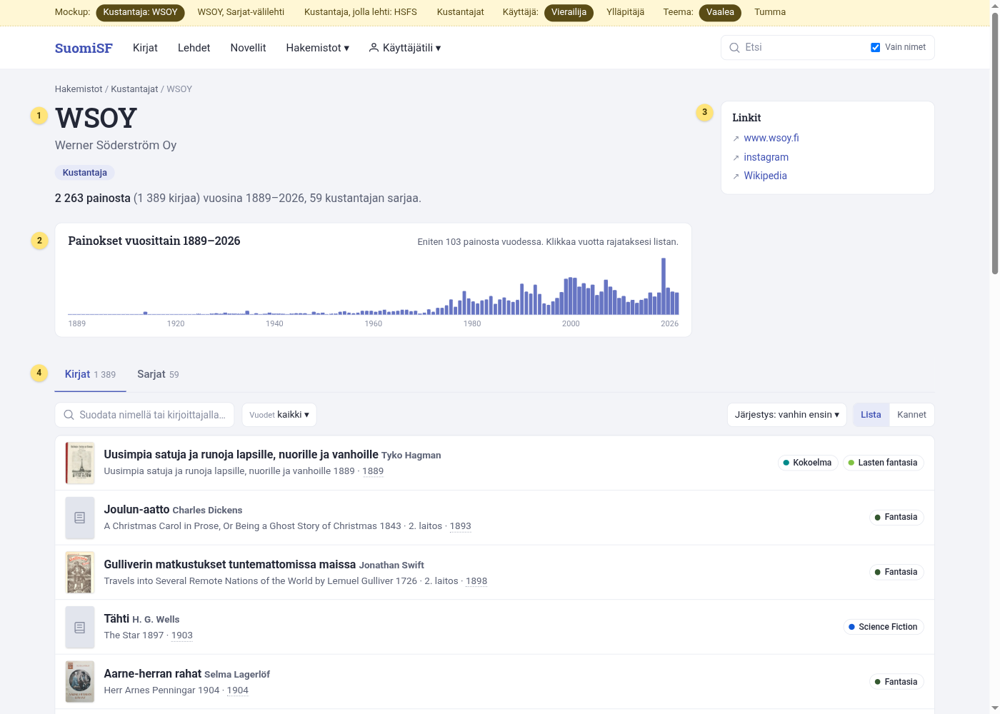
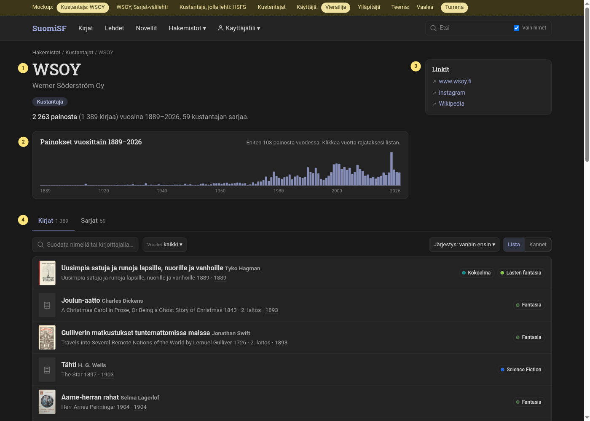
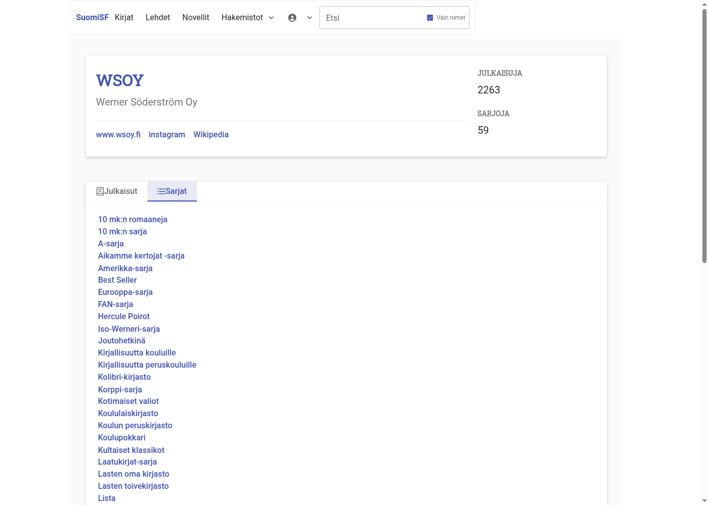
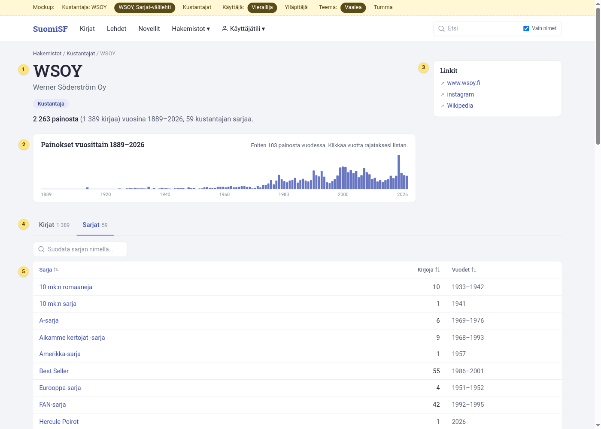
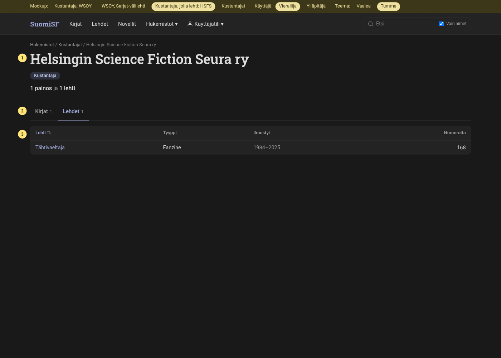
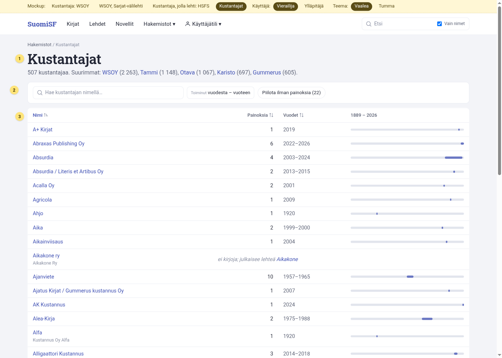
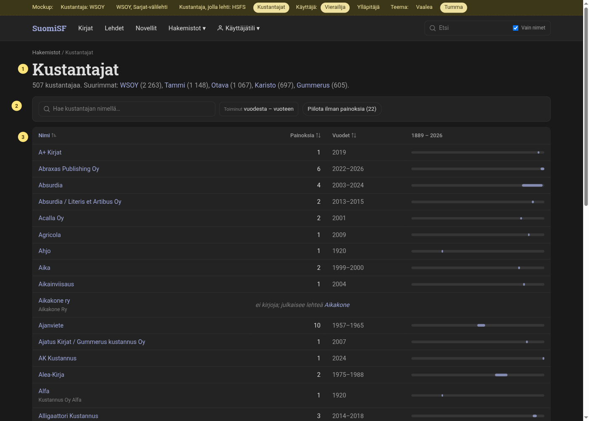
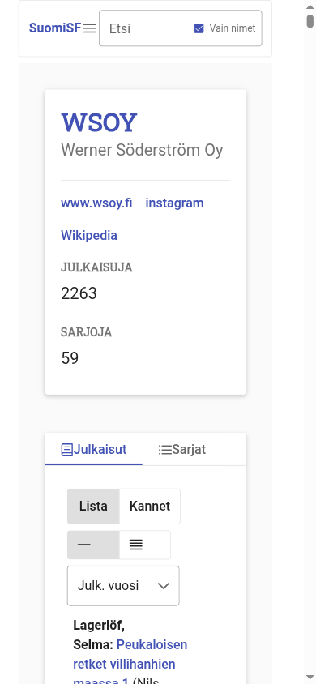
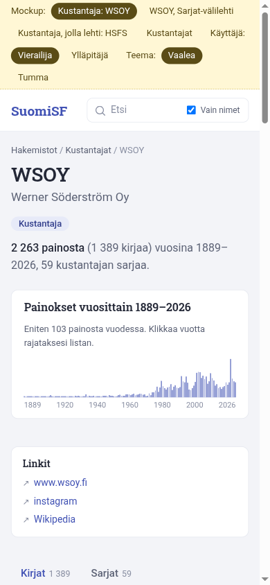
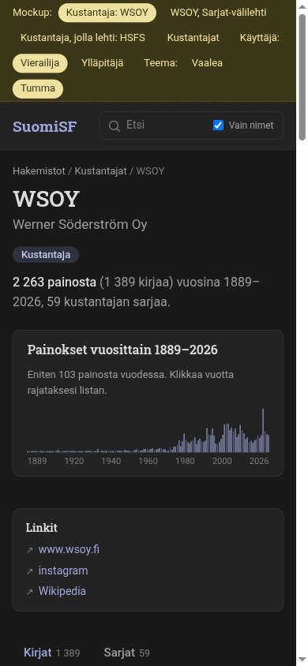

# Publishers

**Routes:** `/publishers` (list) and `/publishers/:id` · **Code:** `src/features/publisher/routes/publisher-list-page.tsx`, `publisher-page.tsx`,
`src/features/edition/components/edition-list.tsx`, `src/features/pubseries/components/pubseries-list.tsx`; backend `GET /api/publishers`, `/api/publishers/:id`
**Status:** Agreed; the list (`/publishers`) implemented as an admin-only trial in identity style (2026-11-26) · **Updated:** 2026-11-26
**Samples:** the list (507 publishers), WSOY (2,263 editions, 59 publisher series, https://www.sf-bibliografia.fi/publishers/387) and
Helsingin Science Fiction Seura ry (publisher of Tähtivaeltaja, https://www.sf-bibliografia.fi/publishers/85).
**Mockup:** [`../mockups/publishers.html`](../mockups/publishers.html) with [`publishers-data.js`](../mockups/publishers-data.js) (real data): `?v=pub` WSOY, `?v=series` its Sarjat tab,
`?v=mags` a publisher with a magazine (Lehdet tab), `?v=list` the list. The yellow bar switches visitor / admin and light / dark.

| Before | After (mockup, light) | After (mockup, dark) |
|---|---|---|
|  |  |  |
|  |  |  |
| _no Lehdet tab today_ |  |  |
|  |  |  |
|  |  |  |

More: [after, whole WSOY page](../images/publishers/after-publisher-full.png) ([dark](../images/publishers/after-publisher-full-dark.png)) ·
phones: [list before](../images/publishers/before-list-mobile.png), [list after](../images/publishers/after-list-mobile.png).

## What's wrong today

1. **A big publisher's page loads everything at once.** WSOY's 2,263 editions come in one 2 MB response (1.1 s) and render as one text list:
   the page is **47,007 px tall on desktop and 170,483 px on a phone** (too big to keep as a screenshot).
2. **The header says only "Julkaisuja 2263 / Sarjoja 59"** in large labelled numbers; no years, nothing about when the publisher was active.
3. **The edition list is text lines with codes** ("Lagerlöf, Selma: Peukaloisen retket … 1 - 3.painos. WSOY 1906 - 1929. [nF]"), sorted by year with no paging or search.
4. **The Sarjat tab is a bare list of 59 names,** with no book counts or years.
5. **List page:** 507 publishers in a `DataTable` with filters in the header cells; the API returns every edition of every publisher (only id and year)
   to count them; 22 publishers show "0" with no explanation. Many of them are clubs whose output is a magazine: "Aikakone ry" has no books
   but publishes Aikakone (50 issues). The page doesn't show a publisher's magazines at all, although the API returns them.
   There are also near-duplicates for admins to check, e.g. "Helsingin Science Fiction Seura" and "Helsingin Science Fiction Seura ry".
6. Centred title, "Kustantajia yhteensä: 507" without thousands separators elsewhere.

## Proposed layout

**Publisher page**
1. **Header:** name, full name, a "Kustantaja" chip and one line of facts: "2 263 painosta (1 389 kirjaa) vuosina 1889–2026, 59 kustantajan sarjaa".
2. **"Painokset vuosittain" timeline:** the person page's timeline component (bar heights, solid first editions and hatched reprints, bins for long spans; WSOY peaks at 103 editions a year).
   Clicking a year filters the book list to that year.
3. **Sidebar:** links.
4. **Tabs with counts:** Kirjat, Sarjat, and **Lehdet** when the publisher has magazines (decided): a table of its magazines with type, years and
   number of issues ([screenshot](../images/publishers/after-publisher-magazines.png)).
5. **Kirjat:** one row per book and laitos (agreed rule: printings of the same book are one row with their years): cover, title, author,
   original title and year, laitos when more than one, printing years (each links to its edition), publisher series, genre chips.
   Text filter, year range, sort (**oldest first by default**, decided; newest first, title, author), Lista / Kannet. **Server-side paging** (agreed rule).
   **Sarjat:** a table of the publisher's series with book counts and years, sortable.
6. Paging under the list.

**List page**
1. Header with the total and the five biggest publishers as links.
2. Filter bar: name search, "toiminut" year range, "Piilota ilman painoksia (22)".
3. Table: name (full name under it when different), number of editions, years, and a thin **activity bar** on a common 1889–2026 axis,
   so long-running houses and one-off publishers are told apart at a glance. A publisher without books but with a magazine says
   "ei kirjoja; julkaisee lehteä Aikakone"; one with neither says "ei luetteloituja painoksia".
   Every column sorts; state in the URL; cards on a phone (the activity bar is hidden there).

## Implementation (2026-11-26): `/publishers` as an admin-only trial in identity style

Built to the [build rules](../README.md#rules-for-every-redesigned-page-decided-2026-11-24): the list page of this plan in the identity
style (the book index's tokens and type). Admins switch with *Uusi kustantajasivu* or Shift+U (`suomisf.publishersPageVersion`, apart
from the other pages' choices); everyone else gets the current page. The publisher page (`/publishers/:id`) is not started.

- **Backend:** a new route, `GET /api/publisherindex` (`app/impl_publisherindex.py`): every publisher with its edition count, first and
  last year and magazines with issue counts, counted in the database (76 kB in about 30 ms on the dev data, against 400 kB and 340 ms for
  `GET /api/publishers`, which the current page keeps using unchanged).
- **Frontend:** `src/features/publisher/list/` (page, styles, `publisher-list-state.ts` with Vitest tests), the switch in
  `src/features/publisher/routes/publisher-list-switch.tsx`. 507 rows are light, so filtering and sorting happen in the page.
- **Header:** "507 kustantajaa. Suurimmat: WSOY (2 260), Tammi (1 148), Otava (1 066), Karisto (695), Gummerus (605)."
- **Filters:** name (as typed, from the start of any word of the name or the full name, so "söderström" finds WSOY through
  "Werner Söderström Oy" and four other houses), "Toiminut" year range (active at any time in it; *Rajaa* or Enter), and
  "Piilota ilman painoksia (22)". Count line "N / 507 kustantajaa" when filtered, *Tyhjennä*.
- **Table:** name (full name under it when it differs beyond case), Painoksia, Vuodet, and the activity bar on one axis from the
  earliest to the latest year in the data (1856–2026 today, not the plan's 1889: J. Simeliuksen perilliset, 1856). Each header sorts;
  its first click is its natural direction (names A–Ö, most editions, oldest first), the second reverses; publishers without editions
  stay last. A publisher without books says "ei kirjoja; julkaisee lehteä Aikakone (50 numeroa)" with the magazine linked.
- **URL:** `nimi`, `toiminut=1950-1980`, `piilota=tyhjat`, `jarjestys=painoksia|vuodet`, `suunta` only when not the column's default;
  the name is written without a history entry for every letter.
- **Phone:** cards ("2 260 painosta · 1889–2026"), no activity bar, a *Järjestys* select instead of the column headers.
- **Tests:** backend `tests/api/test_publisherindex.py`; Playwright `tests/admin/publishers-new.spec.ts`,
  `tests/anon|user/publishers-version.spec.ts`.

### Compared with the live site (2026-11-26)

| | Live (`/publishers`) | Dev data, new page | Why |
|---|---|---|---|
| Publishers | 507 | 507 | same |
| Without editions | 22 (shown as 0) | 22, all with a magazine | same |
| WSOY / Tammi / Otava / Karisto / Gummerus | 2 263 / 1 148 / 1 067 / 697 / 605 | 2 260 / 1 148 / 1 066 / 695 / 605 | the dev database is an older copy |
| WSOY years | 1889–2026 | 1889–2026 | same |

### Notes: possible data errors (to check later, not part of the redesign)

1. Savukeidas, a publisher of this century, starts in 1869: its edition 7276, *Fantasmagoria ja muita runoja*, has the year 1869, the year
   Lewis Carroll's *Phantasmagoria* first appeared; probably the original's year entered as the printing year. It stretches Savukeidas's
   activity bar from 1869.

## Shared principles used or added

Uses: large lists paged on the server, printings of the same book as one row, the person page's year timeline, filters above lists,
state in the URL, text first, tabs with counts, empty values last, dark theme, page width.

No new rules.

## Implementation steps

1. **Backend:** `/api/publishers/:id` returns the header facts, editions per year (for the timeline), series with counts and years, and the books
   **paged** (grouped by work and laitos, with filters and sorting) instead of all editions, and its magazines with issue counts and years.
   `/api/publishers` returns name, full name, edition count, year span and magazine names instead of every edition.
2. **Publisher page:** header, reuse `publication-timeline.tsx` from the person plan (year click sets a filter in the URL), tabs, book rows
   (shared compact row), series table.
3. **List page:** shared filter bar and table; the activity bar as a small presentational component.
4. **Tests and wiki:** Playwright for paging, the year filter from the timeline, the series table, the list filters; update `SuomiSF‐ohje.md`.

## Tests

- Backend: paging and totals for WSOY; grouping by work and laitos; per-year counts.
- Playwright: the WSOY page loads one page of books, oldest first; HSFS shows a Lehdet tab with Tähtivaeltaja, WSOY doesn't;
  "Aikakone ry" in the list says it publishes Aikakone; clicking 1980 in the timeline filters to 1980 and puts it in the URL; Sarjat sorts by count;
  the list hides publishers without editions on request.

## Open questions

_None._

## Decisions

2026-11-22, project owner:
- The backend change (paged books, per-year counts, series and magazines on the publisher page, light list) is fine.
- A publisher's books are shown oldest first by default.
- Publishers with magazines get a Lehdet tab.
