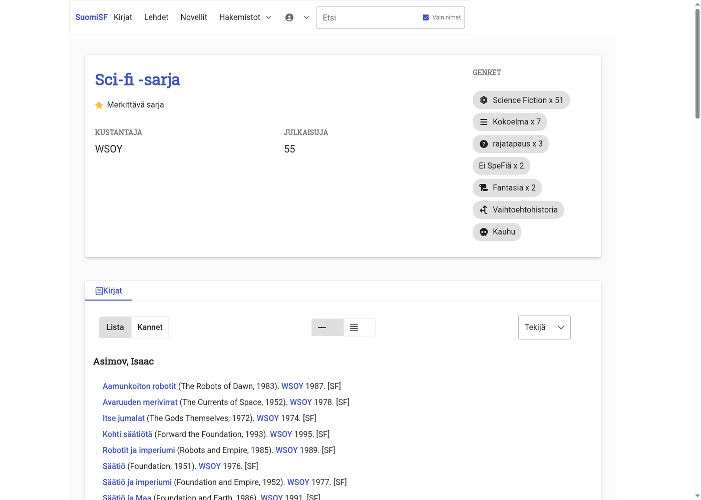
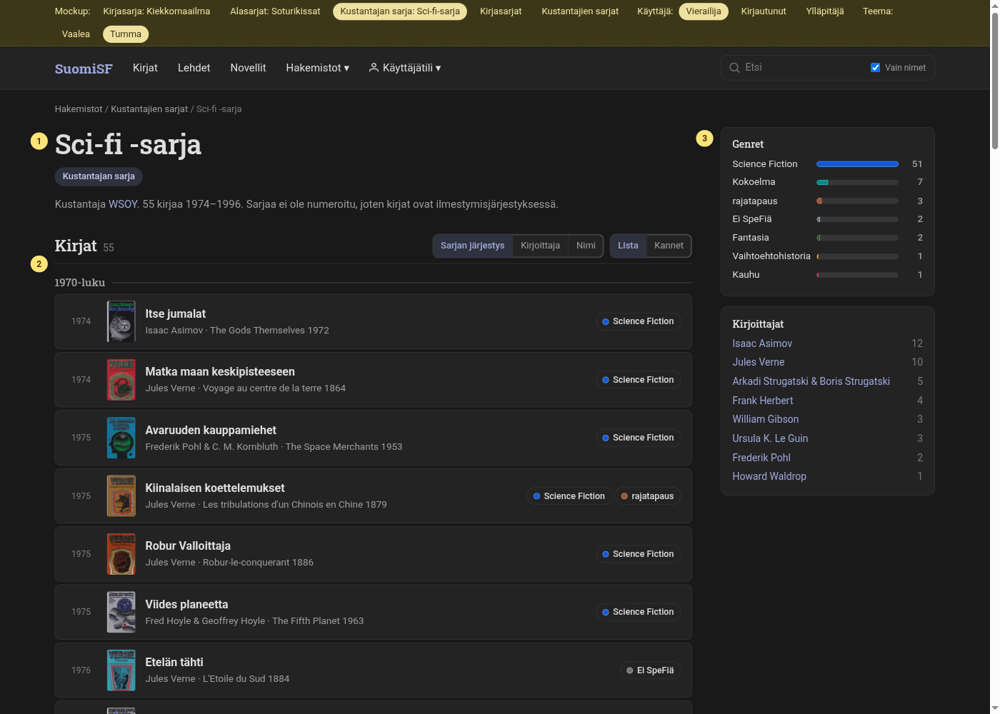
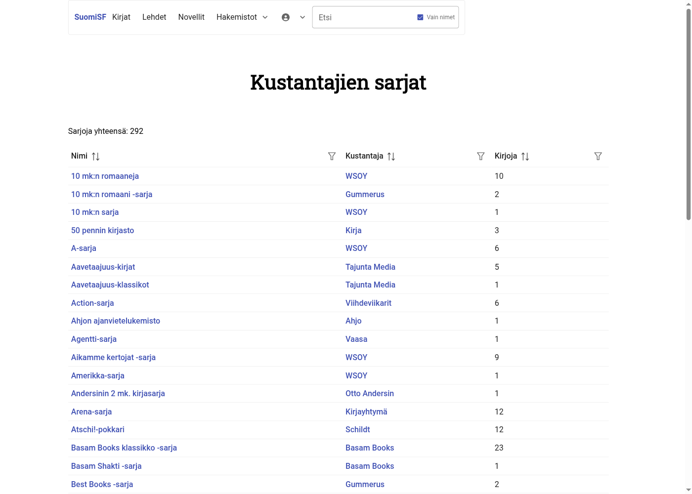
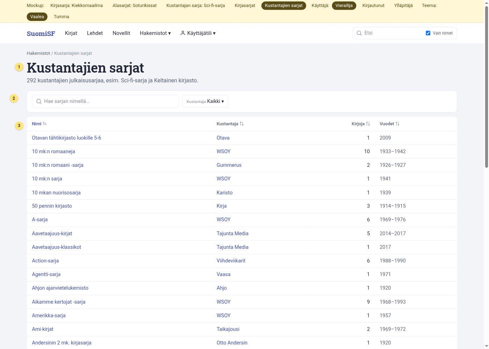
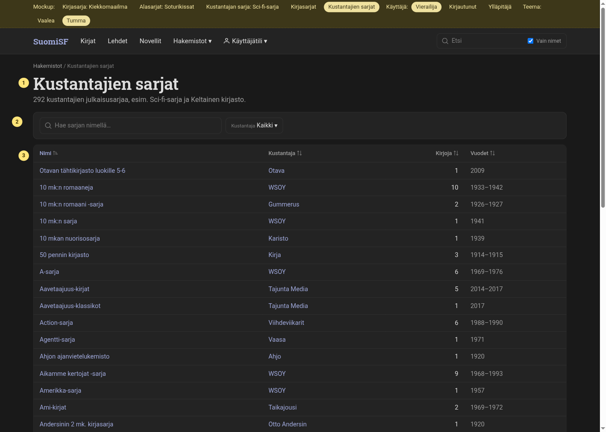
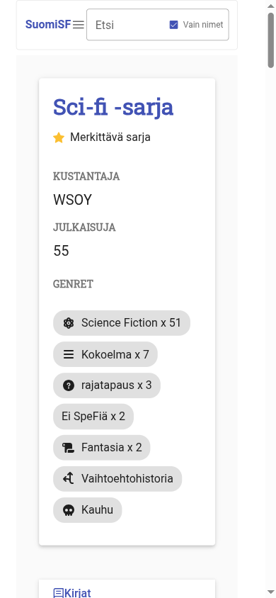
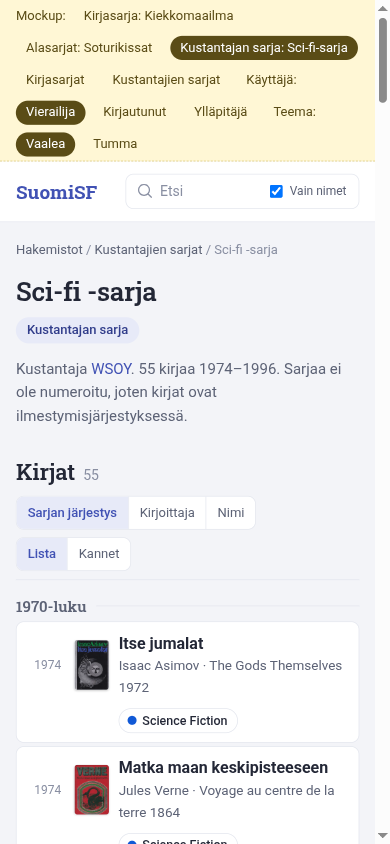
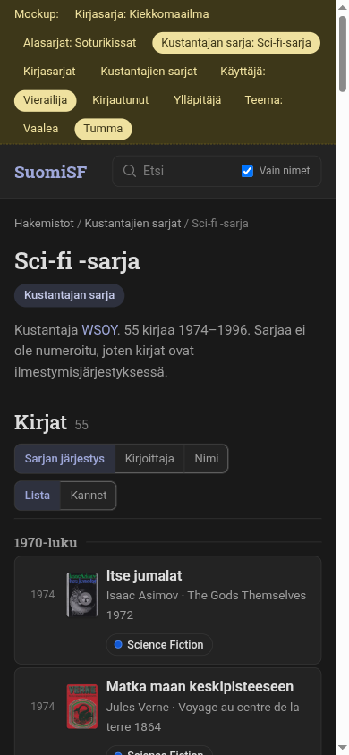

# Publisher series

**Routes:** `/pubseries` (list) and `/pubseries/:id` · **Code:** `src/features/pubseries/routes/pubseries-list-page.tsx`, `pubseries-page.tsx`,
`src/features/edition/components/edition-list.tsx`; backend `GET /api/pubseries`, `/api/pubseries/:id`
**Status:** Agreed · **Updated:** 2026-11-22
**Sample:** WSOY's Sci-fi-sarja (55 books 1974–1996, https://www.sf-bibliografia.fi/pubseries/180).
**Mockup:** [`../mockups/series.html`](../mockups/series.html) with [`series-data.js`](../mockups/series-data.js) (real data): `?v=ps` Sci-fi-sarja, `?v=pslist` the list.
Shares its pattern with the [book series](bookseries.md) plan.

| Before | After (mockup, light) | After (mockup, dark) |
|---|---|---|
|  |  |  |
|  |  |  |
|  |  |  |

More: [before, whole page](../images/pubseries/before-ps-scifi-full.png) · [after, Kannet view](../images/pubseries/after-ps-covers.png) ([dark](../images/pubseries/after-ps-covers-dark.png)).

## What's wrong today

1. **Books are sorted by author,** so a publisher series' own order (its numbering, or for unnumbered series like Sci-fi-sarja the order it came out in)
   is lost.
2. **The publisher isn't a link,** and "Kustantaja" / "Julkaisuja" are shown as two big labelled values.
3. **Genres as a column of large chips** ("Science Fiction x 51"…).
4. **List page:** 292 series, filters in the header cells, and **8.5 s to load**, because the API returns every edition of every series to count them.
   One name starts with a tab character ("\tOtavan tähtikirjasto…") and sorts first.

## Proposed layout

1. **Header:** name, a "Kustantajan sarja" chip, one line: the publisher (linked), number of books and years,
   and whether the series is numbered.
2. **Books in series order by default:** by series number when the books have one, otherwise by publication year, grouped by decade in the list view.
   **The list is the default view** (decided: text first). "Kannet" shows a cover grid with title, author and year under each cover
   (and the number on the cover when there is one).
   Order toggle: Sarjan järjestys / Kirjoittaja / Nimi. Logged-in users see ★ on books they own.
3. **Sidebar:** genre bars and the series' most frequent authors with counts. Admins keep the SpeedDial (edit, delete).
4. **List page:** filter bar (name, publisher), table with name, publisher, number of books and years; every column sorts;
   state in the URL; cards on a phone.

## Shared principles used or added

Same as the [book series](bookseries.md) plan, including "a list with a natural order shows that order by default".

## Implementation steps

1. **Backend:** a light list endpoint (name, publisher, book count, year span) instead of whole editions; trim whitespace from names.
2. **Series page:** header facts, list view by default with a cover-grid option, series-number-or-year order (pure `pubSeriesOrder(editions)`, Vitest), decade groups, sidebar.
3. **List page:** the shared filter bar and table.
4. **Tests and wiki:** Playwright for the default order and view, the list filters; update `SuomiSF‐ohje.md`.

## Tests

- Vitest: numbered series sort by number, unnumbered by year then title.
- Playwright: Sci-fi-sarja opens in the list view, oldest first; publisher links to its page; the list loads without fetching editions; filters survive reload.

## Open questions

_None._

## Decisions

2026-11-22, project owner:
- The backend changes (light list endpoint, trimming names) are fine.
- Remove "Merkittävä sarja" from the UI for now.
- Publisher series open in the list view; the cover grid is an option. Text always comes first in a bibliography.
