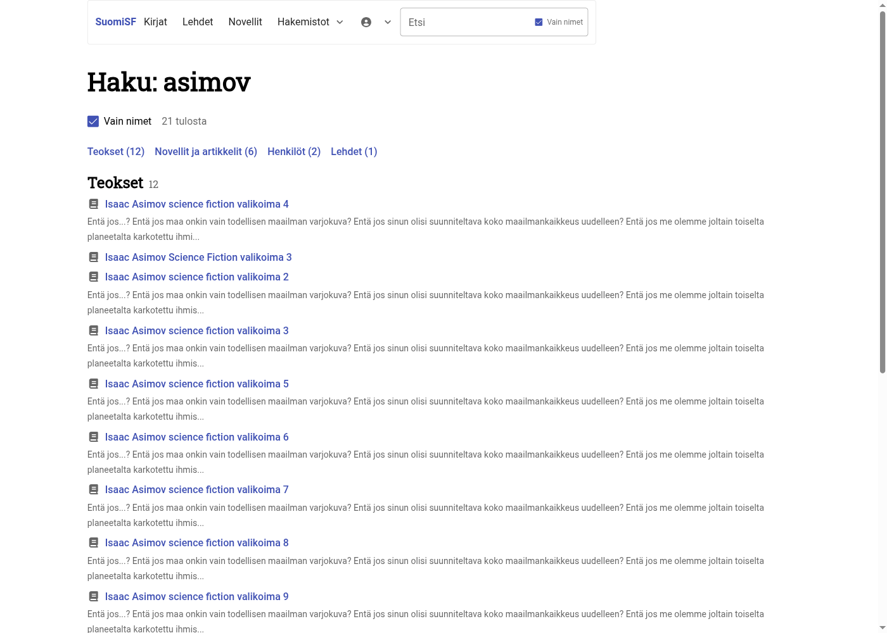
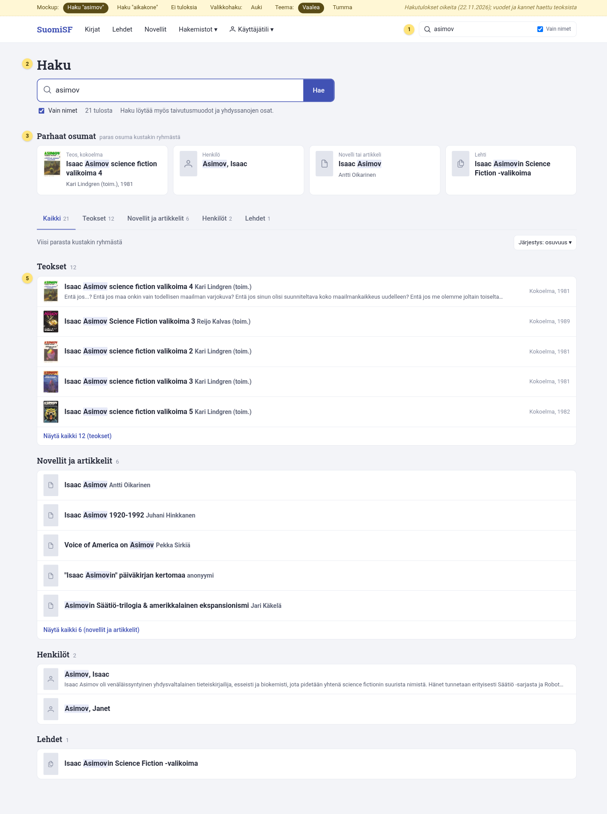
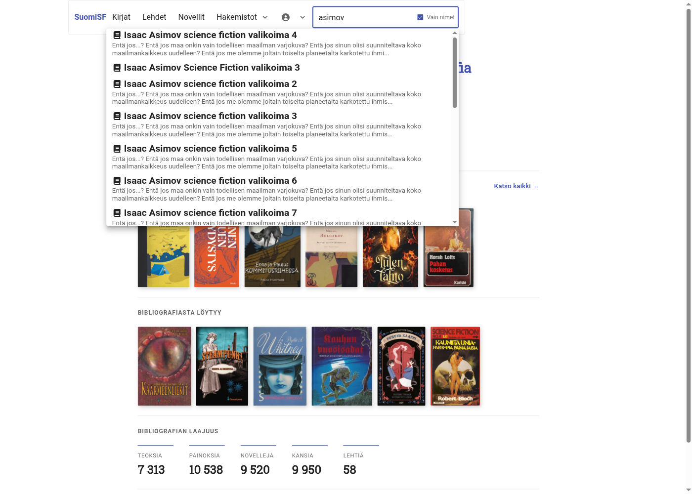
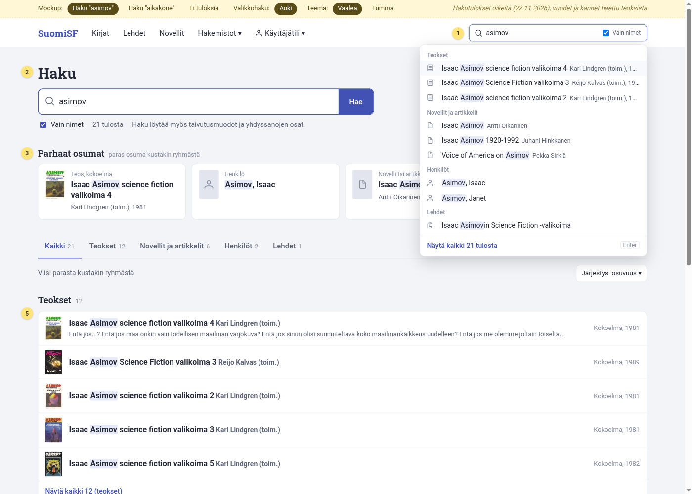
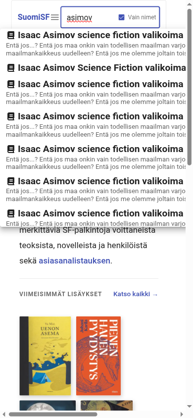
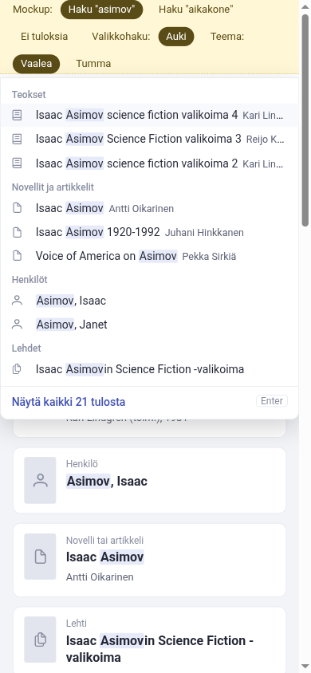

# Search

**Routes:** the search box in the main menu (every page) and `/search?q=<term>[&titles=1]`
· **Code:** `src/components/mainmenu.tsx` (AutoComplete), `src/features/search/routes/search-results-page.tsx`,
`src/features/search/utils/search-items.ts`; backend `GET /api/search/<term>` (PostgreSQL full-text search with the Finnish `voikko` config)
**Status:** Agreed · **Updated:** 2026-11-22
**Sample searches:** "asimov" with "Vain nimet" (21 hits) and "aikakone" without it (180 hits).
**Mockup:** [`../mockups/search.html`](../mockups/search.html) with [`search-data.js`](../mockups/search-data.js). The hits are the real API results;
years, types, covers and anthology editors were fetched from each work, because the search API doesn't return them (see backend changes).
The yellow bar switches between the two searches, an empty result, the open menu dropdown, and light / dark.

| Before | After (mockup) |
|---|---|
|  |  |
|  |  |
|  |  |

More: [before, "aikakone", whole page](../images/search/before-results-aikakone-desktop-full.png) ·
[after, "aikakone"](../images/search/after-results-aikakone-desktop.png) · [after, "aikakone", Teokset tab](../images/search/after-results-aikakone-tab.png) ·
[before, phone](../images/search/before-results-asimov-mobile-full.png) · [after, phone](../images/search/after-results-asimov-mobile.png) ·
[no results](../images/search/after-empty-desktop.png).
Dark theme: [results](../images/search/after-results-asimov-desktop-dark.png), [dropdown](../images/search/after-dropdown-desktop-dark.png),
[phone dropdown](../images/search/after-dropdown-mobile-dark.png), ["aikakone"](../images/search/after-results-aikakone-desktop-dark.png),
[no results](../images/search/after-empty-desktop-dark.png).

## What's wrong today

**Menu dropdown**
1. **Each suggestion is four lines tall** because it shows the description, so only about seven fit and they're all the same type.
   For "asimov" the first seven are anthology volumes with an identical blurb; Isaac Asimov himself is below the fold.
2. **No grouping and no way to the full results** except pressing Enter, which nothing tells you.
3. **On a phone the dropdown runs off the right edge** and the page scrolls sideways.
4. **Choosing a hit reloads the whole app** (`window.open(..., "_self")`) instead of navigating inside it.

**Results page**
5. **The best match can be buried.** Hits are grouped by type in a fixed order (works first). The API gives every hit a score,
   but the page ignores it: for "asimov" the person Isaac Asimov (score 30.5, nearly the top) is in the third group, after 12 works and 6 articles.
6. **Very long pages.** "aikakone" without "Vain nimet" gives 180 hits, 150 of them works, on one page: 14,539 px on desktop, 25,954 px on a phone.
   The group links at the top help, but every group is shown in full.
7. **The same description repeats.** The eleven "Isaac Asimov science fiction valikoima" volumes share one blurb, shown eleven times.
8. **Rows lack the facts you'd use to pick the right one:** no year, no type (romaani, kokoelma…), no cover, and no editor for anthologies
   (the author field is empty for them). The API doesn't return these.
9. **No search box on the page**, so changing the term means going back up to the menu. The matched words aren't highlighted.
10. **Empty result is a bare "Ei tuloksia."** with no suggestion what to try.

## Proposed layout

```
Menu dropdown (one line per hit)            Results page
┌────────────────────────────────────┐      Haku
│ Teokset                            │      [🔍 asimov                      ][Hae]
│ ▤ Isaac Asimov sf valikoima 4  Kari L. │  ☑ Vain nimet   21 tulosta
│ ▤ Isaac Asimov sf valikoima 3  Reijo K.│
│ Henkilöt                           │      Parhaat osumat (best hit of each type)
│ ☺ Asimov, Isaac                    │      [Teos …] [Henkilö Asimov, Isaac] [Novelli …] [Lehti …]
│ Novellit ja artikkelit             │
│ ▢ Isaac Asimov   Antti Oikarinen   │      Kaikki 21 | Teokset 12 | Novellit 6 | Henkilöt 2 | Lehdet 1
│ Lehdet                             │      Järjestys: osuvuus ▾
│ ▢ Isaac Asimovin SF -valikoima     │      Teokset 12
│ Näytä kaikki 21 tulosta      Enter │      ▫ Title  editor (toim.)        Kokoelma, 1981
└────────────────────────────────────┘      … five per group, "Näytä kaikki 12 (teokset)"
```

The numbers 1–6 in the mockup screenshots match the sections below.

1. **Menu dropdown: grouped, one line per hit.** Up to three hits per type, groups in the same type order as today, each hit one line
   (icon, title with the match highlighted, author or editor and year in grey, cut with an ellipsis). No descriptions.
   The last row, "Näytä kaikki 21 tulosta" with an Enter hint, opens the results page. Choosing a hit navigates inside the app (`navigate()`).
   On a phone the dropdown is a full-width panel under the menu, so nothing overflows.
2. **Search box on the results page,** filled with the term, with "Vain nimet" (the same setting as the menu, as today), the hit count,
   and one line saying the search also finds inflected forms and parts of compound words (the `voikko` stemming).
3. **"Parhaat osumat"** (always shown): the best hit of each type, up to four cards, in score order. A person, magazine or tag that matches well
   is right at the top even when there are 150 works. Cards show type (and work type), title, author or editor, year and a cover when there is one.
4. **Tabs instead of one long list:** "Kaikki" plus one tab per type with counts (agreed tab rules: one row when they fit, sticky, state in the URL,
   e.g. `/search?q=aikakone&tab=work`). "Kaikki" keeps today's order: grouped by type (works, editions, short stories, people…),
   best score first within each group. A sort menu inside a tab: osuvuus (default), nimi, vuosi.
5. **Compact rows:** cover thumb or type icon, title with the match highlighted, author or editor, type and year on the right,
   a one-line description. A description already shown on the page isn't repeated. "Kaikki" shows the five best per type with
   "Näytä kaikki 150 (teokset)", which switches to that tab. "aikakone" goes from 14,539 px to 2,541 px; the Teokset tab with all 150 is 10,992 px.
6. **Empty result with directions:** what to try (turn off "Vain nimet", check the spelling or type only the start of the word) and links to the indexes.

## Shared principles used or added

Uses from [principles.md](../principles.md): tabs (one row, counts, sticky, URL state), compact rows, title next to every cover,
main menu the same on every page, dark theme tokens, page width.

New rules from this plan:
- Search hits show the matched term highlighted.
- A text that repeats across a list (a shared blurb) is shown once.
- Picking a link or a suggestion navigates inside the app; nothing reloads the whole site.

## Implementation steps

1. **Backend, `/api/search`:** add to each hit the year, the work type, a cover thumbnail (`img` exists but is always empty) and,
   for anthologies, the editor(s) when there's no author; give issue hits a title (magazine name and number; today the header is empty).
   Optional `type` and `offset` parameters, so a tab can load more than the first 500.
2. **Shared search box**: one `SearchBox` component (AutoComplete, "Vain nimet", Enter behaviour) used by the menu, the front page hero and the results page.
3. **Dropdown**: group and cap the suggestions (pure `groupSuggestions(items, perType)` with Vitest tests), one-line `itemTemplate`,
   the "Näytä kaikki" row, `navigate()` instead of `window.open`, full-width panel on a phone.
4. **Results page**: "Parhaat osumat" (`bestPerType(items)`), tabs with `useSearchParams`, sort, compact rows reusing the person page's row component,
   `highlight(text, term)`, de-duplicated descriptions, empty-state text.
5. **Tests and wiki**: update `tests/anon/search.spec.ts`; update the search section of `SuomiSF‐ohje.md` and its screenshots.

## Tests

- Vitest: `groupSuggestions` (three per type, today's type order), `bestPerType`, `highlight` (case-insensitive, HTML-escaped), description de-duplication.
- Playwright: typing shows grouped suggestions and "Näytä kaikki"; choosing a suggestion navigates without a reload; Enter opens `/search`;
  "Parhaat osumat" includes the person for "asimov"; tab and sort survive reload and back; no sideways scroll on a phone with the dropdown open;
  the empty result shows the suggestions.
- a11y: dropdown is a listbox with options and keyboard navigation, the results search has `role="search"` and a label.

## Open questions

_None._

## Decisions

2026-11-22, project owner:
- The `/api/search` change (year, work type, cover, anthology editors, issue titles) is fine.
- "Parhaat osumat" is always shown.
- Results stay grouped by type in today's order.
