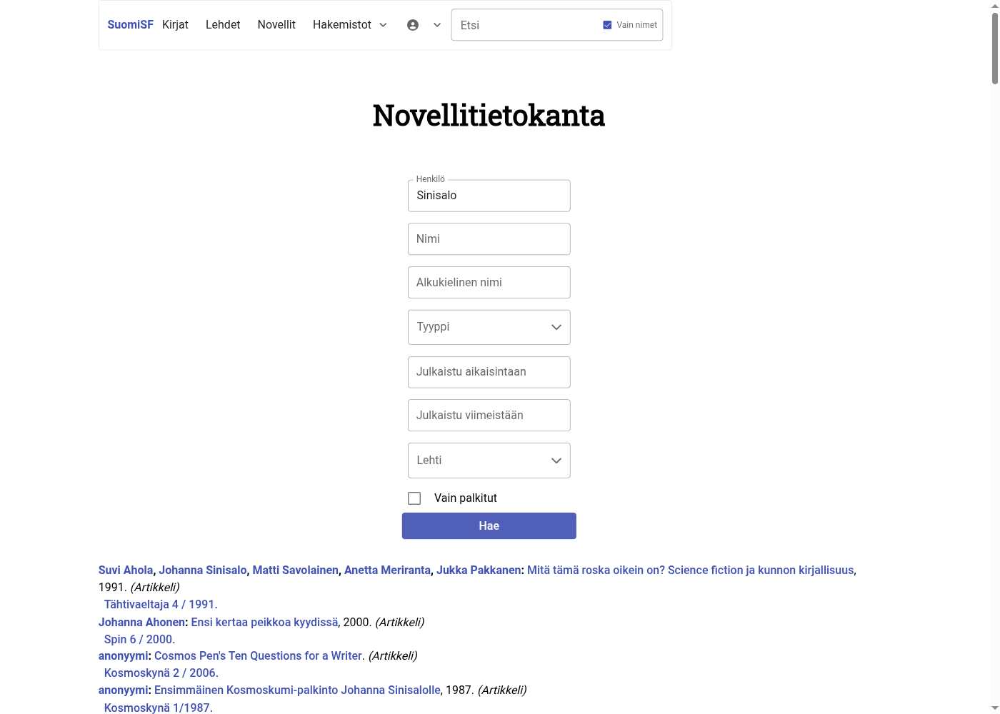
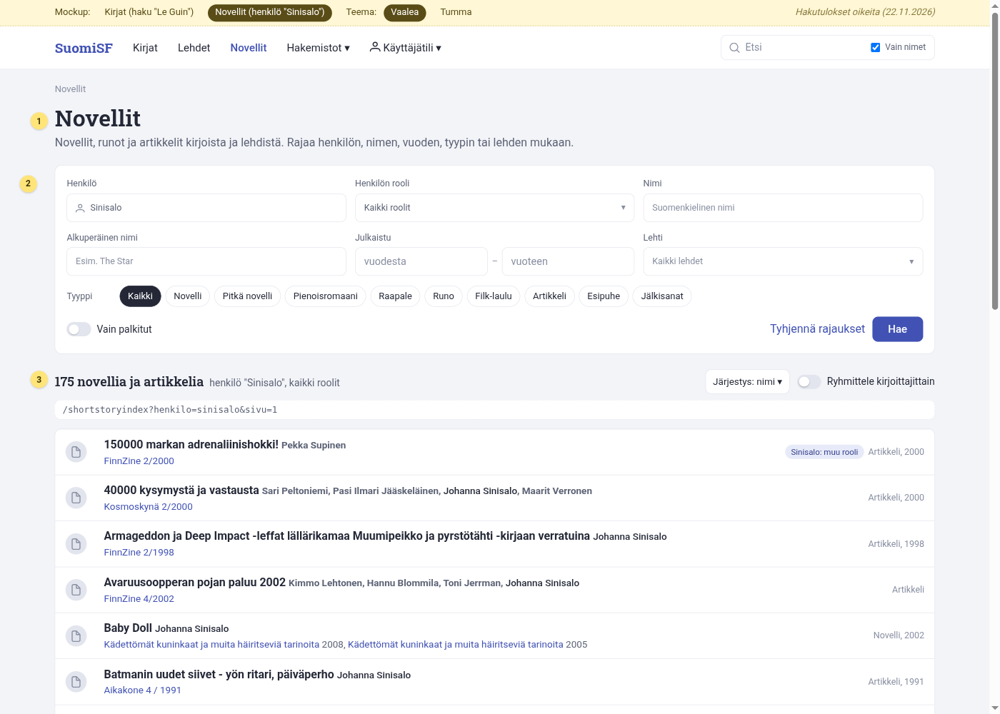
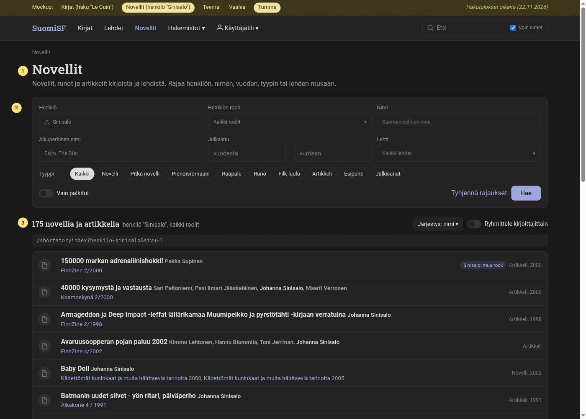
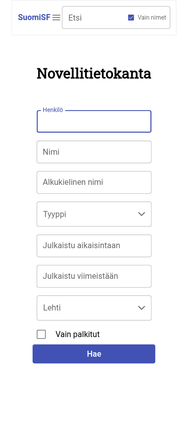
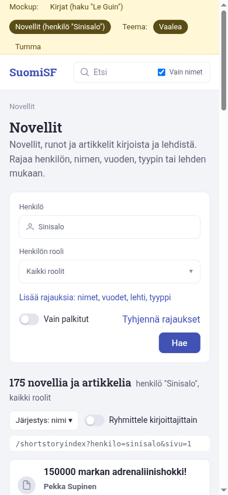
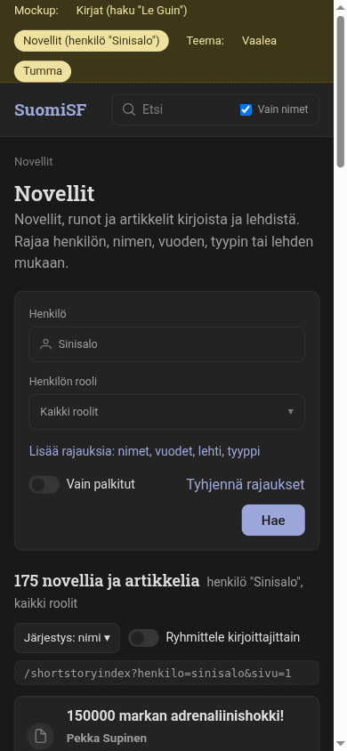

# Short story index

**Route:** `/shortstoryindex` ("Novellit" in the menu) · **Code:** `src/features/short/routes/short-search-page.tsx`, `src/features/short/components/shorts-list.tsx`;
backend `POST /api/searchshorts`
**Status:** Agreed · **Updated:** 2026-11-22
**Sample:** https://www.sf-bibliografia.fi/shortstoryindex, searched for person "Sinisalo" (175 hits).
**Mockup:** [`../mockups/index.html?k=shorts`](../mockups/index.html) with [`index-data.js`](../mockups/index-data.js) (real results).
It shares its pattern with the [book index](book-index.md); see that plan for the common parts (filter panel, letter bar, URL state, paging).

| Before | After (mockup, light) | After (mockup, dark) |
|---|---|---|
|  |  |  |
|  |  |  |

More: [before, empty](../images/short-index/before-shorts-empty-desktop.png) · [after, whole page](../images/short-index/after-shorts-full.png).
Dark: [desktop](../images/short-index/after-shorts-desktop-dark.png), [phone](../images/short-index/after-shorts-mobile-dark.png),
[whole page](../images/short-index/after-shorts-full-dark.png).

## What's wrong today

1. **A narrow centred form:** eight fields stacked in one column, 735 px tall even on a wide screen, before any result.
2. **"Henkilö" matches every role without saying so.** Searching "Sinisalo" returns her stories, but also articles by others where she only appears
   (e.g. "150000 markan adrenaliinishokki!" by Pekka Supinen), with nothing to tell them apart.
3. **No count, no sort, no paging:** 175 hits make a 9,610 px page of dense text lines ("Johanna Ahonen: Ensi kertaa peikkoa kyydissä, 2000. (Artikkeli) Spin 6 / 2000.").
4. **Nothing is in the URL;** the page starts empty with no way to browse.
5. Centred title "Novellitietokanta"; floating labels; "Vain palkitut" as a lone checkbox.

## Proposed layout

The same structure as the book index (header, filter panel, results header with count, rows, paging). Specific to short stories:

1. **Header** "Novellit" with one sentence; with no filters, every short story, paged.
2. **Filter panel:** person **plus a role** (default "Kaikki roolit", as the person search works today; Kirjoittaja, Suomentaja, Esiintyy), title, original title, year range, magazine;
   **type chips** (Novelli, Pitkä novelli, Pienoisromaani, Raapale, Runo, Filk-laulu, Artikkeli, Esipuhe, Jälkisanat); "Vain palkitut" as a switch.
   On a phone the first two fields show and the rest open from "Lisää rajauksia".
3. **Results header:** count and what was searched (text fields search on Enter or "Hae", chips and selects at once), sort (title, author, year), "Ryhmittele kirjoittajittain", everything in the URL
   (`/shortstoryindex?henkilo=sinisalo&rooli=kirjoittaja&tyyppi=novelli`).
4. **Rows:** title, authors (the searched person in bold), where it was published (books and magazine issues as links, "ja 3 muuta" after three),
   type and year on the right, an award marker when it has won one. When the searched person isn't an author of the hit, a small
   "Sinisalo: muu rooli" label says why it's there.
5. **Paging:** 25 or 50 per page.

## Shared principles used or added

Same as the [book index](book-index.md), including the new rule that large lists are paged on the server.

## Implementation steps

1. **Backend:** `searchshorts` gets paging and totals, sorting, the person's role as a filter, multi-select types, and a lighter payload
   (title, authors, type, year, where published, award flag).
2. **Shared index component** from the book index plan; short story rows; the "muu rooli" label from the person's role in each hit.
3. **Tests and wiki:** update the short story search part of `SuomiSF‐ohje.md`.

## Tests

- Backend: paging, role filter (Sinisalo as writer vs any role), type multi-select, awarded only.
- Playwright: list shows before any search; role filter narrows "Sinisalo" to her own texts; URL keeps filters across reload; phone filters collapse.

## Open questions

_None._

## Decisions

2026-11-22, project owner:
- The backend change (paging, totals, sorting, role filter, multi-select types, lighter payload) is fine.
- The person filter keeps today's behaviour: it matches every role by default ("Kaikki roolit"); the role select narrows it.
- Results update as in the book index: text fields on Enter or "Hae", chips and selects at once.
