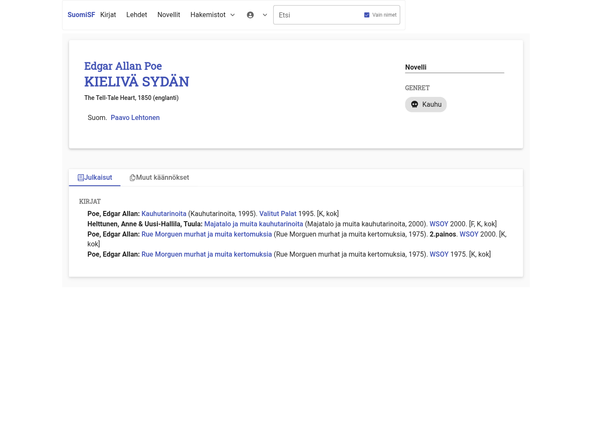
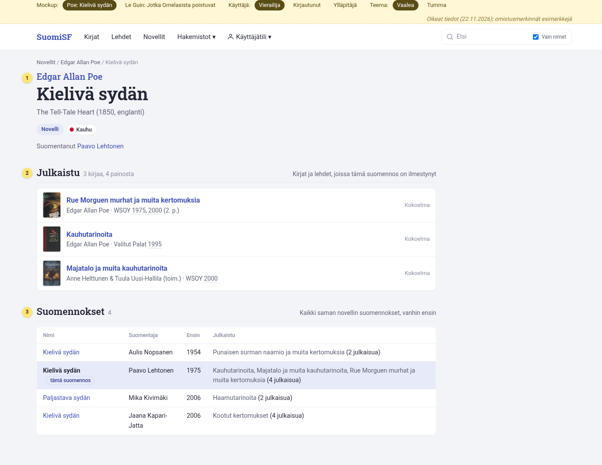
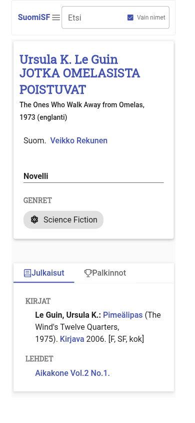
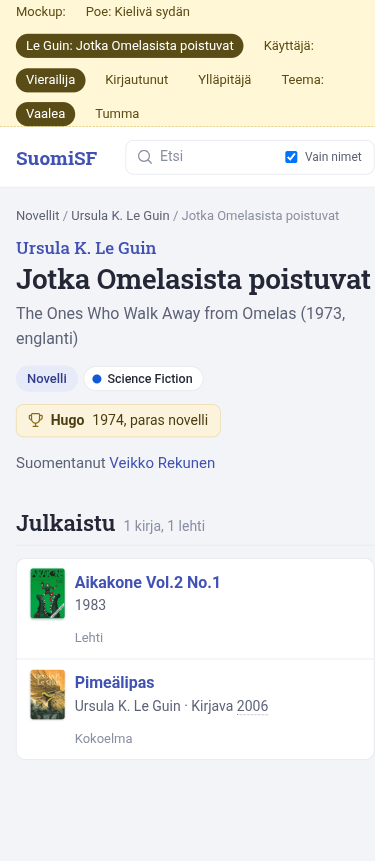

# Short story page

**Route:** `/shorts/:id` · **Code:** `src/features/short/routes/short-page.tsx`, `src/features/short/components/short-defails.tsx`,
`src/features/short/components/similar-shorts.tsx`; backend `GET /api/shorts/:id` and `/api/shorts/:id/similar` (other translations: same author and original title)
**Status:** Agreed · **Updated:** 2026-11-22
**Sample pages:** Edgar Allan Poe, *Kielivä sydän* (https://www.sf-bibliografia.fi/shorts/714): three books, four Finnish translations.
Ursula K. Le Guin, *Jotka Omelasista poistuvat* (https://www.sf-bibliografia.fi/shorts/1028): Hugo award, one book and one magazine.
**Mockup:** [`../mockups/short.html`](../mockups/short.html) with [`short-data.js`](../mockups/short-data.js) (real data). `?s=a` is Poe, `?s=b` Le Guin;
the yellow bar also switches visitor / logged-in / admin and light / dark. Ownership marks are made-up examples.

| Before | After (mockup) |
|---|---|
|  |  |
|  |  |

More: [before, "Muut käännökset" tab](../images/short/before-714-translations.png) · [before, Le Guin](../images/short/before-1028-desktop.png) ·
[after, Le Guin](../images/short/after-omelas-desktop.png) · [after, logged in (owned marks)](../images/short/after-poe-user.png) · [after, admin (year note)](../images/short/after-poe-admin.png) · [after, Poe on a phone](../images/short/after-poe-mobile.png).
Dark theme: [Poe](../images/short/after-poe-desktop-dark.png), [Le Guin](../images/short/after-omelas-desktop-dark.png),
[logged in](../images/short/after-poe-user-dark.png), [admin](../images/short/after-poe-admin-dark.png), [phone](../images/short/after-omelas-mobile-dark.png).

## What's wrong today

The page is short (680 px for Poe), so length isn't the problem. The problems are about answering "where can I read this?"

1. **Publications are text lines with codes.** "Poe, Edgar Allan: Kauhutarinoita (Kauhutarinoita, 1995). Valitut Palat 1995. [K, kok]":
   the bracketed genre codes mean nothing to most readers, there are no covers, and the book's own title is repeated in brackets.
2. **Two printings of the same book are two separate lines** (Rue Morguen murhat… 1975 and its 2nd printing 2000), with the book title written twice.
3. **Books and magazines are separate lists** under small uppercase headings, so the order the story came out in is lost.
4. **Other translations are hidden in a tab** ("Muut käännökset"), as bare lines without where or when each appeared
   ("Kielivä sydän (The Tell-Tale Heart, 1850). Suom Aulis Nopsanen."). For a story translated four times, that comparison is the interesting part.
5. **Awards are hidden in a tab,** like on the work page before its plan (Le Guin's Hugo).
6. **Three tabs for a few lines each,** title in uppercase, and a sidebar that mostly holds just the type and one genre chip.

## Proposed layout

```
Novellit / Edgar Allan Poe / Kielivä sydän
Edgar Allan Poe
Kielivä sydän
The Tell-Tale Heart (1850, englanti)
(Novelli) (● Kauhu)   [🏆 Hugo 1974, paras novelli]
Suomentanut Paavo Lehtonen

Julkaistu  3 kirjaa, 4 painosta          Kirjat ja lehdet, joissa tämä suomennos on ilmestynyt
┌ ▫ Rue Morguen murhat ja muita kertomuksia   Edgar Allan Poe · WSOY 1975, 2000 (2. p.)   Kokoelma ┐
│ ▫ Kauhutarinoita                            Edgar Allan Poe · Valitut Palat 1995         Kokoelma │
└ ▫ Majatalo ja muita kauhutarinoita          A. Helttunen & T. Uusi-Hallila (toim.) · WSOY 2000 ┘

Suomennokset  4                           Kaikki saman novellin suomennokset, vanhin ensin
 Nimi                 Suomentaja          Ensin  Julkaistu
 Kielivä sydän        Aulis Nopsanen      1954   Punaisen surman naamio… (2 julkaisua)
 Kielivä sydän ◂tämä  Paavo Lehtonen      1975   Kauhutarinoita, Majatalo…, Rue Morguen… (4)
 Paljastava sydän     Mika Kivimäki       2006   Haamutarinoita (2)
 Kielivä sydän        Jaana Kapari-Jatta  2006   Kootut kertomukset (4)
```

The numbers 1–4 in the mockup screenshots match the sections below. The page is a single column (up to about 920 px); a short story
rarely has enough tags or people for a sidebar. When it has tags, they go under the header grouped by type, as on the work page.

1. **Header:** author link, title in mixed case, original title with year and language, type and genre chips, award chips (agreed rule:
   up to three, the rest in a dialog), "Suomentanut …", and the notes field under it when there is one.
2. **"Julkaistu": one list of books and magazines, oldest first.** One row per book (not per printing): cover, book title, author or
   editor, publisher and the printing years (each year links to that edition, `/editions/:id`), and the book's type on the right.
   Magazine issues are rows too, with the issue cover when there is one. The heading says how many: "3 kirjaa, 4 painosta" or "1 kirja, 1 lehti".
   **Logged-in users** see ★ before a printing they own, as today (`EditionSummary isOwned`).
3. **"Suomennokset": every Finnish translation of the same story side by side**, oldest first: title, translator, the year it first appeared,
   and where it has been published with a count. The current translation is highlighted and labelled "tämä suomennos"; the others link to their pages.
   Shown only when there is more than one translation (today's "Muut käännökset" tab, from `/api/shorts/:id/similar`).
   It replaces the tab.
4. **Original-year note (admins).** When the translations of the same story give different original years
   (*The Tell-Tale Heart*: 1843 for "Paljastava sydän", 1850 for the others), admins see a note above the table listing them.
   It's there so the cause can be checked later; if the differences turn out not to be errors, the note is removed.

**Admins** keep today's SpeedDial (Muokkaa, Palkinnot, Poista). There's no change history for short stories today
(`EntityChanges` supports only works and people), so the mockup doesn't show one.

## Shared principles used or added

Uses from [principles.md](../principles.md): mixed-case titles, award chips in the header, genre chips with old colours, tags grouped by type,
title next to every cover, no "Suomeksi" labels, real main menu per role, dark theme, page width.

New rule from this plan:
- Printings of the same book are one row with their years, not one row per printing (as on the person page).

## Implementation steps

All frontend: `/api/shorts/:id` already returns editions with their work, publisher, printing number and covers, magazine issues, awards and genres;
`/similar` returns the other translations. The translations table needs each translation's editions and issues; today it would take one request
per translation, so the `/similar` response will include them (agreed backend change).

1. **Header**: `short-defails.tsx` in mixed case with type and genre chips, the shared `award-chips.tsx` from the work plan, translator line, notes.
2. **Publications list**: new `short-publications.tsx` grouping editions by work (pure `groupEditionsByWork(editions)` with Vitest tests),
   merged with issues and sorted by year; reuse the compact row component.
3. **Translations table**: rework `similar-shorts.tsx` into `short-translations.tsx` (pure `translationRows(current, similar)` for the order,
   first year and places), plus the admin original-year note (`origYearMismatch(current, similar)`).
4. **Remove the tabs** and the near-empty sidebar.
5. **Tests and wiki**: Playwright for the publications list, the translations table and the owned marks; update the short story part of `SuomiSF‐ohje.md`.

## Tests

- Vitest: `groupEditionsByWork` (Poe fixture: Rue Morguen 1975 and 2000 become one row), `translationRows` (oldest first, current flagged, counts),
  `origYearMismatch` (Poe: 1843 vs 1850).
- Playwright: a printing year links to `/editions/:id`; the translations table appears only with more than one translation and links to the others;
  logged-in user sees ★ on an owned printing; admin sees the SpeedDial and the original-year note, a visitor doesn't; award chip shows for Le Guin.

## Open questions

_None._

## Decisions

2026-11-22, project owner:
- `/api/shorts/:id/similar` will also return each translation's books and magazines.
- Change history for short stories comes later, after the new UI is in place (in the README's "Later" list).
- Admins see a note when translations of the same story disagree on the original year; the cause is checked later and the note removed if the differences aren't errors.
