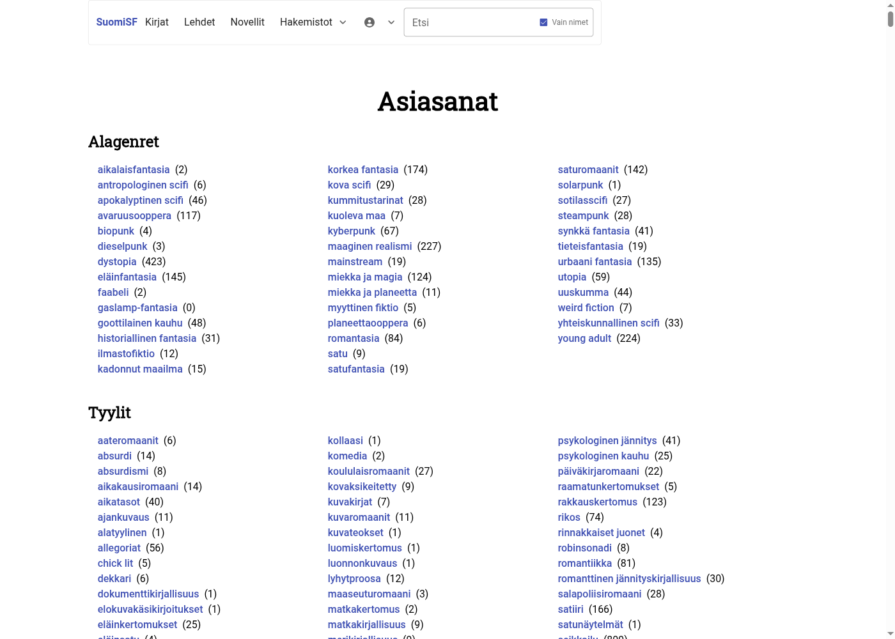
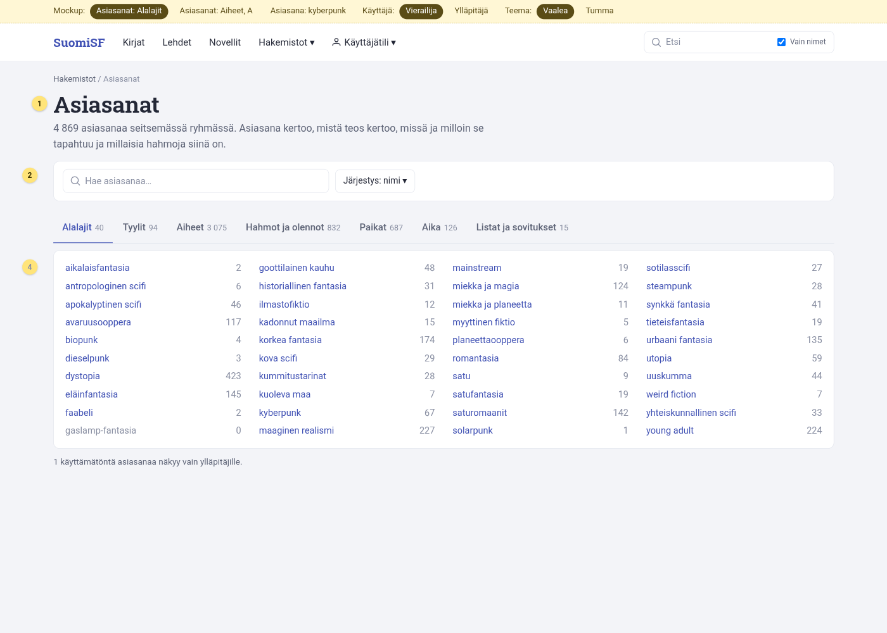
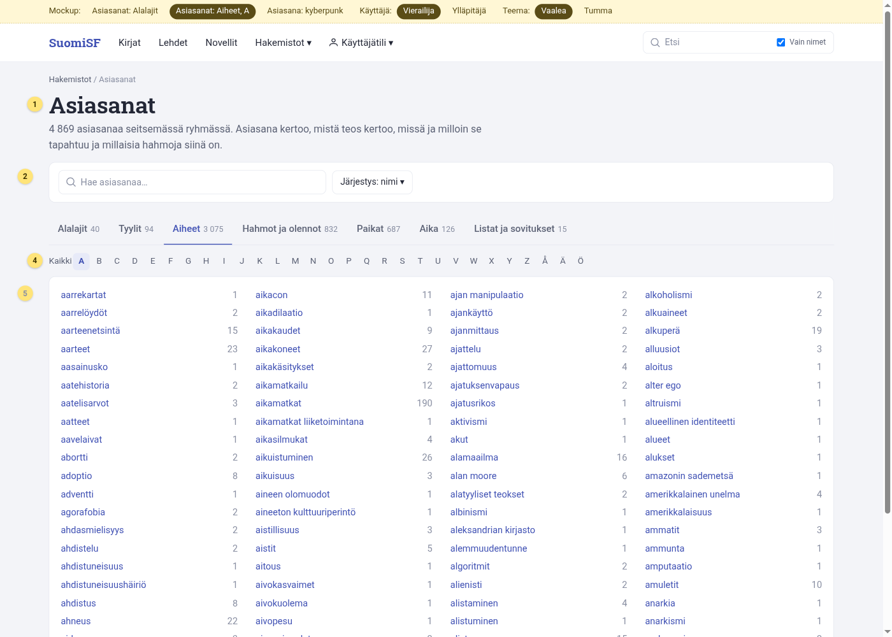
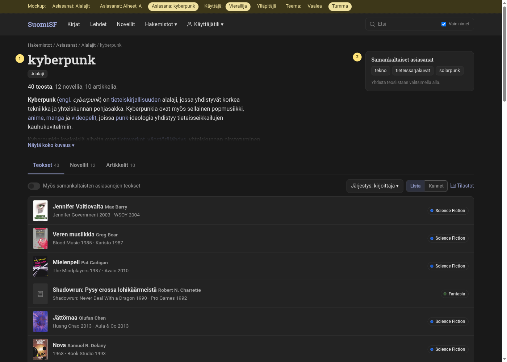
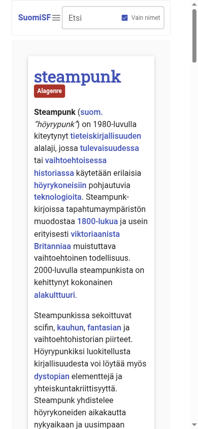
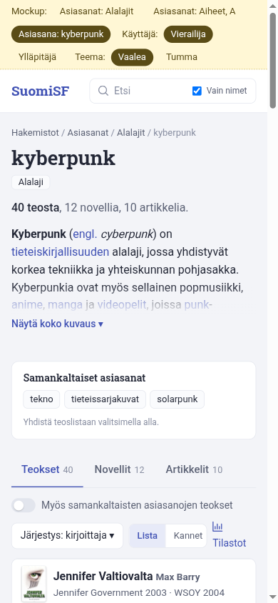

# Tags

**Routes:** `/tags` (list) and `/tags/:id` · **Code:** `src/features/tag/routes/sftags-page.tsx`, `sftag.tsx`,
`src/features/tag/components/similar-tags-editor.tsx`; backend `GET /api/tags`, `/api/tags/:id`, `/api/tags/:id/similar`, `/api/tags/:id/similar/works`
**Status:** Agreed; both pages implemented as admin-only trials in identity style (2026-11-28) · **Updated:** 2026-11-28
**Samples:** the list (4,869 tags), kyberpunk (40 works, 12 stories, 10 articles, three similar tags, https://www.sf-bibliografia.fi/tags/303)
and steampunk for the before shot (https://www.sf-bibliografia.fi/tags/305).
**Mockup:** [`../mockups/tags.html`](../mockups/tags.html) with [`tags-data.js`](../mockups/tags-data.js) (real data): `?v=list` the Alalajit tab,
`?v=aihe` the Aiheet tab at letter A, `?v=tag` kyberpunk. The yellow bar switches visitor / admin and light / dark.

| Before | After (mockup, light) | After (mockup, dark) |
|---|---|---|
|  |  |  |
| _no tabs or letters today_ |  |  |
|  |  |  |
|  |  |  |

More: [after, tag as admin](../images/tags/after-tag-admin.png) ([dark](../images/tags/after-tag-admin-dark.png)) ·
phones: [list before](../images/tags/before-list-mobile.png), [list after](../images/tags/after-list-mobile.png) ([dark](../images/tags/after-list-mobile-dark.png)).

## What's wrong today

**List (`/tags`)**
1. **All 4,869 tags on one page:** 39,833 px on desktop and **117,882 px on a phone**. The API sends every tag with all its works, stories and
   articles (1.35 MB, **12 s**) only so the page can count them.
2. **No search, no sorting, no way to jump** to a letter or a group; the seven groups are headings far down the page (Aiheet alone has 3,075 tags).
3. Group names differ from the work page ("Alagenret", "Toimijat", "Tapahtuma-aika"); 21 tags with no works show "(0)" to everyone.

**Tag (`/tags/:id`)**
4. **The description isn't clamped:** steampunk's Wikipedia text pushes the works below the fold.
5. **Counts in uppercase stat boxes** on the right ("TEOKSIA 25 / NOVELLEJA 0 / ARTIKKELEITA 2"), and the type as a red "Alagenre" badge.
6. **Similar tags** sit above the tabs, and the checkbox that adds their works is inside the works tab without saying which tags they are.
7. The work list is the old text list with "Ryhmittele tekijän mukaan" and three density buttons; tab label "Artikkeli (2)" is singular.

## Proposed layout

**List**
1. Header "Asiasanat" with a count and one sentence on what tags are.
2. Filter bar: search by name (server side), sort by name or by number of works.
3. **Tabs per group** with counts, using the work page's group names (Alalajit, Tyylit, Aiheet, Hahmot ja olennot, Paikat, Aika,
   Listat ja sovitukset). Tab, letter and sort in the URL.
4. **Letter bar** for big groups (Aiheet, Hahmot ja olennot, Paikat); small groups show everything.
5. **Columns of name and count**, count right-aligned. Unused tags are shown only to admins (for clean-up), greyed.

**Tag**
1. Header: name, a neutral type chip ("Alalaji"), one facts line ("40 teosta, 12 novellia, 10 artikkelia"), description clamped with "Näytä koko kuvaus".
2. **Sidebar:** similar tags as chips; admins also get the similar-tag editor (add, dismiss) and the SpeedDial (edit, merge, delete).
3. **Tabs with counts:** Teokset, Novellit, Artikkelit (plural).
4. **Works as compact rows** (the shared row: cover, title, author, original title and year, first publisher, genre chips), sort, Lista / Kannet, Tilastot.
   The switch "Myös samankaltaisten asiasanojen teokset" sits above the list; added works show which similar tag they came from.

## Implementation (2026-11-28): both pages as admin-only trials

Built to the [build rules](../README.md#rules-for-every-redesigned-page-decided-2026-11-24). Admins switch with *Uusi asiasanasivu*
(`/tags`, `suomisf.tagsPageVersion`) or *Uusi asiasanan sivu* (`/tags/:id`, `suomisf.tagPageVersion`), or Shift+U; everyone else gets
the current pages. Code: `src/features/tag/new/` (pages, `tags-state.ts` with Vitest tests, `tags-new.css`), switches in
`src/features/tag/routes/tags-page-switch.tsx`.

- **Backend:** `GET /api/tagindex` (`app/impl_tagindex.py`): one group, optionally a letter (A–Ö, or `0` for other initials such as
  "1800-luku") or a search, sort by name or count, with every group's count for the tabs; unused tags only with `unused=1`. Aiheet
  at A is 8 kB; the current list loads 1.35 MB. `/api/tags` and `/api/tagsquick` are unchanged, so the current pages keep working.
  `GET /api/bookindex` got a `tag` filter and `tag_similar=1` (rows then carry `matched_tags`).
- **List:** header with the total; search by name (Enter) and sort (*Nimi*, *Yleisimmät ensin*); tabs with counts in the work page's
  group names; the letter bar on Aiheet, Hahmot ja olennot and Paikat, which open at A (*Kaikki* lists the whole group; a search
  covers the whole group and hides the letters); columns of name and count. Admins also get unused tags, greyed with 0. URL:
  `ryhma`, `kirjain` (`kaikki` for every letter), `haku`, `jarjestys=maara`.
- **Tag page:** crumbs Asiasanat / group; name, the neutral type ("Alalaji"), the facts line, the description clamped with
  *Näytä koko kuvaus*; similar tags in the sidebar as text links with their type. Tabs Teokset, Novellit, Artikkelit with counts
  (empty story tabs hidden). Novellit and Artikkelit are split as on the current page (story types 7–9, Artikkeli, Esipuhe,
  Jälkisanat, are articles). URL: `valilehti`, `samankaltaiset=1`, and the list's own `jarjestys`, `ryhmittely`, `sivu`, `riveja`,
  `tilastot`.
- **Works use the book index's list** (memory of 2026-11-26: the agreed row is reused on every later work list): the shared
  `BookResults` and `WorkRow` (`src/features/work/bookindex/`), so the tag page has the same text rows, sorting, grouping, paging and
  *Tilastot tästä hausta*. The plan's cover thumbnails and Lista/Kannet switch are left out for that reason. The switch
  *Myös samankaltaisten asiasanojen teokset (…)* above the list adds the similar tags' works; a work that has only a similar tag gets
  the line "Samankaltainen asiasana: solarpunk", linked.
- **Stories and articles** as on the current list, restyled: writers, title, (original title, year), translators, genres, and where
  each was published (each book once, magazine issues); every name a link. Artikkelit shows the type (Artikkeli, Esipuhe, …).
- **Admin tools** as on the current page: the SpeedDial (4rem, bottom right) with Muokkaa (the tag form and the similar-tag editor),
  Yhdistä and Poista, reusing the current page's dialogs (`MergeTagsDialog` is now exported from `sftag.tsx`).
- **Tests:** backend `tests/api/test_tagindex.py`, `TestBookIndexTag` in `test_bookindex.py`; Playwright `tests/admin/tags-new.spec.ts`,
  `tag-new.spec.ts`, the tag page in `identity-dial.spec.ts`, `tests/anon|user/tags-version.spec.ts`.

### Compared with the live site (2026-11-28)

| Value | Plan / mockup | Live (current pages, production API) | New page | Why |
|---|---|---|---|---|
| kyberpunk works, stories, articles | 40, 12, 10 | 40, 12 Novelli, 10 Artikkeli | 40, 12, 10 | same rule (story types 7–9 are articles) |
| Tags in all | 4,869 | 4,997 (21 unused) | 4,235 on the dev database | the dev database is older than production; same count rule |
| aikamatkat in the list | 190 | 190 works + 8 stories + 5 articles = 203 shown | works + stories + articles | the mockup showed works only; the new list counts as the current one does, so the sort is *Yleisimmät ensin*, not "Eniten teoksia" |

### Notes: possible issues on the live site (not fixed here)

1. Magazine articles linked to a tag (`articletag`, e.g. kyberpunk's 5) count in the list's number but neither the current nor the new
   tag page lists them.
2. Names that start with a letter outside A–Ö (e.g. "Š…") fall under "0–9" in the letter bar.

## Shared principles used or added

Uses: filters above lists, state in the URL, tabs with counts on one row, clamped long text, text first (Lista default), genre dot chips,
large lists paged or split on the server, dark theme, page width, mixed-case titles.

No new rules.

## Implementation steps

1. **Backend:** `/api/tags` returns id, name, type and counts only (no works), with optional `type`, `letter` and `q` filters.
   `/api/tags/:id` stays; the works list could later page like the publisher page if a tag grows large (dystopia has 421 works).
2. **List page:** tabs, letter bar, columns; admin-only unused tags.
3. **Tag page:** header and clamp, sidebar with similar tags, tabs, the shared work rows; the similar-works switch marks each added work's tag.
4. **Tests and wiki:** Playwright for tabs and letters in the URL, search, the similar-works switch; update `SuomiSF‐ohje.md`.

## Tests

- Backend: the light list has counts and no works; filters by type and letter.
- Playwright: `/tags` opens on Alalajit; Aiheet with letter A lists "aikamatkat 190"; a visitor doesn't see unused tags, an admin does;
  kyberpunk shows tabs Teokset 40, Novellit 12, Artikkelit 10; turning on the switch adds works marked "solarpunk".

## Open questions

_None._

## Decisions

2026-11-23, project owner:
- The backend change (light list with counts and type, letter and search filters) is fine.
- Unused tags are shown to admins only.
- The list opens on Alalajit, the most important group.
