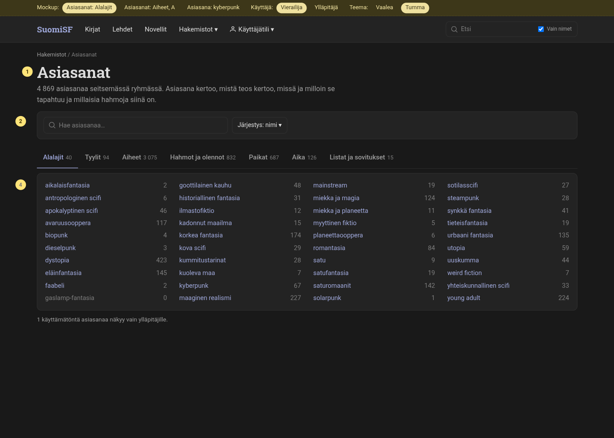
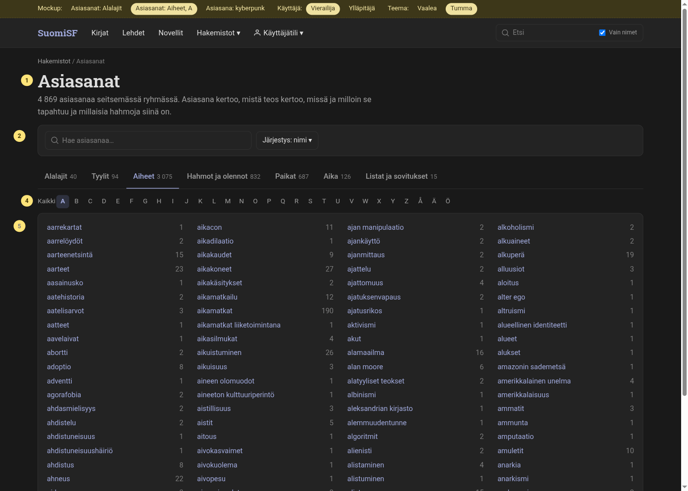
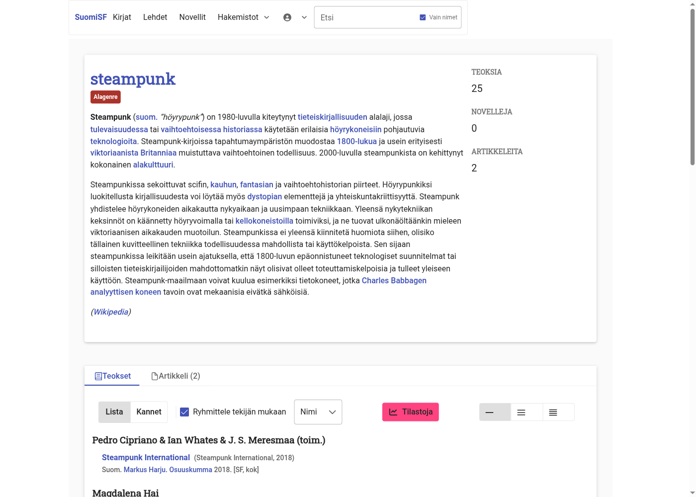
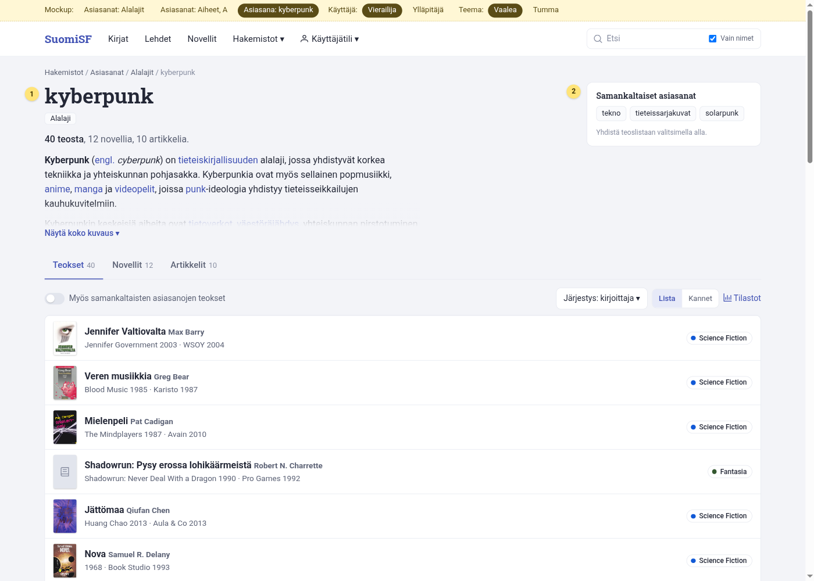
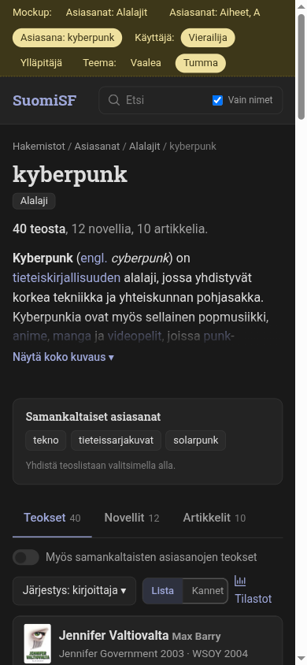

# Tags

**Routes:** `/tags` (list) and `/tags/:id` · **Code:** `src/features/tag/routes/sftags-page.tsx`, `sftag.tsx`,
`src/features/tag/components/similar-tags-editor.tsx`; backend `GET /api/tags`, `/api/tags/:id`, `/api/tags/:id/similar`, `/api/tags/:id/similar/works`
**Status:** Agreed · **Updated:** 2026-11-23
**Samples:** the list (4,869 tags), kyberpunk (40 works, 12 stories, 10 articles, three similar tags, https://www.sf-bibliografia.fi/tags/303)
and steampunk for the before shot (https://www.sf-bibliografia.fi/tags/305).
**Mockup:** [`../mockups/tags.html`](../mockups/tags.html) with [`tags-data.js`](../mockups/tags-data.js) (real data): `?v=list` the Alalajit tab,
`?v=aihe` the Aiheet tab at letter A, `?v=tag` kyberpunk. The yellow bar switches visitor / admin and light / dark.

| Before | After (mockup, light) | After (mockup, dark) |
|---|---|---|
|  |  |  |
| _no tabs or letters today_ |  |  |
|  |  |  |
|  |  |  |

More: [after, tag as admin](../images/tags/after-tag-admin.png) ([dark](../images/tags/after-tag-admin-dark.png)) ·
phones: [list before](../images/tags/before-list-mobile.png), [list after](../images/tags/after-list-mobile.png) ([dark](../images/tags/after-list-mobile-dark.png)).

## What's wrong today

**List (`/tags`)**
1. **All 4,869 tags on one page:** 39,833 px on desktop and **117,882 px on a phone**. The API sends every tag with all its works, stories and
   articles (1.35 MB, **12 s**) only so the page can count them.
2. **No search, no sorting, no way to jump** to a letter or a group; the seven groups are headings far down the page (Aiheet alone has 3,075 tags).
3. Group names differ from the work page ("Alagenret", "Toimijat", "Tapahtuma-aika"); 21 tags with no works show "(0)" to everyone.

**Tag (`/tags/:id`)**
4. **The description isn't clamped:** steampunk's Wikipedia text pushes the works below the fold.
5. **Counts in uppercase stat boxes** on the right ("TEOKSIA 25 / NOVELLEJA 0 / ARTIKKELEITA 2"), and the type as a red "Alagenre" badge.
6. **Similar tags** sit above the tabs, and the checkbox that adds their works is inside the works tab without saying which tags they are.
7. The work list is the old text list with "Ryhmittele tekijän mukaan" and three density buttons; tab label "Artikkeli (2)" is singular.

## Proposed layout

**List**
1. Header "Asiasanat" with a count and one sentence on what tags are.
2. Filter bar: search by name (server side), sort by name or by number of works.
3. **Tabs per group** with counts, using the work page's group names (Alalajit, Tyylit, Aiheet, Hahmot ja olennot, Paikat, Aika,
   Listat ja sovitukset). Tab, letter and sort in the URL.
4. **Letter bar** for big groups (Aiheet, Hahmot ja olennot, Paikat); small groups show everything.
5. **Columns of name and count**, count right-aligned. Unused tags are shown only to admins (for clean-up), greyed.

**Tag**
1. Header: name, a neutral type chip ("Alalaji"), one facts line ("40 teosta, 12 novellia, 10 artikkelia"), description clamped with "Näytä koko kuvaus".
2. **Sidebar:** similar tags as chips; admins also get the similar-tag editor (add, dismiss) and the SpeedDial (edit, merge, delete).
3. **Tabs with counts:** Teokset, Novellit, Artikkelit (plural).
4. **Works as compact rows** (the shared row: cover, title, author, original title and year, first publisher, genre chips), sort, Lista / Kannet, Tilastot.
   The switch "Myös samankaltaisten asiasanojen teokset" sits above the list; added works show which similar tag they came from.

## Shared principles used or added

Uses: filters above lists, state in the URL, tabs with counts on one row, clamped long text, text first (Lista default), genre dot chips,
large lists paged or split on the server, dark theme, page width, mixed-case titles.

No new rules.

## Implementation steps

1. **Backend:** `/api/tags` returns id, name, type and counts only (no works), with optional `type`, `letter` and `q` filters.
   `/api/tags/:id` stays; the works list could later page like the publisher page if a tag grows large (dystopia has 421 works).
2. **List page:** tabs, letter bar, columns; admin-only unused tags.
3. **Tag page:** header and clamp, sidebar with similar tags, tabs, the shared work rows; the similar-works switch marks each added work's tag.
4. **Tests and wiki:** Playwright for tabs and letters in the URL, search, the similar-works switch; update `SuomiSF‐ohje.md`.

## Tests

- Backend: the light list has counts and no works; filters by type and letter.
- Playwright: `/tags` opens on Alalajit; Aiheet with letter A lists "aikamatkat 190"; a visitor doesn't see unused tags, an admin does;
  kyberpunk shows tabs Teokset 40, Novellit 12, Artikkelit 10; turning on the switch adds works marked "solarpunk".

## Open questions

_None._

## Decisions

2026-11-23, project owner:
- The backend change (light list with counts and type, letter and search filters) is fine.
- Unused tags are shown to admins only.
- The list opens on Alalajit, the most important group.
