# Users, profile and admin page

**Routes:** `/users`, `/users/:id`, `/admin` · **Code:** `src/features/user/routes/users-page.tsx`, `profile-page.tsx`,
`src/features/user/components/` (owned-books, read-books, user-stats, collection-stats-dialog, user-collection-charts),
`src/features/admin/routes/admin-page.tsx` and its components; backend `GET /api/users`, `/api/users/:id`, `/api/editions/owned/:id`,
`/api/editions/wishlist/:id`, `/api/works/read/:id`, `/api/users/:id/stats/genres`, `/api/user/:id/collection/stats`
**Status:** Agreed · **Updated:** 2026-11-23
**Samples:** the user list (12 users) and the profile of user 2 (986 editions owned, 47 on the wishlist, 27 read, https://www.sf-bibliografia.fi/users/2).
The admin page needs an admin login, so its before state is described from the code.
**Mockup:** [`../mockups/users.html`](../mockups/users.html) with [`users-data.js`](../mockups/users-data.js) (real data): `?v=owned`, `?v=read`, `?v=stats`,
`?v=users`, `?v=admin`. The yellow bar switches between the profile's owner and another user, and light / dark.

| Before | After (mockup, light) | After (mockup, dark) |
|---|---|---|
| 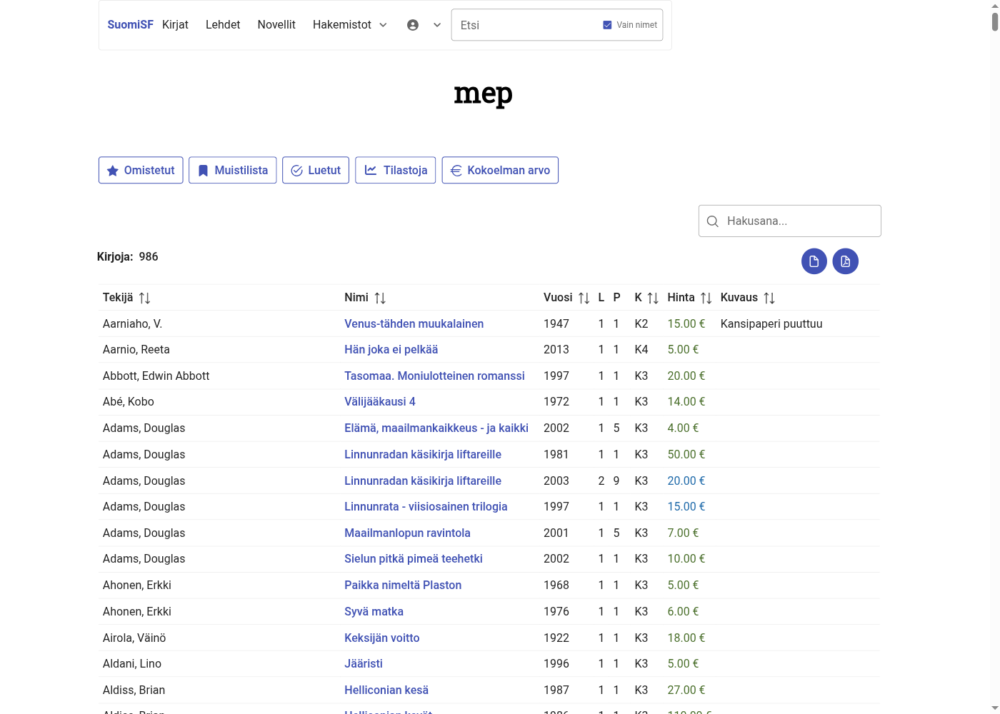 | 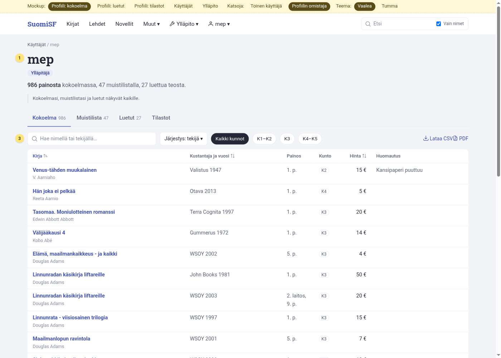 | 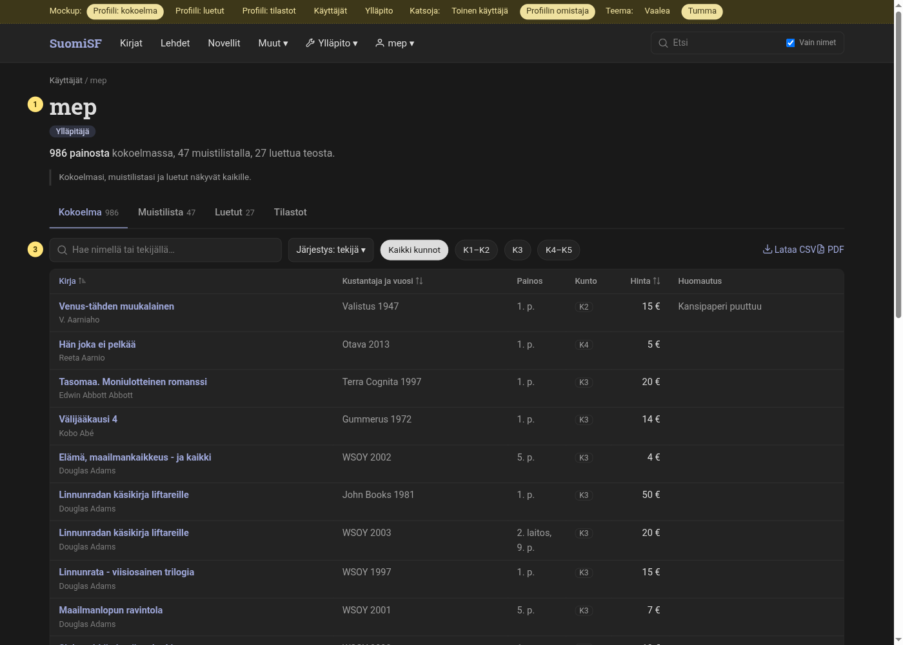 |
| 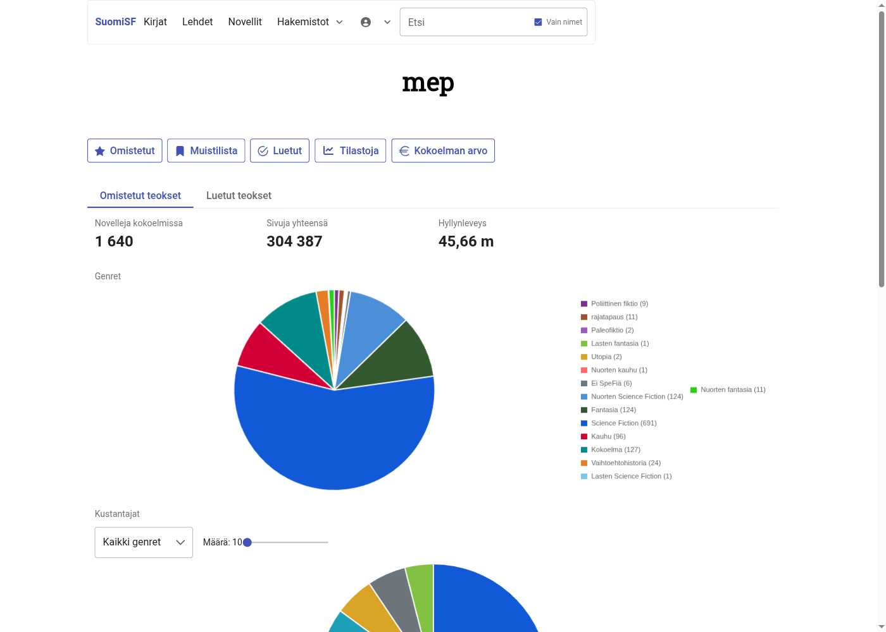 | 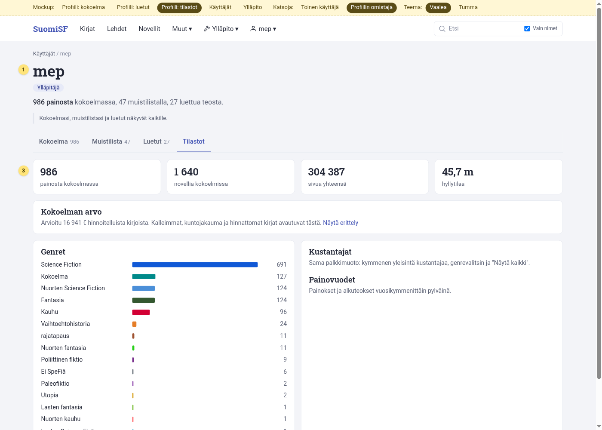 | 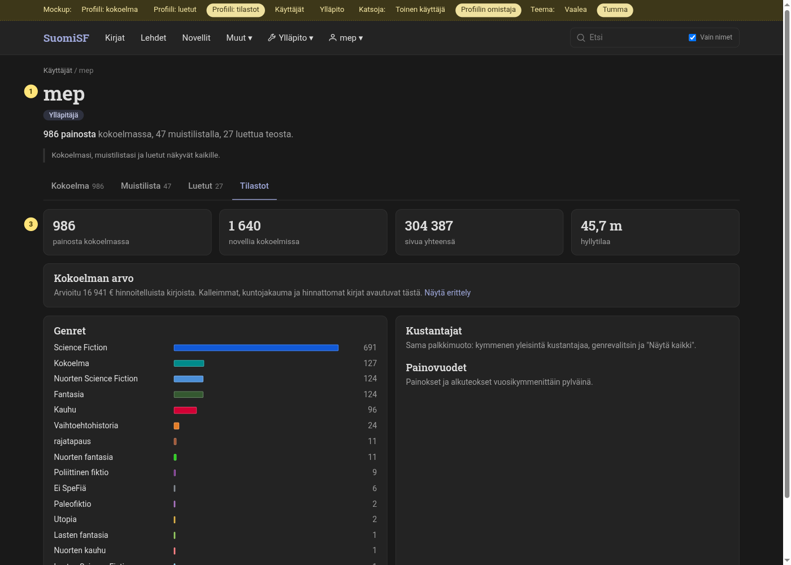 |
| 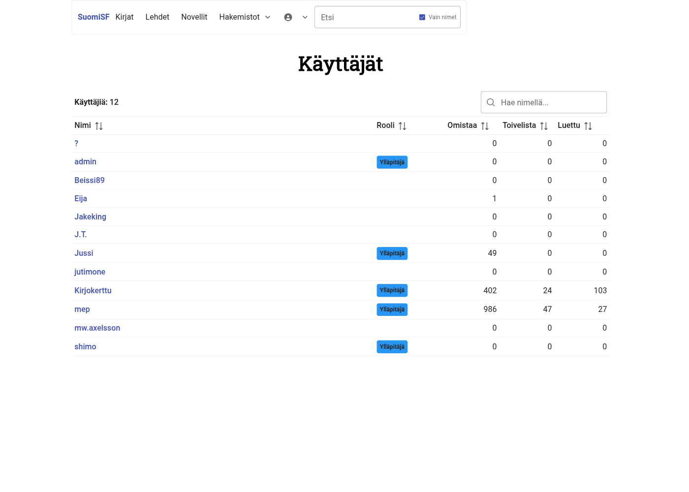 | 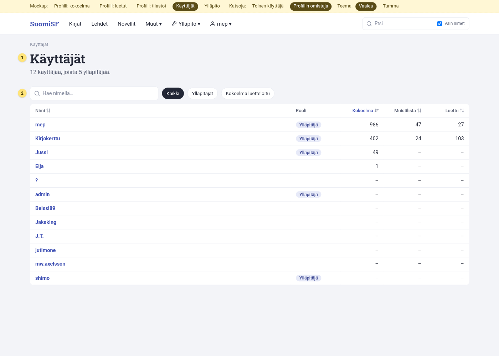 | 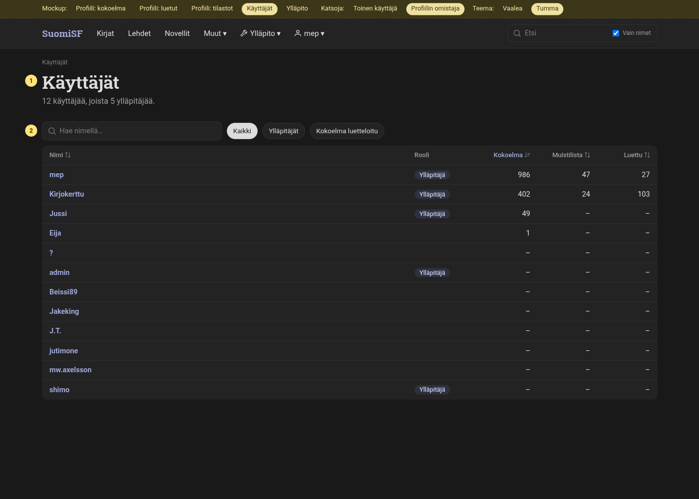 |
| _admin page: four stacked cards (see below)_ | 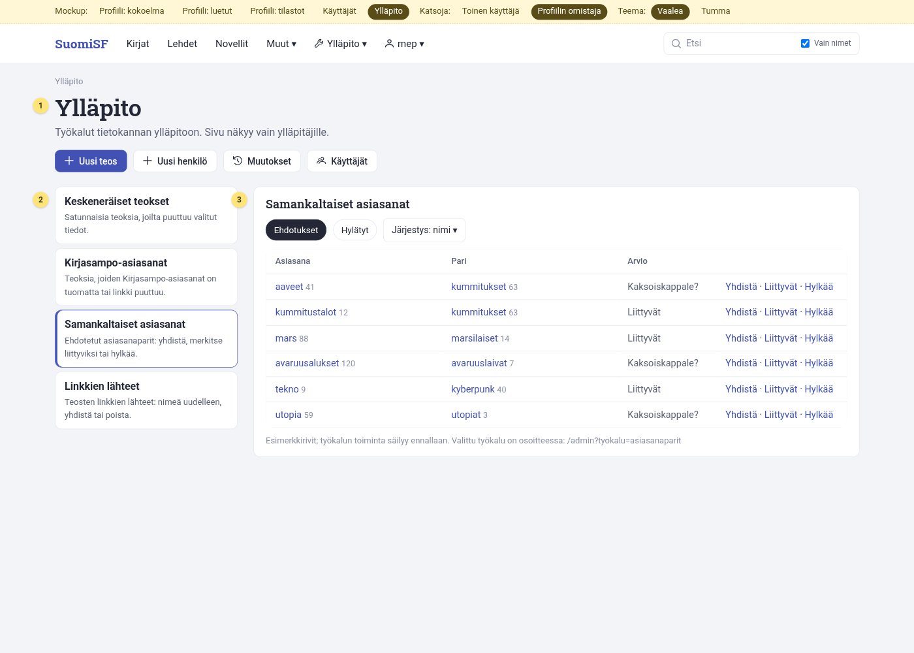 | 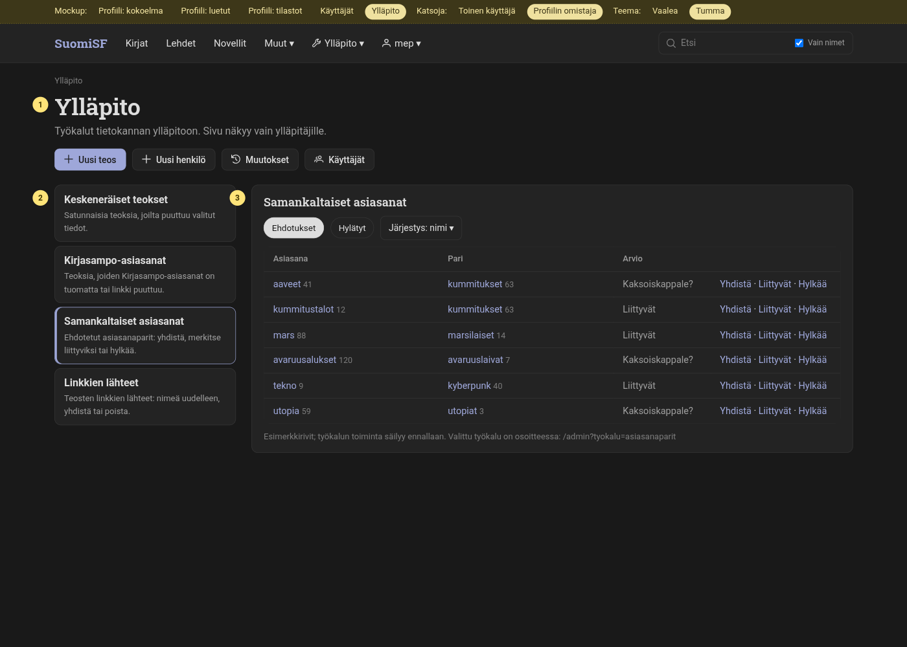 |
| 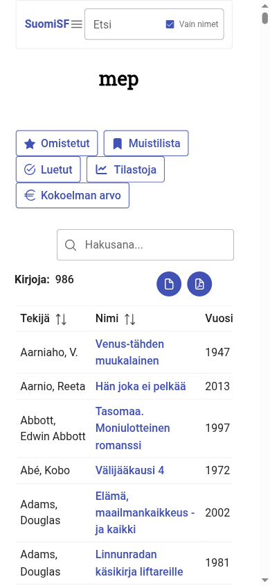 | 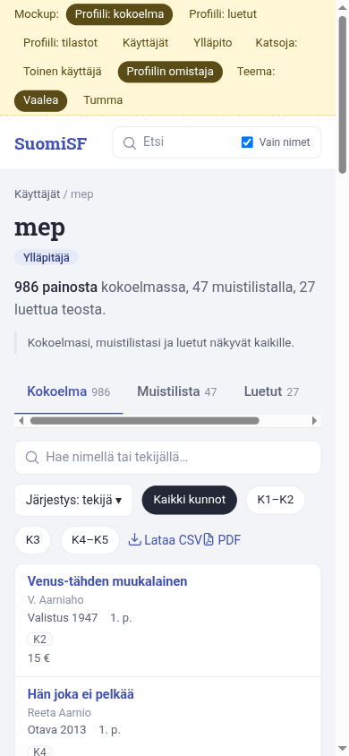 | 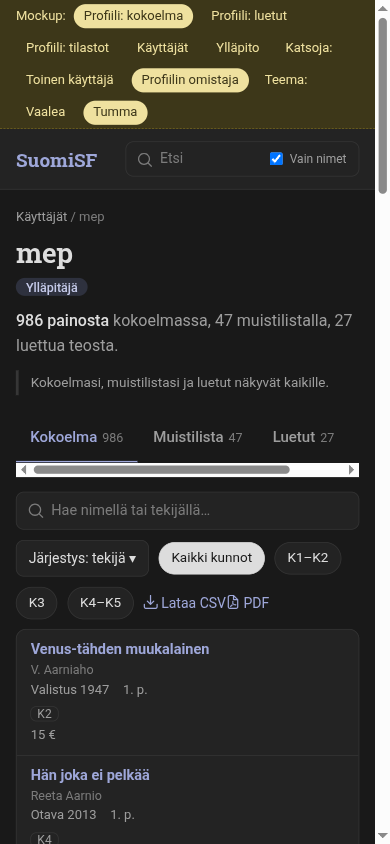 |

More: after: [profile seen by another user](../images/users/after-profile-visitor.png) ([dark](../images/users/after-profile-visitor-dark.png)),
[luetut](../images/users/after-profile-read.png) ([dark](../images/users/after-profile-read-dark.png)) ·
[admin on a phone](../images/users/after-admin-mobile.png) ([dark](../images/users/after-admin-mobile-dark.png)) ·
before: [luetut](../images/users/before-profile-read.png), [admin page as a visitor](../images/users/before-admin-visitor.png).

## What's wrong today

**Profile (`/users/:id`)**
1. **The whole collection in one table:** 986 rows, **37,896 px on desktop and 59,144 px on a phone**, from a 326 kB response.
2. **Views are a row of outlined buttons** (Omistetut, Muistilista, Luetut, Tilastoja, Kokoelman arvo) with no counts; the last one opens a dialog
   instead of a view. The view is kept in the URL as a number (`?view=4`).
3. **Column headers are codes:** "L", "P", "K"; authors surname first; the "Hinta" colours aren't explained.
4. **Statistics are pie charts** with up to 15 slices and a separate legend; small genres can't be read.
5. **Everything is public:** the collection, wishlist, read list, prices and the collection's total value are returned to anyone without a login.
   Prices are public on edition pages anyway, so that is fine; but the page doesn't tell the owner what others see.
6. Loading and error states are in English ("Loading...", "User not found"); centred title.

**User list (`/users`)**
7. A plain table of 12 users; works, but the role badge is a bright button-like chip, a user named "?" shows as a link, and zeros fill the table.

**Admin (`/admin`)**
8. **Four tools stacked as cards on one page** (random incomplete works, Kirjasampo tags, similar tags, work link sources), each loading its own
   data when the page opens. New tools make the page longer; a tool's choices aren't in the URL. "Uusi teos" and "Uusi henkilö" live
   only in the Ylläpito menu.

## Proposed layout

**Profile**
1. Header: user name, role chip, one facts line ("986 painosta kokoelmassa, 47 muistilistalla, 27 luettua teosta").
   **For the owner:** a note on what others can see.
2. **Tabs with counts:** Kokoelma, Muistilista, Luetut, Tilastot; the tab in the URL by name (`?nakyma=luetut`).
3. **Kokoelma:** filter bar (search, sort, condition chips) and a table: book (title, author in natural order), publisher and year,
   printing ("2. laitos, 9. p." written out), condition, price, note. **Paged on the server**, 25 or 50 rows.
   CSV and PDF export for the owner. **Muistilista** uses the same table; **Luetut** adds the opinion (Pidin / Ihan ok / En pitänyt) as a filter.
4. **Tilastot:** four summary numbers; the collection value as a panel (the existing dialog's breakdown opens from it);
   **genres, publishers and years as horizontal bars** in genre colours instead of pies.

**User list:** count sentence, search and chips (Kaikki, Ylläpitäjät, Kokoelma luetteloitu), table sorted by collection size, a soft role chip,
"–" for empty counts.

**Admin**
1. Header with quick actions (Uusi teos, Uusi henkilö, Muutokset, Käyttäjät).
2. **Tool list on the left:** one entry per tool with a sentence on what it does. New tools are added to the list.
3. **One tool visible at a time** on the same page (decided), the chosen tool in the URL (`/admin?tyokalu=asiasanaparit`), so only that tool loads
   its data. The tools keep their current UI, restyled. The mockup's rows in the similar-tags tool are made-up examples (the real data needs an admin login).
   On a phone the list becomes a scrolling row above the tool.

## Shared principles used or added

Uses: tabs with counts and state in the URL, filters above lists, large lists paged on the server, natural name order, genre colours,
tabular data as tables and cards on a phone, dark theme, page width, mixed-case titles, errors with a message and a retry.

No new rules.

## Implementation steps

1. **Backend:** `/api/editions/owned/:id`, `/api/editions/wishlist/:id` and `/api/works/read/:id` take paging, search, sort and filters
   (condition, opinion) and return one page and the total instead of the whole list (986 rows, 326 kB today).
2. **Profile:** header, tabs by name in the URL, shared table with paging, bars for statistics (one small bar component for genres,
   publishers and years), Finnish loading and error states.
3. **User list:** filter bar and table.
4. **Admin:** tool list and a `tyokalu` URL parameter; render only the chosen component (the four components move unchanged).
5. **Tests and wiki:** Playwright for tabs and paging, the owner-only price column, the admin routes; update `SuomiSF‐ohje.md`.

## Tests

- Backend: owned list pages and totals; search and condition filter.
- Playwright: `/users/2?nakyma=luetut` opens Luetut; Kokoelma shows 25 rows and a pager;
  `/admin?tyokalu=asiasanaparit` shows only the similar-tags tool; a visitor at `/admin` gets "Ei käyttöoikeutta".

## Open questions

_None._

## Decisions

2026-11-23, project owner:
- Prices and the collection value may be shown to everyone; edition prices are public already.
- Admin tools stay on one page, with one tool visible at a time.
- The backend change (paging, search, sort and filters on the list endpoints) is fine.
- Anyone can see a user's collection, wishlist and read list; no privacy setting.
