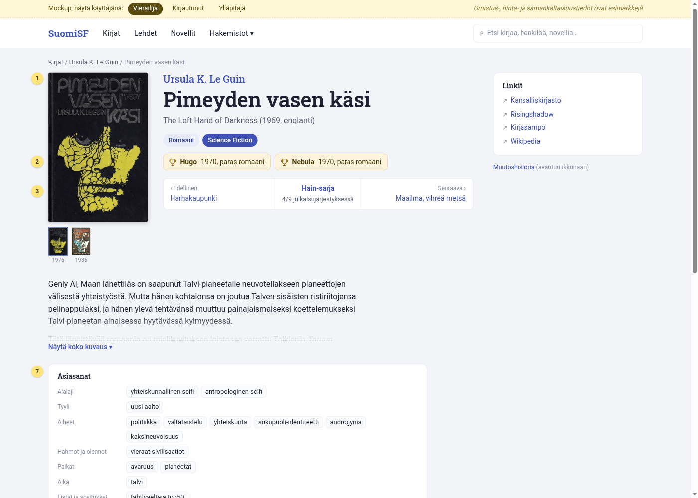
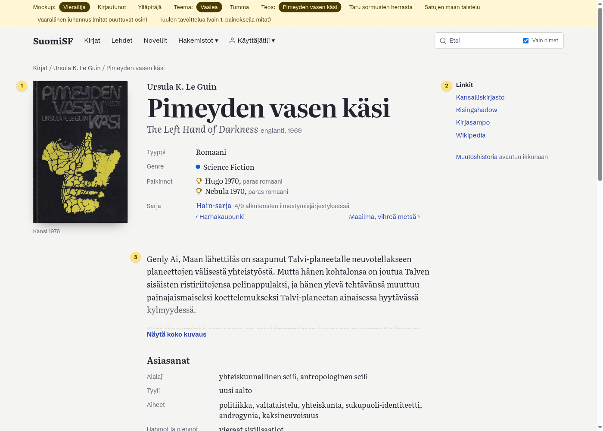
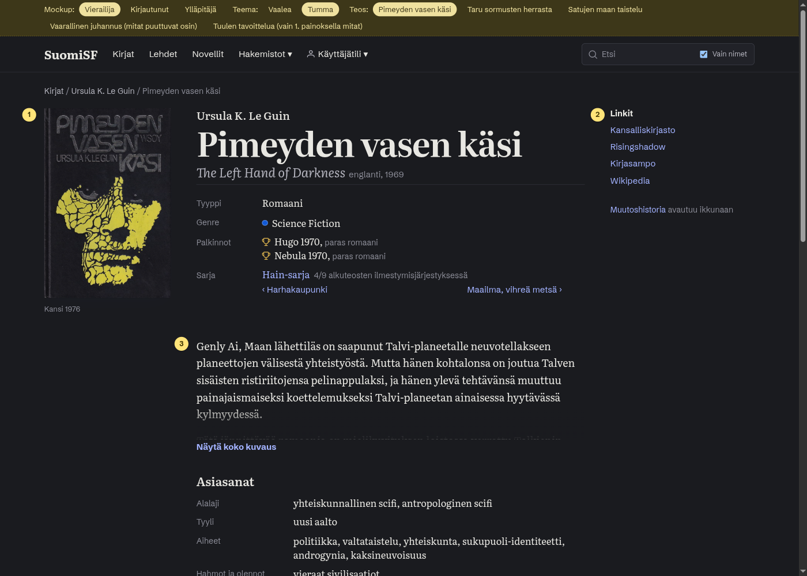
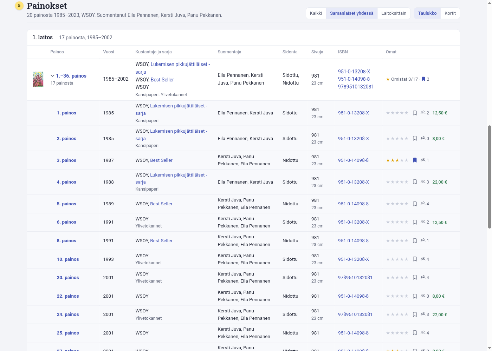
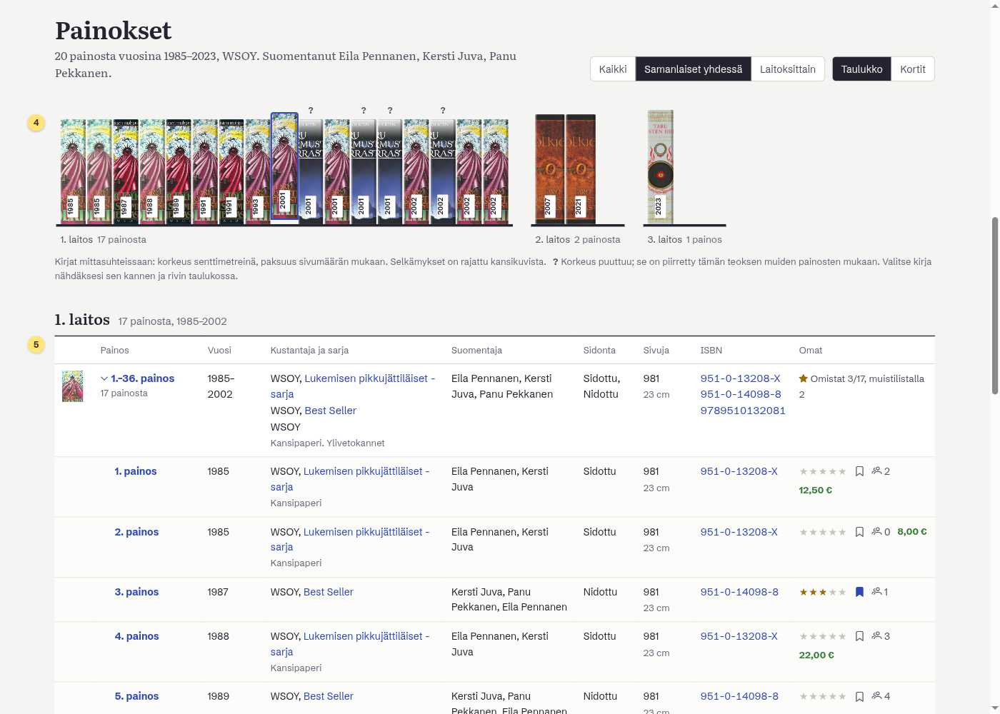
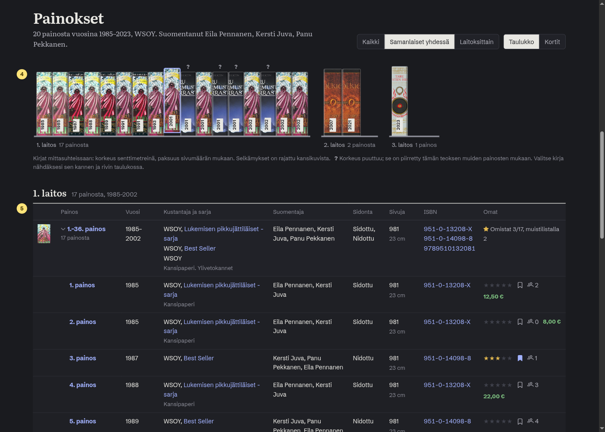
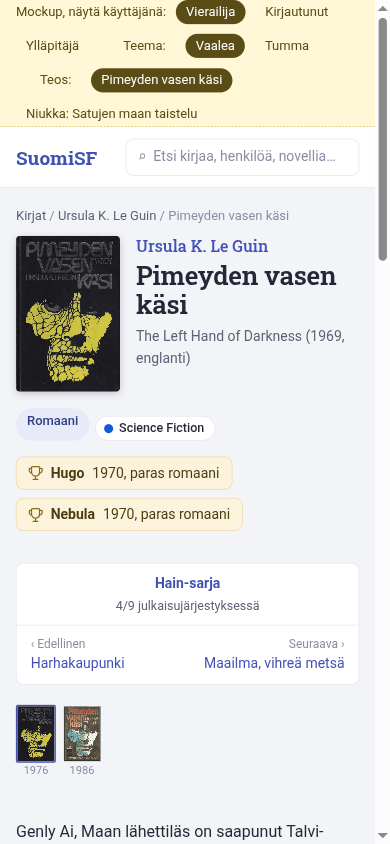
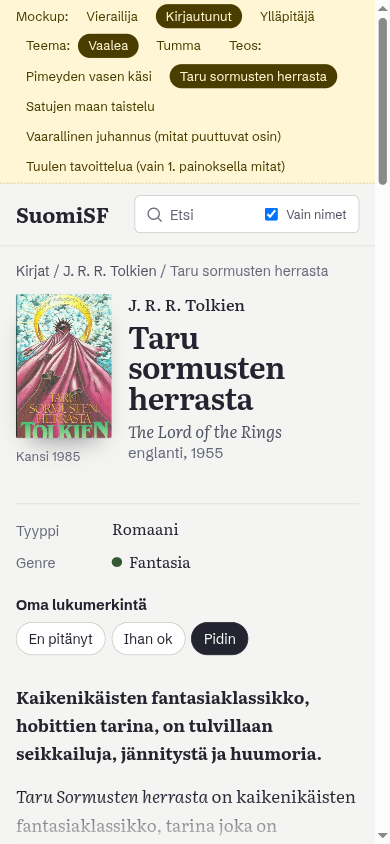
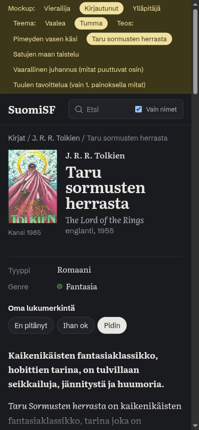

# Work page: visual identity proposal

**Route:** `/works/:id` · **Builds on:** the agreed [work page plan](work.md) (all its behaviour stays: table, grouping, expandable rows,
column bands, URL state, ownership, admin tools, similar works, missing data)
**Companions:** [person-identity.md](person-identity.md) and [front-identity.md](front-identity.md), the same identity on the person page and the front page
**Status:** Proposal; implemented as an admin-only trial (2026-11-24) · **Updated:** 2026-11-24
**Mockup:** [`../mockups/work-identity.html`](../mockups/work-identity.html) with the same [`works-data.js`](../mockups/works-data.js) as the agreed mockup:
`?w=a` Le Guin, `?w=b` Tolkien, `?w=c` a work with little data, `?w=d` Tove Jansson's *Vaarallinen juhannus* (sizes and covers missing
on the oldest printings, three printings without a number), `?w=e` *Tuulen tavoittelua* (only the first printing has any measurements). The yellow bar switches visitor / logged in / admin and light / dark.
`&valittu=1-20` opens Tolkien with the 20th printing picked from the shelf.

This is a proposal for how the site could **look**, made with the brief "a distinctive identity, not a template". It changes typography, colour,
spacing and one element (the shelf). It does not change what the page does. Some of it departs from agreed visual rules; those are listed under
"What this changes in agreed decisions" so they can be accepted or rejected one by one.

| Agreed design (current plan) | This proposal, light | This proposal, dark |
|---|---|---|
|  |  |  |
|  |  |  |
|  |  |  |

More: [Tolkien printings](../images/work-identity/lotr-printings.png) · [picked printing: header shows its cover](../images/work-identity/lotr-selected-header.png)
· [picked printing: its row](../images/work-identity/lotr-selected-row.png) · [admin at 1,100 px](../images/work-identity/lotr-admin-1100.png)
· [admin at 820 px](../images/work-identity/lotr-admin-820.png) · [phone, printings](../images/work-identity/mobile-printings.png)
· [little data, admin](../images/work-identity/sparse-admin.png) · [whole page](../images/work-identity/desktop-full.png) (each also `-dark`).

## Starting point

- **Subject:** the bibliography of Finnish speculative fiction: every book, printing, story and magazine published in Finnish.
- **Readers:** fans looking something up, collectors telling printings apart, and the admins who keep the records.
- **The work page's job:** say what the work is, then let the reader tell its Finnish printings apart.
- **Vernacular it borrows from:** the library card catalogue (a record with labelled fields, subject headings as plain text),
  the book's imprint page, and books on a shelf. In Finland book spines read from bottom to top, and library books carry a label at the foot of the spine.

## Design plan

**Colour** (light / dark):

| Token | Light | Dark | Use |
|---|---|---|---|
| Page | `#FFFFFF` | the dark theme's (`#121212`; Firefox `#1C1B22`) | page background: the site's own, so redesigned pages ship one at a time; the cool paper `#F4F5F2` / `#131419` was dropped (decided 2026-11-24) |
| Sheet | `#FFFFFF` | `#1B1C23` | the edition tables only; on the white page they stand out by their rules, not their fill |
| Ink | `#1D1F2B` | `#E9E8E3` | text, the shelf board, section rules |
| Catalogue blue | `#2B44B8` | `#A3B3FF` | links, the picked printing, focus rings |
| Quiet ink | `#4F5262` / `#66697A` | `#B4B4BE` / `#8B8C97` | secondary text and field labels |
| Rule | `#DADBD4` | `#2E3039` | row lines |

Genre colours stay exactly as agreed (data only, always with the name). Award trophies keep a dark gold. All text pairs pass WCAG AA:
labels 5.4:1 on white and at least 5.1:1 in dark, links 8.0:1 and at least 8.5:1 (recomputed 2026-11-24 for the site's background).

**Type:**
- **Literata** for the title, text, facts and subject headings. A reading face made for screens, with optical sizes: at 58 px the title
  tightens and gains contrast, at 16–18 px it stays open. The original title is set in its italic under the Finnish one, as on an imprint page.
- **Schibsted Grotesk** for the interface and the numbers in tables: a Nordic grotesque with plain figures, so the many years and ISBNs
  read cleanly. (Atkinson Hyperlegible was tried first; its slashed zero made "2002" look like "2ØØ2" on a page full of years.)
- Both are open-source (SIL OFL) and cover Finnish fully. Scale: 58 / 34 / 24 / 21 / 18 / 16.5 / 15 / 13 px; no capitals-only labels.

**Layout:**

```
 Kirjat / Ursula K. Le Guin / Pimeyden vasen käsi
┌────────┐  Ursula K. Le Guin                                  Oma lukumerkintä
│        │  Pimeyden vasen käsi                                [En pitänyt][Ihan ok][Pidin]
│ cover  │  The Left Hand of Darkness  englanti, 1969
│        │  ─────────────────────────────────────              Linkit
│        │  Tyyppi     Romaani                                  Kansalliskirjasto …
└────────┘  Genre      ● Science Fiction                        Muutoshistoria
 Kansi 1976 Palkinnot  🏆 Hugo 1970, paras romaani
            Sarja      Hain-sarja  4/9 alkuteosten ilmestymisjärjestyksessä
                       ‹ Harhakaupunki            Maailma, vihreä metsä ›

            Description in Literata, 66 characters a line … Näytä koko kuvaus
            Asiasanat
            Alalaji   yhteiskunnallinen scifi, antropologinen scifi
            Aiheet    politiikka, valtataistelu, yhteiskunta, …
━━━━━━━━━━━━━━━━━━━━━━━━━━━━━━━━━━━━━━━━━━━━━━━━━━━━━━━━━━━━━━━━━━━━━━━━━━━━━━━━━━━━━━━━━━━━━━━━━━━
 Painokset   20 painosta vuosina 1985–2023, WSOY. …         [Kaikki|Samanlaiset yhdessä|Laitoksittain]
  ▌▌▌▌▌▌▌▌▌▌▌▌▌▌▌▌▌    ▌▌    ▌      ← the shelf: one spine per printing, to scale
  ▔▔▔▔▔▔▔▔▔▔▔▔▔▔▔▔▔    ▔▔    ▔
  1. laitos 17 painosta  2. laitos   3. laitos
 1. laitos ── table (agreed columns, bands, expandable rows) ──
```

Left-aligned throughout; the text column is the same width in the record, the description and the subject headings.

**Principles:**
1. **The record reads like a catalogue card:** a label column (Tyyppi, Genre, Palkinnot, Sarja) and values in the reading face.
   Nothing is boxed unless the box means something: only the edition tables sit on white sheets.
2. **One bold element, the shelf.** Everything around it is quiet: rules instead of cards, text instead of chips.
3. **Subject headings are text,** comma-separated links grouped by type, as in a library catalogue.
4. **Commas, not middle dots,** in running data ("Sidottu, 981 s., 23 cm"; "Omistat 3/17, muistilistalla 2").
5. **No decorative motion.** The only movement answers the reader: a picked or hovered spine lifts 8 px (none with reduced motion).

## Checked against generic defaults

Ideas that came up first and were dropped because they would fit any SF site, not this one:
- **A dark starfield with a neon accent:** the stock "science fiction" look, and the near-black-plus-one-bright-colour default. The subject here is
  books and their printings, not space.
- **Cream paper, a Garamond-style display face and a stamp-red accent** (library stamps): the cream-and-serif-and-warm-accent default.
  Kept the library idea, moved the paper to a cool grey-white and the accent to catalogue blue, close to today's indigo so the site stays recognisable.
  The grey-white was later dropped as well: pages keep the site's white ([Decisions](#decisions)).
- **The agreed mockup's boxes** around links, tags, the admin box and every table: the "everything is a rounded card" kit. Replaced with
  headings, space and rules.
- **Middle-dot strings and chips everywhere:** replaced with commas, a label column and plain text.

## The shelf (new, section 4 of the mockup)

- **One spine per printing,** grouped by laitos on its own board, in printing order, with "1. laitos, 17 painosta" under each board.
  It shows every printing whatever the table's grouping, so it is the physical overview of the table below.
- **Drawn to scale from the data, in real proportions** (revised 2026-11-24): height from the size in cm and thickness from the page count
  on one scale, at **10 pages a millimetre**, so a 400-page book of 20 cm stands 20:4 whatever its siblings are (before, thickness was only
  relative and every printing of a thick book looked thin). At full scale 21 cm → 134 px, 302 pages → 19 px, 981 → 63 px, 1,182 → 76 px;
  the whole shelf is then scaled down evenly until every board and its label fits the page (never below 45 %, below that it scrolls sideways),
  so proportions never change. Tolkien's three laitos look different because they are: 23, 24 and 25 cm, 981 to 1,182 pages.
- **When a size or page count is missing** (added 2026-11-23 after review; a sample of 319 works and 447 editions from the live API):
  - How often: 6.7% of editions have no size, 3.1% no page count, 2.7% neither. It is concentrated in old books: of editions from the
    1950s and 1960s only about half have a size, from the 1920s none; since the 1980s nearly all do. Of works with several printings,
    86% have every size and 93% every page count; 11% mix known and unknown sizes, 4% page counts.
  - **Mixed (some printings known):** the missing dimension is drawn from the **median of this work's known values**, never from a site-wide
    guess, so a missing spine stands as tall as its siblings rather than looking shorter or longer than it was. Such a spine gets a **"?" above it**,
    and a missing height also fades its top. Its name says which value is missing ("1. painos 1957, WSOY, 139 sivua, korkeus ei tiedossa"),
    and a legend line appears under the shelf only when there are such spines: "? Korkeus puuttuu; se on piirretty tämän teoksen muiden
    painosten mukaan." ([screenshot](../images/work-identity/shelf-missing-sizes.png), [page](../images/work-identity/missing-sizes-printings.png),
    [phone](../images/work-identity/missing-sizes-mobile.png))
  - **None known for a dimension:** that dimension is the same for every spine, without "?" marks, and the note says so
    ("Korkeutta ei tiedetä yhdeltäkään painokselta, joten korkeus on sama").
  - **Shown only when at least two printings have a size, a page count or a cover;** otherwise there is nothing to compare and the shelf is left out
    (*Tuulen tavoittelua*: [screenshot](../images/work-identity/no-shelf-printings.png)).
  - The tooltip and the table row always show the real values, so a drawn estimate is never mistaken for data.
  - Found while checking: before this rule the mockup drew a missing size as 21 cm. Tolkien has four printings without a size, which made them
    look shorter than their 23 cm siblings.
- **Spine face:** a vertical slice of that printing's own front cover (the database has no spine scans). The note under the shelf says so:
  "Selkämykset on rajattu kansikuvista." Without a cover the spine is plain grey.
- **Label:** a white library-style label at the foot with the year, reading bottom to top like a Finnish spine.
  A printing without a number keeps its year; its name reads "Numeroton painos 2014".
- **Picking a spine** shows that printing's cover in the header (agreed for `/editions/:id` too), highlights its row with a blue bar and tint
  (not colour alone), opens its merged row if it is inside one, and scrolls to it. Hover and keyboard focus preview the row.
  Each spine is a button with a full name: "20. painos 2001, WSOY, sidottu, 981 sivua, 23 cm".
- **It replaces the cover strip** under the big cover: every printing's cover is one click away on the shelf, so the strip and its "+N" dialog go.
- **Phone:** the shelf scrolls sideways under the "Painokset" heading.
- **Hidden with one printing** (nothing to compare; missing data rule), or when fewer than two printings have measurements or a cover (above).

## Page heights (measured 2026-11-23, visitor)

| | Agreed mockup | This proposal | Change |
|---|---|---|---|
| Le Guin, desktop 1,400 px | 1,791 px | 2,398 px | +34% |
| Le Guin, phone 390 px | 2,767 px | 3,545 px | +28% |
| Tolkien, default grouping, desktop | 2,074 px | 2,707 px | +31% |
| Tolkien, default grouping, phone | 3,132 px | 4,005 px | +28% |
| Tolkien, "Kaikki", desktop | 3,031 px | 4,014 px | +32% |
| Tolkien, "Kaikki", phone | 6,387 px | 8,205 px | +28% |

The proposal is taller: larger type (body 18 px instead of 16), the facts as a labelled list instead of chips, the shelf (about 250 px),
and more space between sections. That is the price of the calmer page. If it is too much, the first things to trim are the section spacing
and the description size (not measured yet).

## What this changes in agreed decisions

Each can be taken or left separately:
1. **Fonts and colours** (principles: "keep the current indigo primary and Roboto / Roboto Slab", the PrimeReact `mdc-light-indigo` /
   `mdc-dark-indigo` themes): this needs a custom PrimeReact theme layer (CSS variables over the current theme) and self-hosted fonts
   (`@fontsource/literata`, `@fontsource/schibsted-grotesk`). Site-wide, not per page.
2. **Tags as chips** ("one chip style per meaning", tag = outlined neutral chip): here subject headings are plain comma-separated text.
3. **The cover strip with "+N"** (work plan, decided 2026-11-23): replaced by the shelf.
4. **Boxes:** the sidebar's links and admin box, and the tag box, lose their card frames (the admin box keeps a dashed left rule).
5. **Page height** grows by about 28–34%.

Unchanged: the table, its columns and width bands, grouping and its URL state, expandable rows and the ownership summary, the admin tools,
the series order and label, the awards overflow, the phone order (reading mark right after the record), missing data handling, similar works.

## Implementation (2026-11-24): an admin-only trial

The new page is built from this proposal with the agreed behaviour of [work.md](work.md), **next to** the current page:
- **Everyone sees the current page.** Admins switch with the button at the bottom left ("Uusi teossivu" / "Nykyinen teossivu") or **Shift+U**,
  as on the person page; the work and person choices are kept apart (`suomisf.workPageVersion`, `suomisf.personPageVersion`). `/works/:id` and
  `/editions/:id` both go through `src/features/work/routes/work-page-switch.tsx`. The switch itself is shared: `src/components/page-version-switch.tsx`
  and `src/utils/page-version.ts`.
- **Code:** `src/features/work/new/` (page, shelf, table, admin tools, styles scoped under `.wn`; the fonts are shared with the person page in
  `src/components/identity-fonts/`) and the pure rules in `src/features/work/utils/` (`work-facts.ts`: labels and ranges, laitos groups, merged rows,
  printings and ownership summaries, series order, subject headings, the shelf; `work-view-state.ts`: grouping, view and the picked printing in the URL
  with the device's last choice). Fixtures: five real works in `src/test/fixtures/works.json`.
- **Backend:** the decided `GET /api/user/:id/work/:workId/ownership` (work.md step 0), the user or an admin only. The table reads the conditions from it
  and the wishlist and other owners from the work response, so a Tolkien page makes one ownership request instead of one per printing. `EditionOwnership`
  and `EditionWishlist` take the prefetched values as optional props; the current page is unchanged.
- **Column bands follow the printings section's own width** (CSS container queries), not the window: the site's content column (`App container`,
  1,140 px) leaves the section about 1,050 px at any window size. With the Omat or Ylläpito column the table therefore always uses the merged "Kirja"
  column and the "⋯" menu on desktop; a visitor's table (neither column) gets every column down to 900 px. Cards below 740 px.
- **Kept from the current page for now:** "Kortit" shows today's edition cards (cover upload stays there); the Sisältö section uses `ShortsList`;
  similar works show only to admins until `works/:id/similar` is public.
- **Background:** the site's own, as decided below.
- **Covers** (owner, 2026-11-25): the table thumbnails are 44 × 66 px (the header cover stays 220 px); clicking either (its "Suurenna kuva" button, PrimeReact `Image` preview) opens the original file at full size, with zoom and
  rotate. The table shows the small WebP copy, the preview the original.
- **Compared with the live site** (API, 2026-11-24): Tolkien 20 printings in 3 laitos, 4 without a size; Le Guin 3 printings, Hugo 1970 and Nebula 1970;
  Jansson 24 printings, 3 unnumbered. The test data and the new page show the same.
- **Tests that must keep passing before it becomes the default:** Vitest `work-facts.test.ts`, `work-view-state.test.ts`, `page-version.test.ts`;
  Playwright `tests/admin/work-new.spec.ts` (switch, record, series, subject headings, shelf, picking a spine, merged rows and one ownership request,
  grouping in the URL, `/editions/:id`, column band and ⋯ menu, sparse work, history dialog, phone, background, axe), `tests/anon/work-version.spec.ts`
  and `tests/user/work-version.spec.ts`; backend `test_work_ownership_*` in `tests/api/test_user_data.py`. To make it the default: render `WorkPageNew`
  for everyone in the switch, make `works/:id/similar` public, then remove the current page and the switch.

### Notes: possible bugs on the live site

1. **Series arrows followed the database order** (work.md section 3): in the test data Hain-sarja put *Pimeyden vasen käsi* between *Maailman syntymäpäivä* and
   *Osattomien planeetta*. **Fixed** on the current page too: `WorkBookseriesBrowser` uses the same `seriesPosition` as the new page
   (`tests/anon/work-version.spec.ts`).
2. **`GET /api/user/:id/work/:workId/edition-prices` has no login check:** anyone can ask for any user's prices, which also tells which printings
   of a work that user owns or has on the wishlist. Not fixed; the new ownership endpoint requires the user or an admin.

## Implementation notes (only if adopted)

1. A theme layer: CSS variables for the tokens above over PrimeReact's theme, both colour schemes; self-hosted fonts with `font-display: swap`.
2. `edition-shelf.tsx`: pure `spineSizes(editions)` (height from size, width from pages; a missing value takes the median of the work's known values
   and is flagged; a dimension nobody has is uniform; returns null when fewer than two printings have any data) with Vitest tests from the
   Tolkien, Jansson and *Tuulen tavoittelua* fixtures;
   spines as buttons; picking sets a `painos` URL parameter so a link can open a printing (the same state `/editions/:id` uses).
3. Record layout and subject-heading lists in `work-details.tsx`; the table keeps the agreed component with new styles only.
4. Playwright: picking a spine highlights the row and swaps the cover; keyboard reaches every spine; reduced motion stops the lift;
   contrast check in both themes in `a11y.spec.ts`.

## Open questions

- Adopt the identity (fonts, colours, calmer layout) for the whole site, for the work page only as a trial, or not at all?
- Keep the shelf? It works without the rest of the identity too.
- Subject headings as text instead of chips?
- Is the extra page height acceptable, or should spacing be tightened first?

## Decisions

2026-11-24, project owner:
- **The page background stays the site's own**, white or the dark theme's, also after the new UI is launched; the grey paper tone
  `#F4F5F2` / `#131419` is dropped. Why: each redesigned page can become the default on its own instead of all at once; the
  theme's dialogs, menus and tables are white and would show as patches on grey; the identity is carried by the type, the shelf and
  the rules, not the tint. Seen first in the person page trial, where the grey page sat as a box inside the white site. The quiet
  grey-green tones stay for hover and selected rows. The mockups and their screenshots still show the grey paper.
- **Spine thickness in real proportion to height:** 10 pages a millimetre (owner, after the first trial: thick books looked thin because
  thickness was compared only with the other printings). The mockup still uses the older relative thickness.
