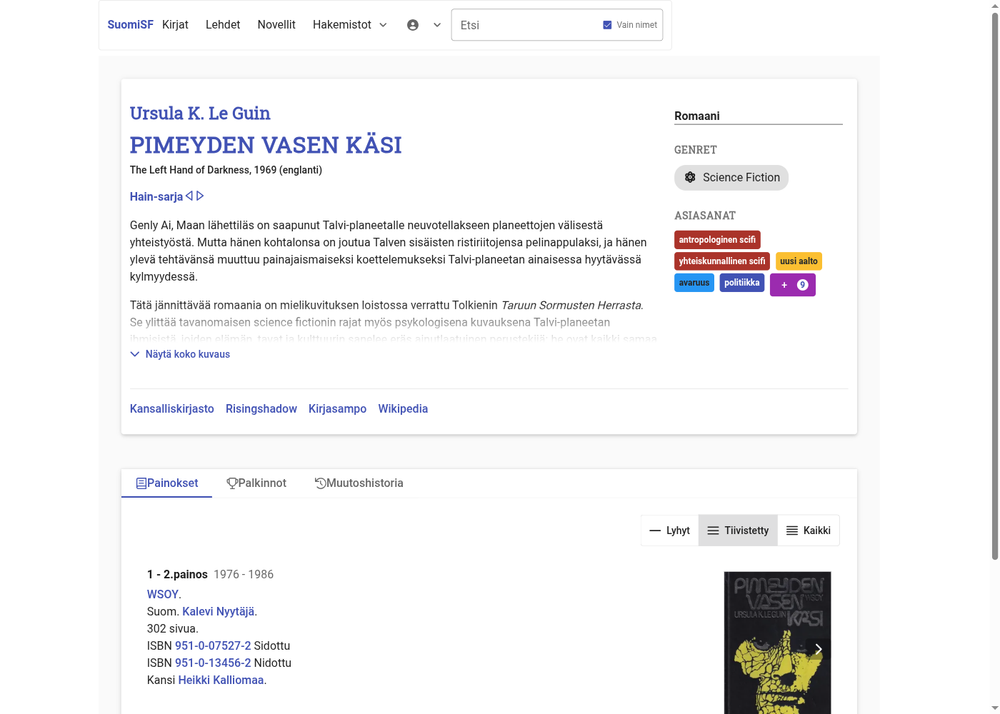
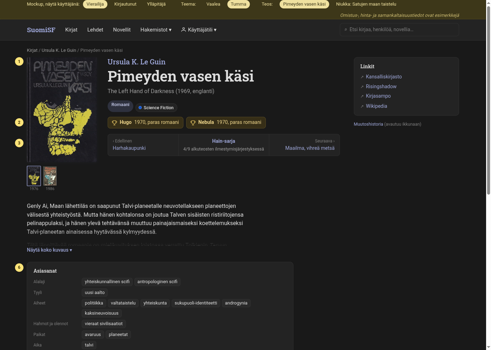
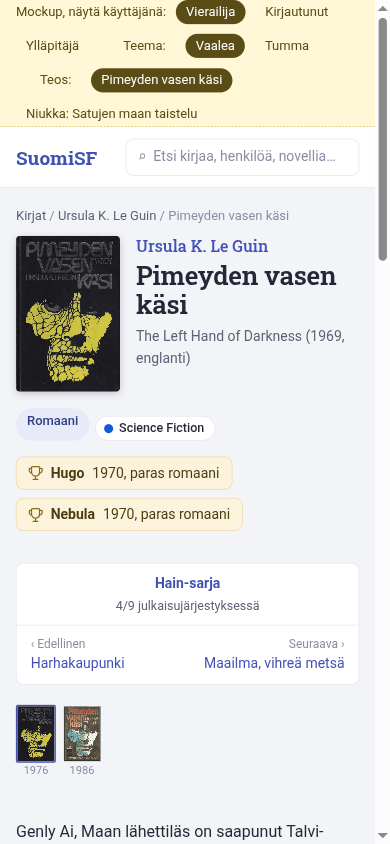

# Work page

**Routes:** `/works/:id`, and `/editions/:id` (the same page with one edition highlighted) · **Code:** `src/features/work/routes/work-page.tsx`, `src/features/work/components/work-details.tsx`, `src/features/edition/components/edition-details.tsx`, `src/features/edition/utils/group-similar-editions.ts`
**Status:** Agreed ·  **Updated:** 2026-11-22
**Sample pages:** Ursula K. Le Guin, *Pimeyden vasen käsi* (https://www.sf-bibliografia.fi/works/3984): awards, series, 3 editions.
J. R. R. Tolkien, *Taru sormusten herrasta* (https://www.sf-bibliografia.fi/works/1514): 20 printings in 3 laitos.
**Mockup:** [`../mockups/work.html`](../mockups/work.html) with [`works-data.js`](../mockups/works-data.js) next to it (real data from the live API).
Open `work.html?w=a` for Le Guin, `work.html?w=b` for Tolkien. The yellow bar at the top switches between visitor, logged-in user and admin.
Ownership, prices and the similar-works list are made-up example values.

| Before | After (mockup, light) | After (mockup, dark) |
|---|---|---|
|  |  |  |
|  |  |  |

More screenshots:
- [Admin view, whole page](../images/work/after-admin-full.png): ownership column, admin actions, "Tarkastettu", admin box.
- [Tolkien, logged-in user, default grouping "Samanlaiset yhdessä"](../images/work/after-lotr-user-full.png) and [before, Tolkien, condensed view](../images/work/before-lotr-full.png).
- [Tolkien, "Kaikki", admin](../images/work/after-lotr-all-admin.png): every printing on its own row with ownership and admin columns.
- [Editions on a phone, logged in](../images/work/after-mobile-editions.png).
- Dark theme: [desktop](../images/work/after-desktop-dark.png), [admin, whole page](../images/work/after-admin-full-dark.png), [Tolkien](../images/work/after-lotr-user-full-dark.png), [phone](../images/work/after-mobile-dark.png), [editions on a phone](../images/work/after-mobile-editions-dark.png), [similar works](../images/work/after-similar-why-admin-dark.png).
- [Similar works with "Miksi samankaltainen?" open, admin](../images/work/after-similar-why-admin.png). Open it in the mockup with `?why=0`.

## What's wrong today

1. **No cover at the top.** The cover appears only next to the first edition, below the tabs. On a phone the first cover is more than a screen down.
2. **Awards are hidden in a tab.** *Pimeyden vasen käsi* won the Hugo and the Nebula; the header doesn't say so.
   Some awards live only in the free-text "Muuta" field (Tolkien: "Prometheus Award Hall of Fame 2009").
3. **Tag colours mean tag types, but nothing says so.** Red = subgenre, yellow = style, blue = place, indigo = topic, and so on
   (`tag-type-to-severity.ts`). A reader sees five random colours plus a purple "+9".
4. **Editions are hard to compare.** Each edition is a paragraph of text ("Suom. X, Suom. Y. 981 sivua. ISBN … Sidottu"),
   so comparing years, series, bindings or ISBNs means reading every paragraph. With "Kaikki", Tolkien's 20 printings make the page 6,232 px tall.
5. **The series navigation is two tiny arrows** (◁ ▷) next to the series name. You can't see what comes before or after.
6. **Title in uppercase**, same as the person page.
7. **Change history is a tab,** next to real content tabs.

## Proposed layout

```
┌──────────────────────────────────────────────────────┬────────────────────┐
│ Kirjat / Ursula K. Le Guin / Pimeyden vasen käsi      │                    │
│ ┌──────┐ Ursula K. Le Guin                            │ Linkit             │
│ │cover │ Pimeyden vasen käsi                          │ Oma lukumerkintä   │
│ │      │ The Left Hand of Darkness (1969, englanti)   │   (logged in)      │
│ │      │ (Romaani)(Science Fiction)                   │ Ylläpitäjille      │
│ └──────┘ [🏆 Hugo 1970, paras romaani] [🏆 Nebula …]   │   (admins)         │
│ ▫1976 ▫1986   ‹ Harhakaupunki | Hain-sarja 4/9 | Maailma, vihreä metsä › │
│ Description, 4 lines … Näytä koko kuvaus ▾            │ Muutoshistoria     │
│ Asiasanat:  Alalaji   yhteiskunnallinen scifi …       │                    │
│             Aiheet    politiikka, valtataistelu …     │                    │
├──────────────────────────────────────────────────────┴────────────────────┤
│ Painokset   3 painosta 1976–1992, WSOY. Suomentanut Kalevi Nyytäjä.         │
│             [Kaikki|Samanlaiset yhdessä|Laitoksittain] [Taulukko|Kortit]    │
│ ┌ 1. laitos, 3 painosta, 1976–1992 ──────────────────────────────────────┐ │
│ │▫ 1. painos 1976 WSOY (Porvoo), Sci-fi-sarja  K. Nyytäjä Sidottu 302 ISBN │ │
│ │                                         [Omat ★★★☆☆ 🔖 👥4] [✎ ⧉ 🗑 €]  │ │
│ └────────────────────────────────────────────────────────────────────────┘ │
│ Samankaltaiset teokset: row of covers                                       │
└────────────────────────────────────────────────────────────────────────────┘
```

The numbers 1–7 in the mockup screenshots match the sections below.

1. **Header with cover.** Cover of the first edition at 200 px (104 px on a phone, beside the title).
   Under it, a strip of every distinct cover with its year. Clicking one swaps the big cover.
   Author link above the title, title in mixed case, original title with year and language, type and genre chips.
2. **Awards in the header** as trophy chips (award, year, category). Up to three chips; when a work has more,
   a "+N muuta palkintoa" chip opens the full list in a dialog (today's `AwardList`). The Palkinnot tab goes away.
3. **Series navigator:** previous and next titles by name, the series name and position ("4/9 julkaisujärjestyksessä").
   Uses the existing `bookseriesorder` / publication year order.
4. **Description** stays clamped (`CollapsibleHtml` already does this). "Muuta" becomes a quiet note under it.
5. **"Painokset" section replaces the tabs** and uses the full page width. A one-line summary (printings, years, publishers, translators),
   then one box per laitos (`version`) with a table:
   - **Columns:** cover thumb, printing (links to `/editions/:id`, see "Edition links" below), year, publisher with printing place and publisher series,
     **translator**, binding, pages and size, ISBN. Cover artist, illustrator, dust jacket ("Kansipaperi"), overlapping covers ("Ylivetokannet"),
     a different edition title and the edition's own notes show in small text under the publisher.
   - **Logged-in users** get an "Omat" column: owned with condition (the 1–5 stars from `EditionOwnership`), wishlist (`EditionWishlist`),
     other owners (`EditionOwnersPanel`) and the best price badge.
   - **Admins** also get a "Ylläpito" column: edit, copy, delete, prices, and the short-stories editor for collections; "Tarkastettu" shows under the printing.
   - **Grouping** keeps today's three modes as a toggle, with today's rules (`groupSimilarEditions`):
     **Kaikki** (every printing on its own row), **Samanlaiset yhdessä** (same laitos, title and page count share a row, so one laitos can have several rows),
     **Laitoksittain** (one row per laitos). A merged row shows the printing range, the year range and every publisher series, binding and ISBN in the group.
     Like today, ownership and admin controls appear only on single-printing rows.
   - **Default: table, grouped "Samanlaiset yhdessä"** (as today's default).
   - "Kortit" keeps today's card view for anyone who prefers it.
   - On a phone each row becomes a small card (thumb on the left, fields stacked with short labels: Suom., Sivuja, ISBN).
   - All laitos tables use the same fixed column widths so their columns line up.
   - **Edition links:** there is no separate edition page. `/editions/:id` opens this work page, scrolls to that printing's row and
     highlights it (today's `highlighted-edition` style, with its dark-theme colours). If the printing is inside a merged row
     ("Samanlaiset yhdessä" or "Laitoksittain"), that row is highlighted.
   - For collections and anthologies, a **"Sisältö"** section with the stories comes before "Painokset" (the Novellit tab today).
6. **Tags under the description**, grouped by type with a written label on the left (Alalaji, Tyyli, Aiheet, Hahmot ja olennot, Paikat, Aika,
   Listat ja sovitukset), all in one neutral chip style. This writes out what today's colours mean. All tags show; a work has at most ~20.
7. **Samankaltaiset teokset** as a full-width row of covers under the editions, **public to everyone** (today admin-only; it is going public).
   Today the list is behind a button and opens in a dialog; the row shows it on the page directly.
   - Each cover keeps today's **"Miksi samankaltainen?"** control: a "?" after the title opens a popover (PrimeReact `OverlayPanel`)
     with the strongest reasons as a list, in today's wording (`shownReasons` + `reasonText`):
     "Yhteinen alagenre: …", "Yhteinen aihe: …", "Samankaltainen kuvaus". One popover open at a time; Esc and clicking outside close it.
   - **Admins** also see today's three rows of numbers under the reasons (`partsText`, `tagTypesText`, `scoreText`) for judging the weights.
     The long explanation of the numbers in today's dialog moves to a "Mitä luvut tarkoittavat?" link in the admin popover.
   **Sidebar** next to the header: links; "Oma lukumerkintä" (`WorkReadControl`) for logged-in users;
   a dashed "Ylläpitäjille" box for admins (Kirjasampo import and its date, prices); and a "Muutoshistoria" link that opens the change history in a **dialog**.

## Shared principles used or added

Uses from [principles.md](../principles.md): mixed-case titles, clamped description, one chip style per meaning, genre colours, links list, phone layout rules.

New rules this plan proposes (added to principles.md):
- Awards appear in the header of the thing that won them, up to three chips, the rest in a dialog.
- Tags are grouped by type with written labels instead of colour-coded.
- Tabular data (editions, printings) uses a real table on desktop and cards on a phone; wide tables use the full page width.
- Admin-only tools live in one dashed "Ylläpitäjille" box, not mixed with public content.
- Change history is a link that opens a dialog, not a tab.
- No "Suomeksi" / "suomennos" labels: everything in the database is published in Finnish.

## Implementation steps

All frontend. `/works/:id` already returns editions with covers, contributors, printing place, publisher series, binding, pages, size, ISBN,
dust jacket and verified flags, awards, tags with types, and the series with its works. No backend change needed
(except making `works/:id/similar` public, which is planned separately).

1. **Header**: `work-details.tsx`. Cover and cover strip (new `cover-history.tsx`), mixed-case title, type and genre chips,
   award chips with overflow dialog (new `award-chips.tsx`, reusable on the person and short story pages), series navigator (replaces `WorkBookseriesBrowser`'s arrows).
2. **Tags and sidebar**: tags grouped by type (new `TagsByType` in `src/features/tag/components/`, reusing the type names from
   `tag-type-to-severity.ts`), links list, read control, admin box, change-history dialog (wraps today's `EntityChanges`).
3. **Editions table**: new `edition-table.tsx` in `src/features/edition/components/`. It reuses `groupSimilarEditions` for the three modes,
   plus new pure helpers with Vitest tests: `mergeGroupForRow(group)` (ranges and unique values).
   Fixtures: the two sample works' API responses in `src/test/fixtures/`.
   PrimeReact `DataTable` with stacked layout on small screens, or a plain table if `DataTable` is too heavy.
4. **Row controls**: move the ownership, wishlist, owners, price and admin buttons out of `edition-details.tsx` into components the table row
   and the card view both use, so nothing is lost in either view.
5. **Remove the tabs**: stories become a "Sisältö" section, awards move to the header, change history becomes a dialog.
   Similar works move from the dialog into the full-width row once the endpoint is public. `similar-works.tsx` keeps its helpers
   (`shownReasons`, `reasonText`, `partsText`, `tagTypesText`, `scoreText`, already tested in `similar-works.test.tsx`);
   only the rendering changes from a dialog list to cover cards with a reasons popover.
6. **Mobile and accessibility pass** at 390 px; update the work-page Playwright specs and `a11y.spec.ts`.
7. **Wiki**: update the work page and edition sections in `SuomiSF‐ohje.md` and `Ylläpito.md`, retake screenshots.

## Tests

- Vitest: `mergeGroupForRow` (ranges, unique series, bindings and ISBNs; Tolkien fixture), series previous/next, tag grouping order, award overflow at more than three.
- Playwright: cover strip swaps the cover; grouping toggle changes rows; the "?" on a similar work opens its reasons (numbers only for admins); series links go to the right works; table rows link to editions;
  logged-in user sees the Omat column; admin sees the Ylläpito column, "Tarkastettu" and the admin box; visitor sees neither;
  change history opens in a dialog.
- Playwright: `/editions/:id` opens the work page with that row highlighted and in view, also when it is inside a merged row.
- a11y: table has headers, icon buttons have labels, cover strip buttons have labels.

## Open questions

_None._

## Decisions

2026-11-22, project owner:
- Table is the default view; cards stay as an option.
- Keep today's grouping modes (per printing, similar printings, per laitos); similar printings can produce several rows per laitos.
- Awards in the header are fine; works with more than a few awards need an overflow (now "+N muuta palkintoa" opening a dialog).
- Change history opens in a dialog.
- Similar works will be public to everyone, and keep the control that shows why a work is considered similar.
- Editions must keep every field and control the cards have today: translator, ownership, wishlist, owners, prices, and admin edit, copy, delete.
- No "Suomeksi" labels anywhere.
- Default grouping stays "Samanlaiset yhdessä".
- No list of missing printing numbers.
- Similar works go in a full-width cover row under the editions.
