# Work page

**Routes:** `/works/:id`, and `/editions/:id` (the same page with one edition highlighted) · **Code:** `src/features/work/routes/work-page.tsx`, `src/features/work/components/work-details.tsx`, `src/features/edition/components/edition-details.tsx`, `src/features/edition/utils/group-similar-editions.ts`
**Status:** Agreed (revised 2026-11-23) · **Updated:** 2026-11-23
**Sample pages:** Ursula K. Le Guin, *Pimeyden vasen käsi* (https://www.sf-bibliografia.fi/works/3984): awards, series, 3 editions.
J. R. R. Tolkien, *Taru sormusten herrasta* (https://www.sf-bibliografia.fi/works/1514): 20 printings in 3 laitos.
**Mockup:** [`../mockups/work.html`](../mockups/work.html) with [`works-data.js`](../mockups/works-data.js) next to it (real data from the live API).
Open `work.html?w=a` for Le Guin, `work.html?w=b` for Tolkien, `work.html?w=c` for a work with little data. The yellow bar at the top switches between visitor, logged-in user and admin.
Ownership, prices and the similar-works list are made-up example values.

| Before | After (mockup, light) | After (mockup, dark) |
|---|---|---|
|  | 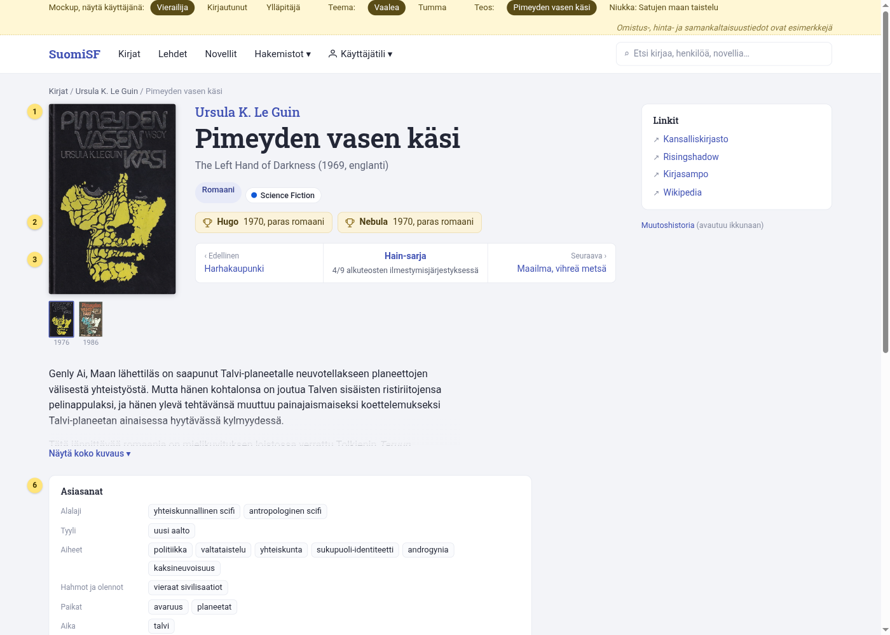 |  |
| 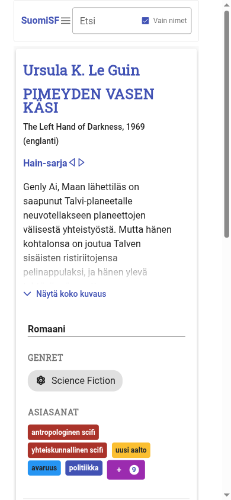 |  | 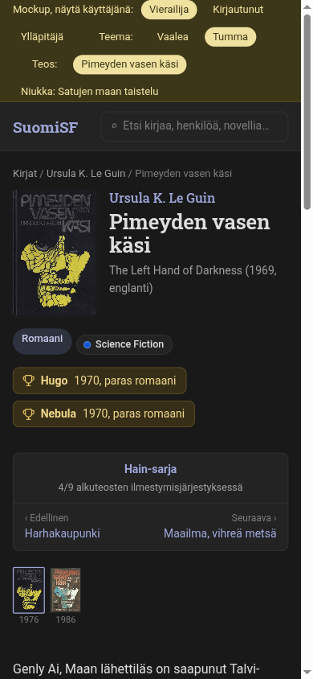 |

More screenshots:
- [Admin view, whole page](../images/work/after-admin-full.png): ownership column, admin actions, "Tarkastettu", admin box.
- [Tolkien, logged-in user, default grouping "Samanlaiset yhdessä"](../images/work/after-lotr-user-full.png) and [before, Tolkien, condensed view](../images/work/before-lotr-full.png).
- [Tolkien, "Kaikki", admin](../images/work/after-lotr-all-admin.png): every printing on its own row with ownership and admin columns.
- [Editions on a phone, logged in](../images/work/after-mobile-editions.png).
- Review 2026-11-23: [merged row expanded into its printings](../images/work/after-lotr-expanded.png),
  [admin at 1,100 px](../images/work/after-lotr-admin-1100.png), [admin at 820 px](../images/work/after-lotr-admin-820.png),
  [cover strip](../images/work/after-lotr-cover-strip.png), [phone: header and reading mark](../images/work/after-lotr-phone-header.png),
  [phone: similar works row](../images/work/after-mobile-similar.png), [before: Tolkien "Kaikki" on a phone](../images/work/before-lotr-all-mobile.png) (each also `-dark`).
- Dark theme: [desktop](../images/work/after-desktop-dark.png), [admin, whole page](../images/work/after-admin-full-dark.png), [Tolkien](../images/work/after-lotr-user-full-dark.png), [phone](../images/work/after-mobile-dark.png), [editions on a phone](../images/work/after-mobile-editions-dark.png), [similar works](../images/work/after-similar-why-admin-dark.png).
- [Similar works with "Miksi samankaltainen?" open, admin](../images/work/after-similar-why-admin.png). Open it in the mockup with `?why=0`.

## What's wrong today

1. **No cover at the top.** The cover appears only next to the first edition, below the tabs. On a phone the first cover is more than a screen down.
2. **Awards are hidden in a tab.** *Pimeyden vasen käsi* won the Hugo and the Nebula; the header doesn't say so.
   Some awards live only in the free-text "Muuta" field (Tolkien: "Prometheus Award Hall of Fame 2009").
3. **Tag colours mean tag types, but nothing says so.** Red = subgenre, yellow = style, blue = place, indigo = topic, and so on
   (`tag-type-to-severity.ts`). A reader sees five random colours plus a purple "+9".
4. **Editions are hard to compare.** Each edition is a paragraph of text ("Suom. X, Suom. Y. 981 sivua. ISBN … Sidottu"),
   so comparing years, series, bindings or ISBNs means reading every paragraph. With "Kaikki", Tolkien's 20 printings make the page 6,232 px tall.
5. **The series navigation is two tiny arrows** (◁ ▷) next to the series name. You can't see what comes before or after.
6. **Title in uppercase**, same as the person page.
7. **Change history is a tab,** next to real content tabs.

## Page heights (Tolkien, visitor, measured 2026-11-23)

| | Before (live) | After (mockup) | Change |
|---|---|---|---|
| "Kaikki", desktop 1,400 px | 6,232 px | 3,031 px | −51% |
| "Kaikki", phone 390 px | 10,383 px | 6,387 px | −38% |
| Default ("Samanlaiset yhdessä"), desktop | 1,650 px | 2,074 px | +26% |
| Default, phone | 2,653 px | 3,132 px | +18% |

The table pays off where there are many rows: the editions section in "Kaikki" is 1,540 px on desktop. In the default view on desktop the editions
are 294 px shorter than today's tab content, the header, description and tags 148 px taller, and the similar works row adds 314 px; the live page
shows that row to nobody (it is admin-only, in a dialog). Without it the default is about +7% on desktop and +6% on a phone.
On a phone "Kaikki" is still long (4,449 px of edition cards), so the default grouping with expandable rows is the better way to browse there.

## Proposed layout

```
┌──────────────────────────────────────────────────────┬────────────────────┐
│ Kirjat / Ursula K. Le Guin / Pimeyden vasen käsi      │                    │
│ ┌──────┐ Ursula K. Le Guin                            │ Linkit             │
│ │cover │ Pimeyden vasen käsi                          │ Oma lukumerkintä   │
│ │      │ The Left Hand of Darkness (1969, englanti)   │   (logged in)      │
│ │      │ (Romaani)(Science Fiction)                   │ Ylläpitäjille      │
│ └──────┘ [🏆 Hugo 1970, paras romaani] [🏆 Nebula …]   │   (admins)         │
│ ▫1976 ▫1986   ‹ Harhakaupunki | Hain-sarja 4/9 | Maailma, vihreä metsä › │
│ Description, 4 lines … Näytä koko kuvaus ▾            │ Muutoshistoria     │
│ Asiasanat:  Alalaji   yhteiskunnallinen scifi …       │                    │
│             Aiheet    politiikka, valtataistelu …     │                    │
├──────────────────────────────────────────────────────┴────────────────────┤
│ Painokset   3 painosta 1976–1992, WSOY. Suomentanut Kalevi Nyytäjä.         │
│             [Kaikki|Samanlaiset yhdessä|Laitoksittain] [Taulukko|Kortit]    │
│ ┌ 1. laitos, 3 painosta, 1976–1992 ──────────────────────────────────────┐ │
│ │▫ 1. painos 1976 WSOY (Porvoo), Sci-fi-sarja  K. Nyytäjä Sidottu 302 ISBN │ │
│ │                                         [Omat ★★★☆☆ 🔖 👥4] [✎ ⧉ 🗑 €]  │ │
│ └────────────────────────────────────────────────────────────────────────┘ │
│ Samankaltaiset teokset: row of covers                                       │
└────────────────────────────────────────────────────────────────────────────┘
```

The numbers 1–7 in the mockup screenshots match the sections below.

1. **Header with cover.** Cover of the first edition at 200 px (104 px on a phone, beside the title).
   Under it, a **strip of distinct covers**: distinct means a **different image file**, not a different edition (Tolkien's 20 printings use 7 images).
   Each thumb is captioned with the first year that image was used; the tooltip and accessible name give the whole range ("Kansi 1985–1991").
   Clicking one swaps the big cover. Opened through `/editions/:id`, the big cover is that printing's cover. **Overflow on desktop:** the strip has 4 slots under the cover; with more covers it shows 3 thumbs and a
   "+N" tile that opens all covers in a dialog (each with its years and printings). **On a phone** the strip spans the full width under the header
   as one sideways-scrolling row with every cover, no "+N" and no visible scrollbar. One cover only: no strip.
   Author link above the title, title in mixed case, original title with year and language, type and genre chips.
2. **Awards in the header** as trophy chips (award, year, category). Up to three chips; when a work has more,
   a "+N muuta palkintoa" chip opens the full list in a dialog (today's `AwardList`). The Palkinnot tab goes away.
3. **Series navigator:** previous and next titles by name, the series name and position. As today, a subseries shows its parent first
   ("Maameren tarinat › …") and the work's series number after the name.
   **Order** (corrected 2026-11-23) is the series page's default "Sarjan järjestys", from the same `seriesOrder` helper: `bookseriesorder`,
   then the series number, then the original year, then title. The label says which it is: "osa 4/9" when the series has an order or numbers,
   "4/9 alkuteosten ilmestymisjärjestyksessä" when it falls back to years. (Today the arrows follow the database order: Hain-sarja has neither
   order nor numbers, so *Pimeyden vasen käsi* sits between *Osattomien planeetta* and *Rocannonin maailma* for no stated reason.)
4. **Description** stays clamped (`CollapsibleHtml` already does this). "Muuta" becomes a quiet note under it. Awards written only in "Muuta"
   (Tolkien's Prometheus Hall of Fame) are not parsed; adding them as award records is data clean-up for admins.
5. **"Painokset" section replaces the tabs** and uses the full page width. A one-line summary (printings, years, publishers, translators),
   then one box per laitos (`version`) with a table:
   - **Columns:** cover thumb, printing (links to `/editions/:id`, see "Edition links" below), year, publisher with printing place and publisher series,
     **translator**, binding, pages and size, ISBN. Cover artist, illustrator, dust jacket ("Kansipaperi"), overlapping covers ("Ylivetokannet"),
     a different edition title and the edition's own notes show in small text under the publisher.
   - **Logged-in users** get an "Omat" column: owned with condition (the 1–5 stars from `EditionOwnership`), wishlist (`EditionWishlist`),
     other owners (`EditionOwnersPanel`) and the best price badge.
   - **Admins** also get a "Ylläpito" column: edit, copy, delete, prices, and for collections the stories editor ("Novellit ja artikkelit");
     "Tarkastettu" shows under the printing. Four icons, five for collections.
   - **Grouping** keeps today's three modes as a toggle, with today's rules (`groupSimilarEditions`):
     **Kaikki** (every printing on its own row), **Samanlaiset yhdessä** (same laitos, title and page count share a row, so one laitos can have several rows),
     **Laitoksittain** (one row per laitos). A merged row shows the printing range, the year range and every publisher series, binding and ISBN in the group.
     **Merged rows expand** (revised 2026-11-23: today ownership and admin controls appear only on single-printing rows, so in Tolkien's default view
     a logged-in user's "Omat" column was mostly empty): a chevron before "1.–36. painos" opens the group's printings as indented sub-rows
     right under it, each with its own Omat and Ylläpito controls. The merged row's label ("1.–36. painos") opens and closes it too, so it is a
     button, not a link; each printing's own row links to `/editions/:id`. The merged row's Omat cell shows a **summary**: "★ Omistat 3/17 · 🔖 2"
     (owned printings out of the group, and how many are on the wishlist), or "Et omista".
     **Data:** `/works/:id` already lists each edition's `owners` and `wishlisted` users, so the summary, the wishlist state and the other-owners
     count need no extra request. The condition (the stars) is a request per printing today (`editions/:id/owner/:user`); it comes instead
     from one new request per work, `user/:id/work/:workId/ownership` (decided), like the existing edition-prices request.
   - **Default: table, grouped "Samanlaiset yhdessä"** (as today's default).
   - **Grouping and view are remembered:** the URL is the source of truth (`?ryhmittely=kaikki|laitoksittain`, `?nakyma=kortit`; defaults left out),
     so links, reload and the back button keep them. When the URL has no value, the reader's last choice on this device (localStorage, read and
     written in try/catch) is used, then the default. Each change adds a history entry. Expanded rows are not stored.
   - "Kortit" keeps today's card view for anyone who prefers it. The "Taulukko / Kortit" toggle is hidden below 760 px, where the table
     already becomes cards (decided).
   - **Columns by width** (revised 2026-11-23; the full set is too wide around 1,000–1,200 px):

     | Width | Columns |
     |---|---|
     | 1,200 px and up | cover, Painos, Vuosi, Kustantaja ja sarja, Suomentaja, Sidonta, Sivuja, ISBN, Omat, Ylläpito (four icons) |
     | 900–1,199 px | Sidonta, Sivuja and ISBN merge into one **Kirja** column ("Sidottu · 981 s. · 23 cm", ISBNs under it); Suomentaja moves under the publisher ("Suom. …"); Ylläpito becomes one **"⋯"** button that opens a menu (Muokkaa, Kopioi painos, Poista, Hinnat, and Novellit ja artikkelit for collections); Omat wraps to two lines |
     | 760–899 px | as above, and Vuosi moves under the printing number |
     | under 760 px | cards: thumb on the left, fields stacked with short labels (Suom., Sivuja, ISBN), Omat and admin icons at the bottom; a merged card opens into indented printing cards |

     The page itself turns to one column below 900 px (the sidebar moves, see "On a phone" below), so 760–899 px has the one-column page with the
     narrow table, and cards start below 760 px.
     Screenshots: [1,100 px](../images/work/after-lotr-admin-1100.png), [820 px](../images/work/after-lotr-admin-820.png), [phone](../images/work/after-mobile-editions.png).
   - **A plain HTML `<table>`, not PrimeReact `DataTable`** (decided here; it was left open): every laitos table shares one set of fixed widths
     (`table-layout: fixed`), rows merge and expand in ways DataTable's row grouping doesn't model, and the columns change by width. The controls
     inside the cells stay PrimeReact (`Menu` for "⋯", `Button`, `Rating`-style stars, `Tooltip`), so the repo's "use PrimeReact where one fits" rule holds.
   - **Edition links:** there is no separate edition page. `/editions/:id` opens this work page, scrolls to that printing's row and
     highlights it (today's `highlighted-edition` style, with its dark-theme colours). If the printing is inside a merged row
     ("Samanlaiset yhdessä" or "Laitoksittain"), that row opens and the printing's own sub-row is highlighted.
   - For collections and anthologies, a **"Sisältö"** section with the stories comes before "Painokset" (the Novellit tab today).
6. **Tags under the description**, grouped by type with a written label on the left (Alalaji, Tyyli, Aiheet, Hahmot ja olennot, Paikat, Aika,
   Listat ja sovitukset), all in one neutral chip style. This writes out what today's colours mean. **All tags show** (no "+N"): across 5,100 tagged
   works the median is 7 tags, 90% have 15 or fewer, 109 have more than 20, and the most is 39 (Murakami, *Kafka rannalla*: 26 Aiheet).
   Its box is 321 px on desktop and 624 px on a phone ([screenshot](../images/work/after-tags-39.png), [phone](../images/work/after-tags-39-mobile.png)),
   so no clamping is needed.
7. **Samankaltaiset teokset** as a full-width row of covers under the editions, **public to everyone** (today admin-only; it is going public).
   Today the list is behind a button and opens in a dialog; the row shows it on the page directly.
   - Each cover keeps today's **"Miksi samankaltainen?"** control: a "?" after the title opens a popover (PrimeReact `OverlayPanel`)
     with the strongest reasons as a list, in today's wording (`shownReasons` + `reasonText`):
     "Yhteinen alagenre: …", "Yhteinen aihe: …", "Samankaltainen kuvaus". One popover open at a time; Esc and clicking outside close it.
   - **Admins** also see today's three rows of numbers under the reasons (`partsText`, `tagTypesText`, `scoreText`) for judging the weights.
     The long explanation of the numbers in today's dialog moves to a "Mitä luvut tarkoittavat?" link in the admin popover.
   **Sidebar** next to the header: links; "Oma lukumerkintä" (`WorkReadControl`) for logged-in users;
   a dashed "Ylläpitäjille" box for admins (Kirjasampo import and its date, prices); and a "Muutoshistoria" link that opens the change history in a **dialog**.
   **On a phone and below 900 px** (revised 2026-11-23) the order is: header (cover, title, chips, awards, series, cover strip) → **Oma lukumerkintä** (a main action,
   so right under the header) → description → tags → Painokset → Samankaltaiset teokset (one sideways-scrolling row) → Linkit → Ylläpitäjille → Muutoshistoria.
   [Screenshot](../images/work/after-lotr-phone-header.png).

## Sparse data (checked 2026-11-23)

A real work with little data: **Satujen maan taistelu** by Unelma Julma (Finnish original, one edition, no cover, description, tags or links;
https://www.sf-bibliografia.fi/works/3407). Mockup: [`../mockups/work.html?w=c`](../mockups/work.html) (the same page as the main mockup).

| Before | After (mockup, light) | After (mockup, dark) |
|---|---|---|
| 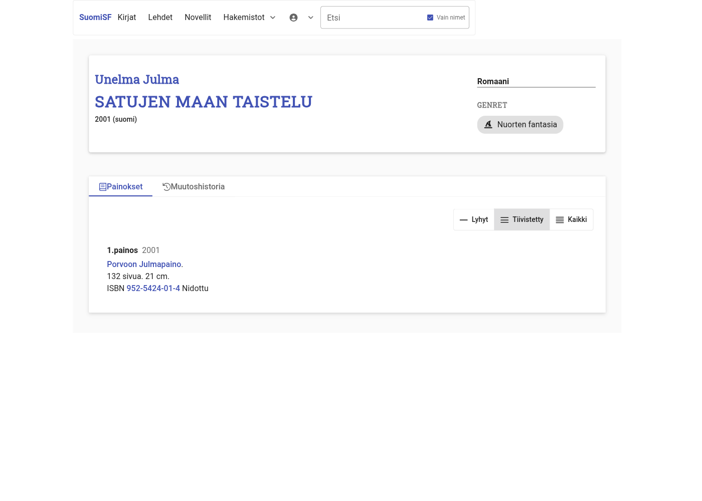 | 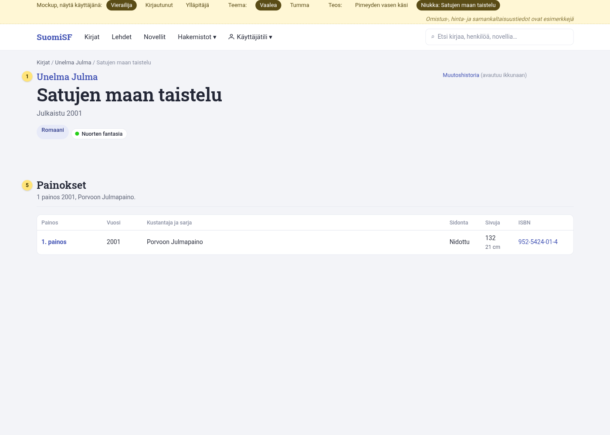 | 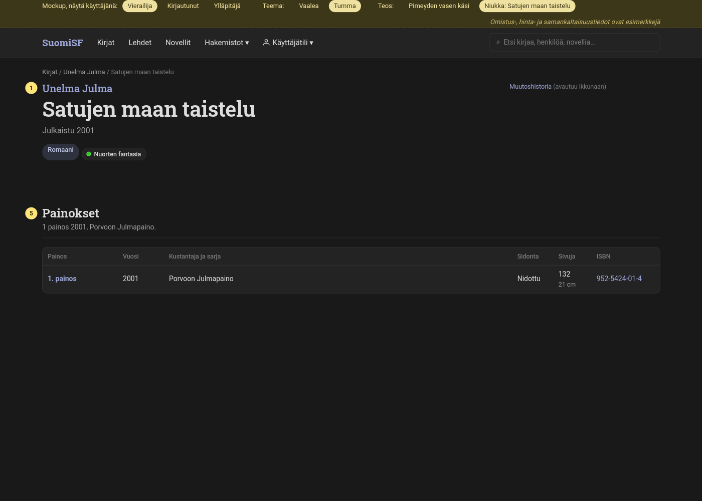 |
| _admin view_ | 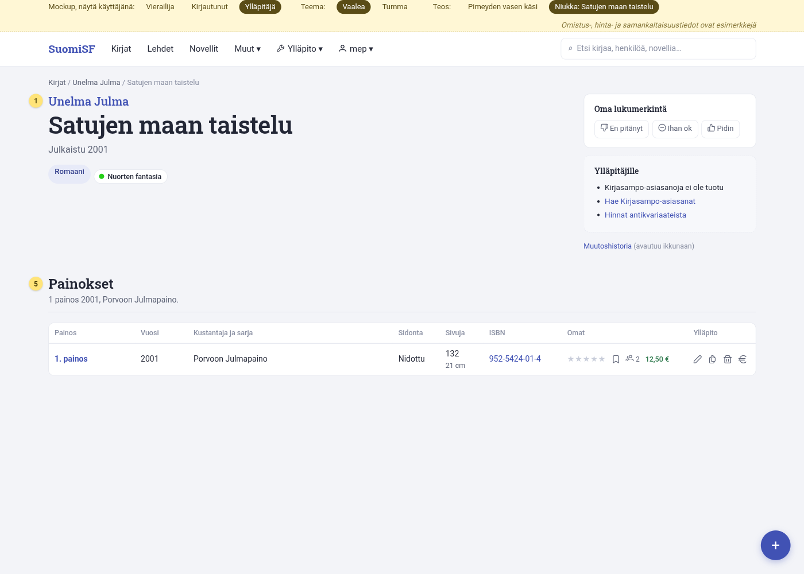 | 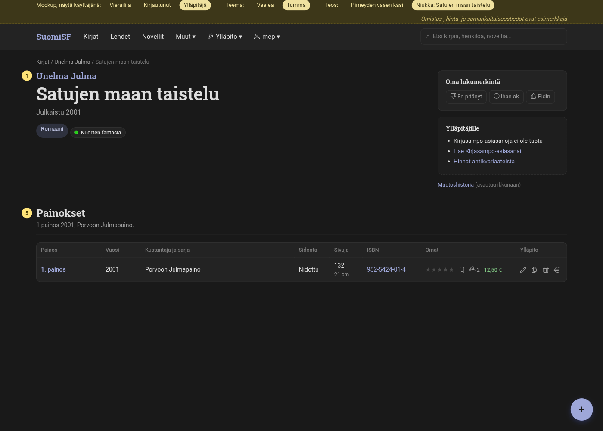 |
| 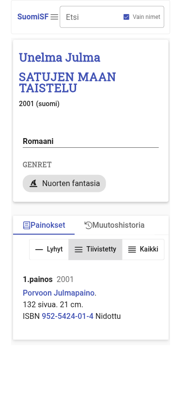 | 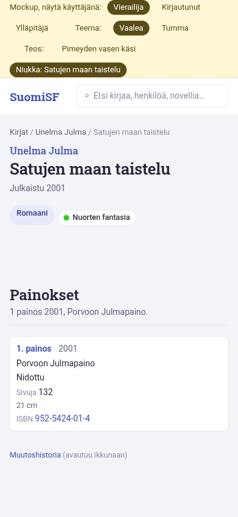 | 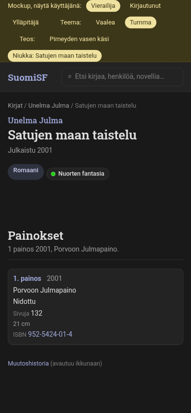 |

What the layout does with missing data (the "Missing data" rule in [principles.md](../principles.md)):
- **No cover:** the header is one column; no grey box. The edition table drops its thumbnail column (on a phone too).
- **Original title the same as the title** (a Finnish original): no repeated name; the line reads "Julkaistu 2001".
- **No description, tags or links:** no description block, no "Näytä koko kuvaus", no Asiasanat box, no Linkit box.
- **No similar works section:** with no tags and no description there is nothing to compare on.
- **One edition:** no grouping toggles and no "1. laitos" heading; the summary drops "Suomentanut" and the table drops the translator column
  when no edition has a translator.
- **No hints for admins either** (decided 2026-11-23): missing data is simply not shown. The admin box keeps its Kirjasampo import link.

## Shared principles used or added

Uses from [principles.md](../principles.md): mixed-case titles, clamped description, one chip style per meaning, genre colours, links list, phone layout rules.

Rules this plan added to principles.md (all agreed):
- Awards appear in the header of the thing that won them, up to three chips, the rest in a dialog.
- Tags are grouped by type with written labels instead of colour-coded.
- Tabular data (editions, printings) uses a real table on desktop and cards on a phone; wide tables use the full page width; between those,
  columns merge by width; merged rows expand into their parts.
- View state (grouping, view) is in the URL, with the reader's last choice on the device as the default.
- Admin-only tools live in one dashed "Ylläpitäjille" box, not mixed with public content.
- Change history is a link that opens a dialog, not a tab.
- No "Suomeksi" / "suomennos" labels: everything in the database is published in Finnish.

## Implementation steps

Frontend, plus one small backend endpoint. `/works/:id` already returns editions with covers, contributors, printing place,
publisher series, binding, pages, size, ISBN, dust jacket and verified flags, each edition's owners and wishlist users, awards, tags with types,
and the series with its works. Prices already come in one request per work (`user/:id/work/:workId/edition-prices`).
Making `works/:id/similar` public is planned separately.

0. **Backend:** `GET user/:id/work/:workId/ownership` returns the user's condition for every printing of the work they own
   (same auth and shape conventions as `user/:id/work/:workId/edition-prices`), with a backend test; saving still goes through `save-ownership`.

1. **Header**: `work-details.tsx`. Cover and cover strip (new `cover-history.tsx`), mixed-case title, type and genre chips,
   award chips with overflow dialog (new `award-chips.tsx`, reusable on the person and short story pages), series navigator (replaces `WorkBookseriesBrowser`'s arrows).
2. **Tags and sidebar**: tags grouped by type (new `TagsByType` in `src/features/tag/components/`, reusing the type names from
   `tag-type-to-severity.ts`), links list, read control, admin box, change-history dialog (wraps today's `EntityChanges`).
3. **Row controls** (before the table, which needs them): move the ownership, wishlist, owners, price and admin buttons out of
   `edition-details.tsx` into components the table row, the expanded sub-rows and the card view all use, so nothing is lost in any view.
   Add an ownership summary component for merged rows ("Omistat 3/17"), take wishlist state and owner counts from the work response,
   and read conditions from the new per-work ownership request instead of one request per printing.
4. **Editions table**: new `edition-table.tsx` in `src/features/edition/components/`, a plain `<table>` with shared fixed column widths and the
   width bands above (CSS only). It reuses `groupSimilarEditions` for the three modes, plus new pure helpers with Vitest tests:
   `mergeGroupForRow(group)` (ranges and unique values) and `ownershipSummary(group, user)`. Expand state per merged row; grouping and view
   in the URL with the localStorage fallback. Fixtures: the two sample works' API responses in `src/test/fixtures/`.
5. **Remove the tabs**: stories become a "Sisältö" section, awards move to the header, change history becomes a dialog.
   Similar works move from the dialog into the full-width row once the endpoint is public. `similar-works.tsx` keeps its helpers
   (`shownReasons`, `reasonText`, `partsText`, `tagTypesText`, `scoreText`, already tested in `similar-works.test.tsx`);
   only the rendering changes from a dialog list to cover cards with a reasons popover.
6. **Mobile and accessibility pass** at 390, 820, 1,100 and 1,400 px; update the work-page Playwright specs and `a11y.spec.ts`.
7. **Wiki**: update the work page and edition sections in `SuomiSF‐ohje.md` and `Ylläpito.md`, retake screenshots.

## Tests

- Vitest: `mergeGroupForRow` (ranges, unique series, bindings and ISBNs; Tolkien fixture), `ownershipSummary`, distinct covers by image file
  (Tolkien: 20 printings, 7 covers), series order and its label (Hain-sarja falls back to original years), tag grouping order,
  award overflow at more than three, grouping and view state when localStorage throws (falls back to the default).
- Playwright: a merged row expands and its printings have Omat controls; the merged row shows "Omistat n/m"; `?ryhmittely=kaikki` survives reload
  and back; without it the last choice on the device is used; at 1,100 px the Kirja column and the "⋯" menu replace the four columns and icons;
  on a phone "Oma lukumerkintä" comes right after the header; the cover strip shows "+4" for Tolkien on desktop; the "⋯" menu of a collection's
  printing has "Novellit ja artikkelit"; `/editions/:id` shows that printing's cover in the header; the "Taulukko / Kortit" toggle is not shown
  below 760 px; a logged-in Tolkien page makes one ownership request, not one per printing.
- Playwright: cover strip swaps the cover; grouping toggle changes rows; the "?" on a similar work opens its reasons (numbers only for admins); series links go to the right works; table rows link to editions;
  logged-in user sees the Omat column; admin sees the Ylläpito column, "Tarkastettu" and the admin box; visitor sees neither;
  change history opens in a dialog.
- Playwright: `/editions/:id` opens the work page with that row highlighted and in view, also when it is inside a merged row.
- a11y: table has headers, icon buttons have labels, cover strip buttons have labels.

## Open questions

_None._

## Decisions

2026-11-22, project owner:
- Table is the default view; cards stay as an option.
- Keep today's grouping modes (per printing, similar printings, per laitos); similar printings can produce several rows per laitos.
- Awards in the header are fine; works with more than a few awards need an overflow (now "+N muuta palkintoa" opening a dialog).
- Change history opens in a dialog.
- Similar works will be public to everyone, and keep the control that shows why a work is considered similar.
- Editions must keep every field and control the cards have today: translator, ownership, wishlist, owners, prices, and admin edit, copy, delete.
- No "Suomeksi" labels anywhere.
- Default grouping stays "Samanlaiset yhdessä".
- No list of missing printing numbers.
- Similar works go in a full-width cover row under the editions.

2026-11-23, project owner (review of the work plan):
- Merged rows expand into their printings; the merged row shows an ownership summary ("Omistat 3/17").
- Column bands as proposed: Kirja column and "⋯" admin menu below 1,200 px, year under the printing below 900 px, cards below 760 px.
- A plain HTML table, not `DataTable`.
- The similar works row in the default view is fine (no collapsing).
- Grouping and view are in the page address; the next work opens with the last choice made on this device (option a).

2026-11-23, project owner (second check of the work plan):
- Ownership conditions come in one request per work: a new endpoint `user/:id/work/:workId/ownership`, like the edition-prices one.
- The "Taulukko / Kortit" toggle is hidden below 760 px, where the table is already cards.
- Opened through `/editions/:id`, the header shows that printing's cover.
